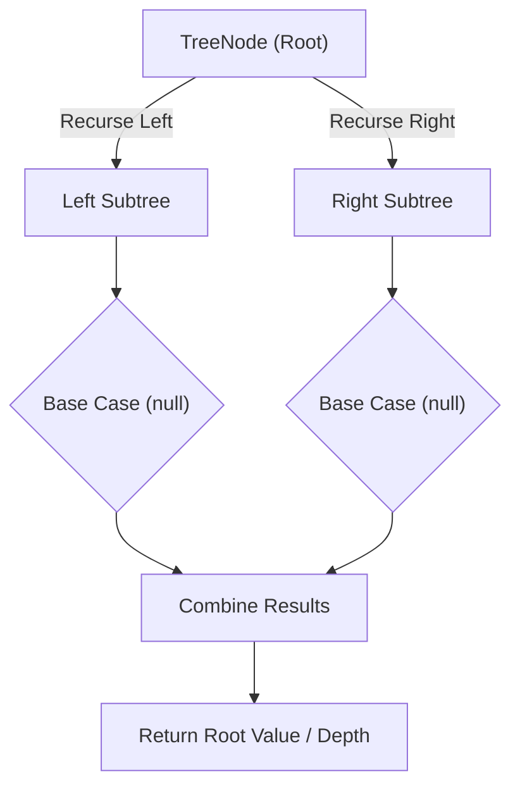

# Kth Smallest Element in a BST

<div style="display:flex; gap:0.5rem; margin-bottom:1.5rem; align-items:center;">
  <span style="background:#f59e0b22; color:#f59e0b; padding:2px 10px; borderRadius:12px; fontWeight:600; fontSize:0.85rem;">Medium</span>
  <span style="color:#64748b; fontSize:0.85rem;">Day 14 • Striver Blind 75</span>
</div>

## 📌 Problem Overview

Given the `root` of a binary search tree, and an integer `k`, return the `k`th smallest value (1-indexed) among all node values in the tree.

### Examples & Constraints
**Example 1:**
- **Input:** `root = [3,1,4,null,2], k = 1`
- **Output:** `1`


**Example 2:**
- **Input:** `root = [5,3,6,2,4,null,null,1], k = 3`
- **Output:** `3`


**Constraints:**
- `The number of nodes is in the range [1, 10⁴]`
- `1 ≤ k ≤ number of nodes`

---

## 💡 Approach & Intuition

Kth Smallest Element in a BST tests exploiting the fact that an in-order traversal of a BST visits nodes in ascending order.

### 🎯 Pattern Recognition
**Pattern: In-Order Traversal with Early Stop**

Walk the tree in-order (which is ascending order for a BST), and stop as soon as you've visited the kth node — no need to visit the rest of the tree.

---

## 📊 Step-by-Step Execution (Mermaid Diagram)



---

## 🐢 Brute Force Solution

### Code
```javascript
// Collect the full in-order traversal, then index into it
function kthSmallest(values, k) {
  const root = buildTree(values);
  const inorder = [];
  (function dfs(node) { if (!node) return; dfs(node.left); inorder.push(node.val); dfs(node.right); })(root);
  return inorder[k - 1];
}
```

- **Time Complexity:** `O(n)`
- **Space Complexity:** `O(n)`
- **Explanation:** Collect the entire in-order traversal, even if k is small.

---

## ⚡ Optimized Solution

### Code
```javascript
class TreeNode {
  constructor(val, left = null, right = null) { this.val = val; this.left = left; this.right = right; }
}
function buildTree(values) {
  if (!values.length || values[0] === null) return null;
  const root = new TreeNode(values[0]);
  const queue = [root];
  let i = 1;
  while (queue.length && i < values.length) {
    const node = queue.shift();
    if (i < values.length) { const lv = values[i++]; if (lv !== null) { node.left = new TreeNode(lv); queue.push(node.left); } }
    if (i < values.length) { const rv = values[i++]; if (rv !== null) { node.right = new TreeNode(rv); queue.push(node.right); } }
  }
  return root;
}
function kthSmallest(values, k) {
  const root = buildTree(values);
  const stack = [];
  let curr = root;
  while (true) {
    while (curr) { stack.push(curr); curr = curr.left; }
    curr = stack.pop();
    k--;
    if (k === 0) return curr.val;
    curr = curr.right;
  }
}
```

- **Time Complexity:** `O(h + k)`
- **Space Complexity:** `O(h)`
- **Explanation:** Iterative in-order traversal that stops as soon as the kth node is popped.

---

## 🐾 Step-by-Step Walkthrough

1. **Initialize State:** Setup necessary pointers, dynamic programming arrays, or hash maps.
2. **Iterate & Evaluate:** Process the input according to the boundary conditions.
3. **Update & Return:** Compute the optimal answer and return early or at termination.

### 🎙️ FAANG Interview Pitch
1. Collecting the full traversal works but wastes time when k is small
2. Use an explicit stack for iterative in-order traversal
3. Stop and return as soon as the kth pop is reached
4. Avoids visiting the rest of the tree unnecessarily

---

## 💡 Progressive Hints

1. In-order traversal of a BST visits values in ascending order.
2. Use an explicit stack to traverse iteratively.
3. Stop as soon as you've popped the kth node.

---

## ⚡ Interactive Practice
👉 **[Solve this problem interactively in the DSA Lab](/DSA-Notes-Problems/dsa/problems/kth-smallest-element-bst)**
