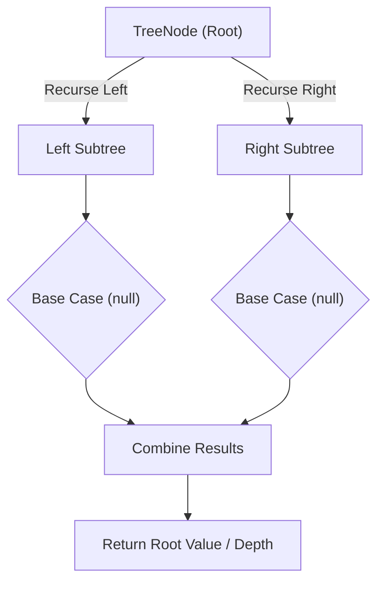

# Lowest Common Ancestor of a Binary Search Tree

<div style="display:flex; gap:0.5rem; margin-bottom:1.5rem; align-items:center;">
  <span style="background:#f59e0b22; color:#f59e0b; padding:2px 10px; borderRadius:12px; fontWeight:600; fontSize:0.85rem;">Medium</span>
  <span style="color:#64748b; fontSize:0.85rem;">Day 14 • Striver Blind 75</span>
</div>

## 📌 Problem Overview

Given a binary search tree (BST), find the lowest common ancestor (LCA) node of two given values `p` and `q` in the BST.

### Examples & Constraints
**Example 1:**
- **Input:** `root = [6,2,8,0,4,7,9,null,null,3,5], p = 2, q = 8`
- **Output:** `6`


**Example 2:**
- **Input:** `root = [6,2,8,0,4,7,9,null,null,3,5], p = 2, q = 4`
- **Output:** `2`


**Constraints:**
- `The number of nodes is in the range [2, 10⁵]`
- `All Node.val are unique`
- `p and q exist in the BST`

---

## 💡 Approach & Intuition

Lowest Common Ancestor of a BST tests exploiting BST ordering to navigate directly to the split point instead of a general tree search.

### 🎯 Pattern Recognition
**Pattern: BST Navigation**

Compare both target values to the current node. If both are smaller, go left; if both are larger, go right; otherwise the current node is the split point.

---

## 📊 Step-by-Step Execution (Mermaid Diagram)



---

## 🐢 Brute Force Solution

### Code
```javascript
// Finding root-to-node paths for both values and comparing them also works
function findPath(node, target, path) {
  if (!node) return false;
  path.push(node.val);
  if (node.val === target) return true;
  if (target < node.val) return findPath(node.left, target, path);
  return findPath(node.right, target, path);
}
function lowestCommonAncestor(values, p, q) {
  const root = buildTree(values);
  const pathP = [], pathQ = [];
  findPath(root, p, pathP);
  findPath(root, q, pathQ);
  let lca = pathP[0];
  for (let i = 0; i < Math.min(pathP.length, pathQ.length); i++) {
    if (pathP[i] === pathQ[i]) lca = pathP[i]; else break;
  }
  return lca;
}
```

- **Time Complexity:** `O(h)`
- **Space Complexity:** `O(h)`
- **Explanation:** Build both root-to-target paths, then find where they diverge.

---

## ⚡ Optimized Solution

### Code
```javascript
class TreeNode {
  constructor(val, left = null, right = null) { this.val = val; this.left = left; this.right = right; }
}
function buildTree(values) {
  if (!values.length || values[0] === null) return null;
  const root = new TreeNode(values[0]);
  const queue = [root];
  let i = 1;
  while (queue.length && i < values.length) {
    const node = queue.shift();
    if (i < values.length) { const lv = values[i++]; if (lv !== null) { node.left = new TreeNode(lv); queue.push(node.left); } }
    if (i < values.length) { const rv = values[i++]; if (rv !== null) { node.right = new TreeNode(rv); queue.push(node.right); } }
  }
  return root;
}
function lowestCommonAncestor(values, p, q) {
  let root = buildTree(values);
  while (root) {
    if (p < root.val && q < root.val) root = root.left;
    else if (p > root.val && q > root.val) root = root.right;
    else return root.val;
  }
  return null;
}
```

- **Time Complexity:** `O(h)`
- **Space Complexity:** `O(1)`
- **Explanation:** Iterative BST navigation directly toward the split point.

---

## 🐾 Step-by-Step Walkthrough

1. **Initialize State:** Setup necessary pointers, dynamic programming arrays, or hash maps.
2. **Iterate & Evaluate:** Process the input according to the boundary conditions.
3. **Update & Return:** Compute the optimal answer and return early or at termination.

### 🎙️ FAANG Interview Pitch
1. Path-based approach works but uses extra space for two paths
2. Exploit BST ordering: navigate directly using value comparisons
3. Both smaller -> go left; both larger -> go right; otherwise stop
4. Iterative version needs O(1) extra space

---

## 💡 Progressive Hints

1. Compare both p and q to the current node's value.
2. If both are smaller, move left; if both are larger, move right.
3. As soon as they split (or one equals the node), that node is the LCA.

---

## ⚡ Interactive Practice
👉 **[Solve this problem interactively in the DSA Lab](/DSA-Notes-Problems/dsa/problems/lowest-common-ancestor-bst)**
