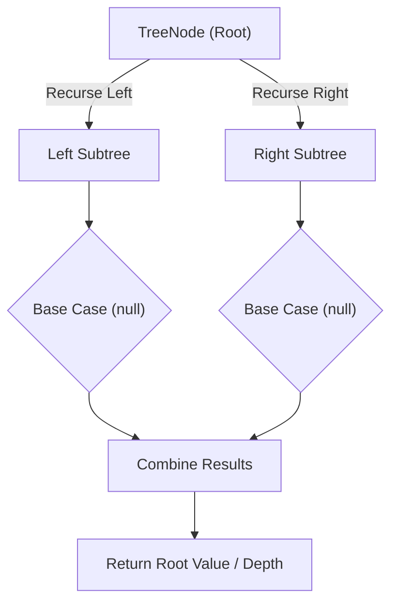

# Maximum Depth of Binary Tree

<div style="display:flex; gap:0.5rem; margin-bottom:1.5rem; align-items:center;">
  <span style="background:#22c55e22; color:#22c55e; padding:2px 10px; borderRadius:12px; fontWeight:600; fontSize:0.85rem;">Easy</span>
  <span style="color:#64748b; fontSize:0.85rem;">Day 13 • Striver Blind 75</span>
</div>

## 📌 Problem Overview

Given the root of a binary tree, return its maximum depth (the number of nodes on the longest root-to-leaf path).

### Examples & Constraints
**Example 1:**
- **Input:** `root = [3,9,20,null,null,15,7]`
- **Output:** `3`


**Example 2:**
- **Input:** `root = [1,null,2]`
- **Output:** `2`


**Constraints:**
- `0 ≤ tree nodes ≤ 10⁴`

---

## 💡 Approach & Intuition

The foundational tree problem introducing tree traversal and recursive thinking.

### 🎯 Pattern Recognition
**Pattern: Tree Recursion**

Solve for the left subtree, solve for the right subtree, then combine the results.

---

## 📊 Step-by-Step Execution (Mermaid Diagram)



---

## 🐢 Brute Force Solution

### Code
```javascript
// Recursive DFS is standard
```

- **Time Complexity:** `O(n)`
- **Space Complexity:** `O(h)`
- **Explanation:** DFS recursion.

---

## ⚡ Optimized Solution

### Code
```javascript
function maxDepth(root) {
  if (!root) return 0;
  return 1 + Math.max(maxDepth(root.left), maxDepth(root.right));
}
```

- **Time Complexity:** `O(n)`
- **Space Complexity:** `O(h)`
- **Explanation:** Recursive DFS.

---

## 🐾 Step-by-Step Walkthrough

1. **Initialize State:** Setup necessary pointers, dynamic programming arrays, or hash maps.
2. **Iterate & Evaluate:** Process the input according to the boundary conditions.
3. **Update & Return:** Compute the optimal answer and return early or at termination.

### 🎙️ FAANG Interview Pitch
1. Base case: empty tree depth 0
2. Node depth = 1 + max(left, right)
3. Classic divide-and-conquer on trees

---

## 💡 Progressive Hints

1. Depth of empty tree is 0.
2. Depth of a node = 1 + max(depth of left, depth of right).
3. Use recursion.

---

## ⚡ Interactive Practice
👉 **[Solve this problem interactively in the DSA Lab](/DSA-Notes-Problems/dsa/problems/maximum-depth-of-binary-tree)**
