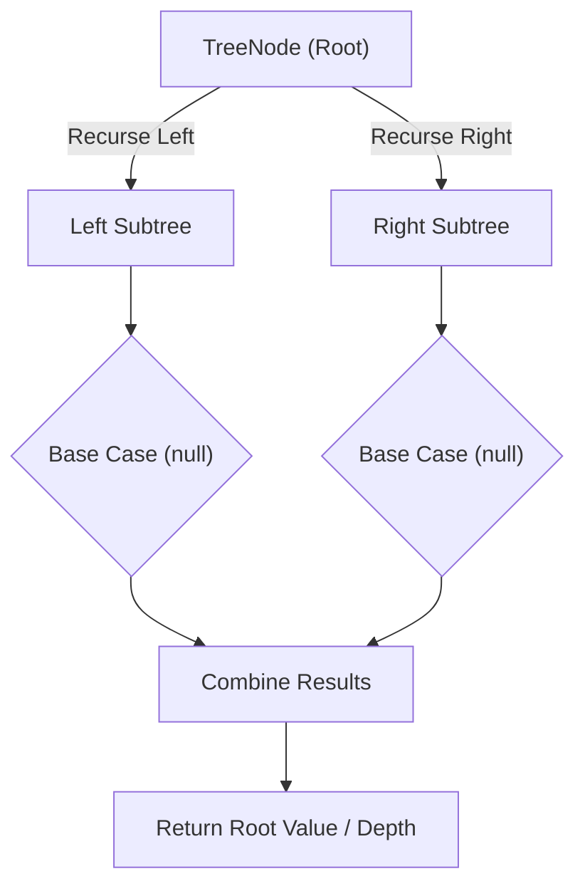

# Same Tree

<div style="display:flex; gap:0.5rem; margin-bottom:1.5rem; align-items:center;">
  <span style="background:#22c55e22; color:#22c55e; padding:2px 10px; borderRadius:12px; fontWeight:600; fontSize:0.85rem;">Easy</span>
  <span style="color:#64748b; fontSize:0.85rem;">Day 13 • Striver Blind 75</span>
</div>

## 📌 Problem Overview

Given the roots of two binary trees `p` and `q`, check if they are the same or not. Two binary trees are the same if they are structurally identical and the nodes have the same values.

### Examples & Constraints
**Example 1:**
- **Input:** `p = [1,2,3], q = [1,2,3]`
- **Output:** `true`


**Example 2:**
- **Input:** `p = [1,2], q = [1,null,2]`
- **Output:** `false`


**Constraints:**
- `The number of nodes in both trees is in [0, 100]`
- `-10⁴ ≤ Node.val ≤ 10⁴`

---

## 💡 Approach & Intuition

Same Tree tests simple structural recursion: two trees match only if every corresponding pair of nodes matches, recursively.

### 🎯 Pattern Recognition
**Pattern: Paired Recursion**

Compare both trees node by node simultaneously: null/null matches, exactly one null fails, otherwise compare values and recurse into both left pairs and both right pairs.

---

## 📊 Step-by-Step Execution (Mermaid Diagram)



---

## 🐢 Brute Force Solution

### Code
```javascript
// Comparing serialized traversals also works but recursion is simpler and equally efficient
function isSameTree(values1, values2) {
  const p = buildTree(values1), q = buildTree(values2);
  function serialize(node) { return node ? `${node.val}(${serialize(node.left)},${serialize(node.right)})` : 'null'; }
  return serialize(p) === serialize(q);
}
```

- **Time Complexity:** `O(min(m, n))`
- **Space Complexity:** `O(min(m, n))`
- **Explanation:** Serialize both trees and compare the resulting strings.

---

## ⚡ Optimized Solution

### Code
```javascript
class TreeNode {
  constructor(val, left = null, right = null) { this.val = val; this.left = left; this.right = right; }
}
function buildTree(values) {
  if (!values.length || values[0] === null) return null;
  const root = new TreeNode(values[0]);
  const queue = [root];
  let i = 1;
  while (queue.length && i < values.length) {
    const node = queue.shift();
    if (i < values.length) { const lv = values[i++]; if (lv !== null) { node.left = new TreeNode(lv); queue.push(node.left); } }
    if (i < values.length) { const rv = values[i++]; if (rv !== null) { node.right = new TreeNode(rv); queue.push(node.right); } }
  }
  return root;
}
function isSameTree(values1, values2) {
  const p = buildTree(values1), q = buildTree(values2);
  function same(x, y) {
    if (!x && !y) return true;
    if (!x || !y) return false;
    return x.val === y.val && same(x.left, y.left) && same(x.right, y.right);
  }
  return same(p, q);
}
```

- **Time Complexity:** `O(min(m, n))`
- **Space Complexity:** `O(min(m, n))`
- **Explanation:** Direct paired recursion without building intermediate strings.

---

## 🐾 Step-by-Step Walkthrough

1. **Initialize State:** Setup necessary pointers, dynamic programming arrays, or hash maps.
2. **Iterate & Evaluate:** Process the input according to the boundary conditions.
3. **Update & Return:** Compute the optimal answer and return early or at termination.

### 🎙️ FAANG Interview Pitch
1. Direct recursive comparison of both trees simultaneously
2. Base cases: both null (match), one null (mismatch)
3. Compare current values, then recurse into left/right pairs
4. Short-circuits as soon as any mismatch is found

---

## 💡 Progressive Hints

1. If both nodes are null, they match.
2. If exactly one is null, or values differ, they don't match.
3. Recurse into both left children and both right children.

---

## ⚡ Interactive Practice
👉 **[Solve this problem interactively in the DSA Lab](/DSA-Notes-Problems/dsa/problems/same-tree)**
