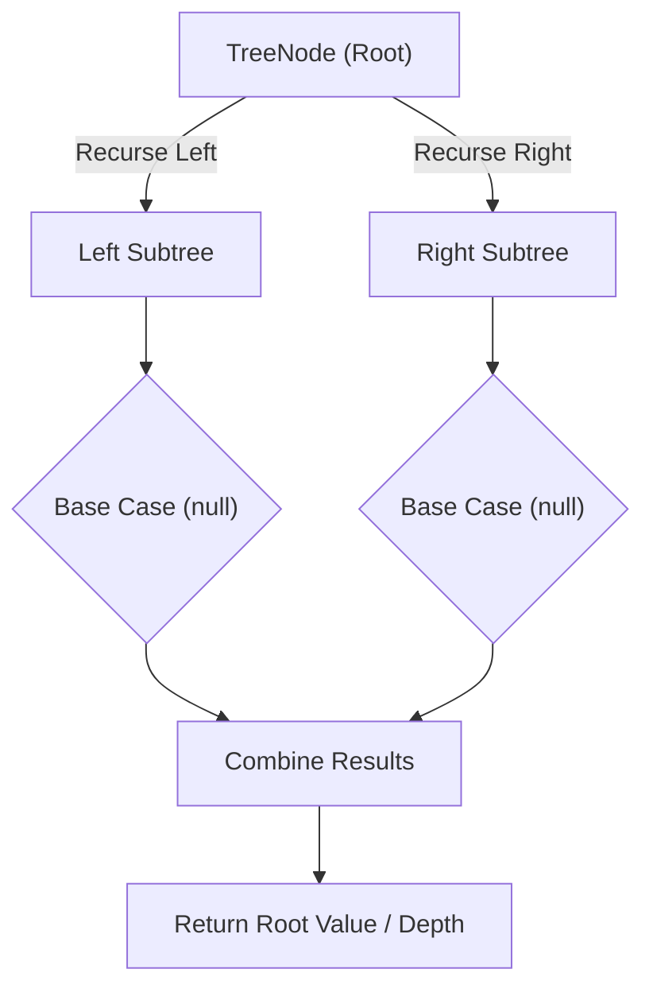

# Serialize and Deserialize Binary Tree

<div style="display:flex; gap:0.5rem; margin-bottom:1.5rem; align-items:center;">
  <span style="background:#ef444422; color:#ef4444; padding:2px 10px; borderRadius:12px; fontWeight:600; fontSize:0.85rem;">Hard</span>
  <span style="color:#64748b; fontSize:0.85rem;">Day 13 • Striver Blind 75</span>
</div>

## 📌 Problem Overview

Design an algorithm to serialize a binary tree into a string, and deserialize that string back into the original tree structure.

### Examples & Constraints
**Example 1:**
- **Input:** `root = [1,2,3,null,null,4,5]`
- **Output:** `[1,2,3,null,null,4,5]`
- **Explanation:** Serializing then deserializing reproduces the original tree.

**Example 2:**
- **Input:** `root = []`
- **Output:** `[]`


**Constraints:**
- `The number of nodes is in the range [0, 10⁴]`
- `-1000 ≤ Node.val ≤ 1000`

---

## 💡 Approach & Intuition

Serialize and Deserialize Binary Tree tests designing a lossless string encoding that fully captures tree shape, not just values — preorder with explicit null markers is the standard technique.

### 🎯 Pattern Recognition
**Pattern: Preorder Encoding with Null Markers**

Write each node's value in preorder, using an explicit marker for missing children, so deserialization can reconstruct the exact shape by consuming tokens in the same order they were written.

---

## 📊 Step-by-Step Execution (Mermaid Diagram)



---

## 🐢 Brute Force Solution

### Code
```javascript
class TreeNode {
  constructor(val, left = null, right = null) { this.val = val; this.left = left; this.right = right; }
}
function buildTree(values) {
  if (!values.length || values[0] === null) return null;
  const root = new TreeNode(values[0]);
  const queue = [root];
  let i = 1;
  while (queue.length && i < values.length) {
    const node = queue.shift();
    if (i < values.length) { const lv = values[i++]; if (lv !== null) { node.left = new TreeNode(lv); queue.push(node.left); } }
    if (i < values.length) { const rv = values[i++]; if (rv !== null) { node.right = new TreeNode(rv); queue.push(node.right); } }
  }
  return root;
}
function treeToArray(root) {
  if (!root) return [];
  const result = [];
  const queue = [root];
  while (queue.length) {
    const node = queue.shift();
    if (node === null) { result.push(null); continue; }
    result.push(node.val);
    queue.push(node.left);
    queue.push(node.right);
  }
  while (result.length && result[result.length - 1] === null) result.pop();
  return result;
}
// Level-order (BFS) serialization with null markers is a valid alternative to preorder
function serialize(root) {
  if (!root) return '';
  const tokens = [];
  const queue = [root];
  while (queue.length) {
    const node = queue.shift();
    if (!node) { tokens.push('null'); continue; }
    tokens.push(String(node.val));
    queue.push(node.left);
    queue.push(node.right);
  }
  return tokens.join(',');
}
function deserialize(data) {
  if (!data) return null;
  const tokens = data.split(',');
  const root = new TreeNode(Number(tokens[0]));
  const queue = [root];
  let i = 1;
  while (queue.length && i < tokens.length) {
    const node = queue.shift();
    const leftVal = tokens[i++];
    if (leftVal !== 'null') { node.left = new TreeNode(Number(leftVal)); queue.push(node.left); }
    const rightVal = tokens[i++];
    if (rightVal !== 'null') { node.right = new TreeNode(Number(rightVal)); queue.push(node.right); }
  }
  return root;
}
function serializeDeserialize(values) {
  const root = buildTree(values);
  const data = serialize(root);
  const restored = deserialize(data);
  return treeToArray(restored);
}
```

- **Time Complexity:** `O(n)`
- **Space Complexity:** `O(n)`
- **Explanation:** BFS-based level-order serialization, mirroring the level-order array format.

---

## ⚡ Optimized Solution

### Code
```javascript
class TreeNode {
  constructor(val, left = null, right = null) { this.val = val; this.left = left; this.right = right; }
}
function buildTree(values) {
  if (!values.length || values[0] === null) return null;
  const root = new TreeNode(values[0]);
  const queue = [root];
  let i = 1;
  while (queue.length && i < values.length) {
    const node = queue.shift();
    if (i < values.length) { const lv = values[i++]; if (lv !== null) { node.left = new TreeNode(lv); queue.push(node.left); } }
    if (i < values.length) { const rv = values[i++]; if (rv !== null) { node.right = new TreeNode(rv); queue.push(node.right); } }
  }
  return root;
}
function treeToArray(root) {
  if (!root) return [];
  const result = [];
  const queue = [root];
  while (queue.length) {
    const node = queue.shift();
    if (node === null) { result.push(null); continue; }
    result.push(node.val);
    queue.push(node.left);
    queue.push(node.right);
  }
  while (result.length && result[result.length - 1] === null) result.pop();
  return result;
}
function serialize(node) {
  if (!node) return 'null';
  return node.val + ',' + serialize(node.left) + ',' + serialize(node.right);
}
function deserialize(data) {
  const vals = data.split(',');
  let idx = 0;
  function helper() {
    const val = vals[idx++];
    if (val === 'null') return null;
    const node = new TreeNode(Number(val));
    node.left = helper();
    node.right = helper();
    return node;
  }
  return helper();
}
function serializeDeserialize(values) {
  const root = buildTree(values);
  const data = serialize(root);
  const restored = deserialize(data);
  return treeToArray(restored);
}
```

- **Time Complexity:** `O(n)`
- **Space Complexity:** `O(n)`
- **Explanation:** Preorder serialization with null markers; deserialization consumes tokens in the same order.

---

## 🐾 Step-by-Step Walkthrough

1. **Initialize State:** Setup necessary pointers, dynamic programming arrays, or hash maps.
2. **Iterate & Evaluate:** Process the input according to the boundary conditions.
3. **Update & Return:** Compute the optimal answer and return early or at termination.

### 🎙️ FAANG Interview Pitch
1. Both preorder and level-order (BFS) encodings work as long as null markers preserve shape
2. Preorder recursion is simpler to write for both serialize and deserialize
3. Deserialize must consume tokens in exactly the order they were produced
4. Verify correctness by checking the round trip reproduces the original structure

---

## 💡 Progressive Hints

1. Serialize with a preorder traversal, writing a marker like 'null' for missing children.
2. Deserialize by consuming tokens in the same preorder sequence they were written in.
3. A shared index (or a queue of tokens) makes recursive deserialization straightforward.

---

## ⚡ Interactive Practice
👉 **[Solve this problem interactively in the DSA Lab](/DSA-Notes-Problems/dsa/problems/serialize-deserialize-binary-tree)**
