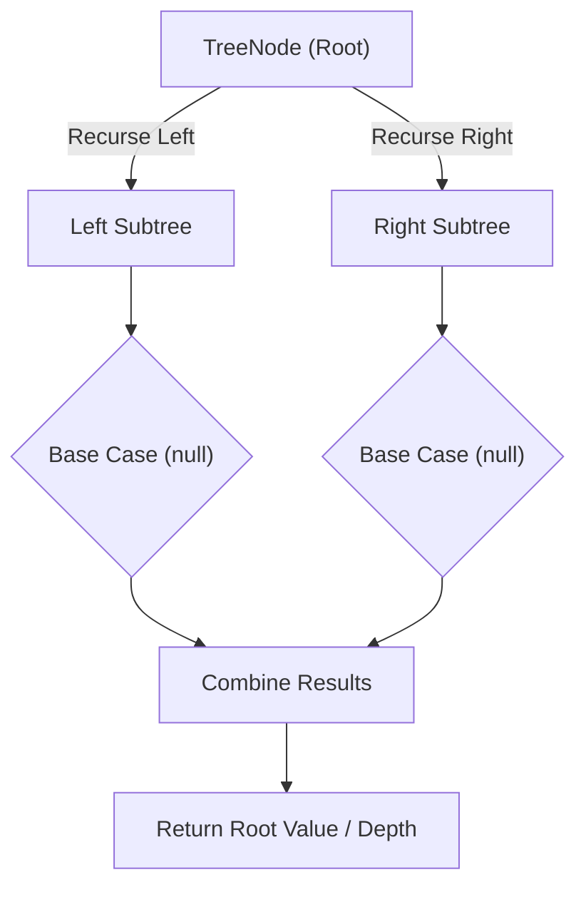

# Subtree of Another Tree

<div style="display:flex; gap:0.5rem; margin-bottom:1.5rem; align-items:center;">
  <span style="background:#22c55e22; color:#22c55e; padding:2px 10px; borderRadius:12px; fontWeight:600; fontSize:0.85rem;">Easy</span>
  <span style="color:#64748b; fontSize:0.85rem;">Day 14 • Striver Blind 75</span>
</div>

## 📌 Problem Overview

Given the roots of two binary trees `root` and `subRoot`, return `true` if there is a subtree of `root` with the same structure and node values as `subRoot`.

### Examples & Constraints
**Example 1:**
- **Input:** `root = [3,4,5,1,2], subRoot = [4,1,2]`
- **Output:** `true`


**Example 2:**
- **Input:** `root = [3,4,5,1,2,null,null,null,null,0], subRoot = [4,1,2]`
- **Output:** `false`


**Constraints:**
- `The number of nodes in root is in [1, 2000]`
- `The number of nodes in subRoot is in [1, 1000]`

---

## 💡 Approach & Intuition

Subtree of Another Tree builds on Same Tree: check every node in `root` as a potential match point for `subRoot`.

### 🎯 Pattern Recognition
**Pattern: Same-Tree Check at Every Node**

DFS through `root`; at each node, test whether the subtree rooted there is structurally identical to `subRoot` using the Same Tree comparison.

---

## 📊 Step-by-Step Execution (Mermaid Diagram)



---

## 🐢 Brute Force Solution

### Code
```javascript
// Serializing both trees with unique markers and using substring search is a common alternative
function serialize(node) { return node ? `#${node.val}(${serialize(node.left)})(${serialize(node.right)})` : '#null'; }
function isSubtree(rootValues, subRootValues) {
  const root = buildTree(rootValues), subRoot = buildTree(subRootValues);
  return serialize(root).includes(serialize(subRoot));
}
```

- **Time Complexity:** `O(m + n)`
- **Space Complexity:** `O(m + n)`
- **Explanation:** Serialize both trees and check if one string contains the other.

---

## ⚡ Optimized Solution

### Code
```javascript
class TreeNode {
  constructor(val, left = null, right = null) { this.val = val; this.left = left; this.right = right; }
}
function buildTree(values) {
  if (!values.length || values[0] === null) return null;
  const root = new TreeNode(values[0]);
  const queue = [root];
  let i = 1;
  while (queue.length && i < values.length) {
    const node = queue.shift();
    if (i < values.length) { const lv = values[i++]; if (lv !== null) { node.left = new TreeNode(lv); queue.push(node.left); } }
    if (i < values.length) { const rv = values[i++]; if (rv !== null) { node.right = new TreeNode(rv); queue.push(node.right); } }
  }
  return root;
}
function isSubtree(rootValues, subRootValues) {
  const root = buildTree(rootValues), subRoot = buildTree(subRootValues);
  function same(a, b) {
    if (!a && !b) return true;
    if (!a || !b) return false;
    return a.val === b.val && same(a.left, b.left) && same(a.right, b.right);
  }
  function dfs(node) {
    if (!node) return false;
    if (same(node, subRoot)) return true;
    return dfs(node.left) || dfs(node.right);
  }
  return dfs(root);
}
```

- **Time Complexity:** `O(m * n)`
- **Space Complexity:** `O(m + n)`
- **Explanation:** DFS through root, checking the same-tree condition at every node.

---

## 🐾 Step-by-Step Walkthrough

1. **Initialize State:** Setup necessary pointers, dynamic programming arrays, or hash maps.
2. **Iterate & Evaluate:** Process the input according to the boundary conditions.
3. **Update & Return:** Compute the optimal answer and return early or at termination.

### 🎙️ FAANG Interview Pitch
1. Serialization + substring search is a clever alternative, but has string-matching edge cases
2. Direct approach: reuse Same Tree logic at every node of root
3. DFS visits every node once, calling same() at each — O(m*n) worst case
4. Short-circuits as soon as a match is found

---

## 💡 Progressive Hints

1. Write a helper to check if two trees are identical (Same Tree logic).
2. DFS through root, testing the same-tree check at every node.
3. Return true as soon as any node's subtree matches subRoot.

---

## ⚡ Interactive Practice
👉 **[Solve this problem interactively in the DSA Lab](/DSA-Notes-Problems/dsa/problems/subtree-of-another-tree)**
