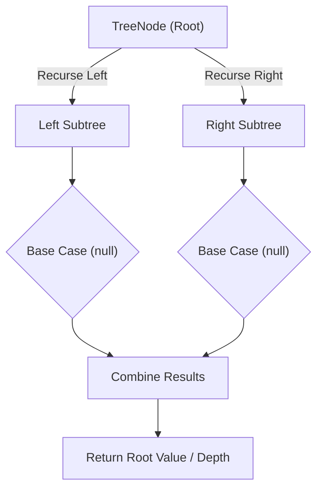

# Validate Binary Search Tree

<div style="display:flex; gap:0.5rem; margin-bottom:1.5rem; align-items:center;">
  <span style="background:#f59e0b22; color:#f59e0b; padding:2px 10px; borderRadius:12px; fontWeight:600; fontSize:0.85rem;">Medium</span>
  <span style="color:#64748b; fontSize:0.85rem;">Day 14 • Striver Blind 75</span>
</div>

## 📌 Problem Overview

Given the `root` of a binary tree, determine if it is a valid binary search tree (BST): every node's left subtree contains only values strictly less than the node's value, and every right subtree contains only values strictly greater, recursively.

### Examples & Constraints
**Example 1:**
- **Input:** `root = [2,1,3]`
- **Output:** `true`


**Example 2:**
- **Input:** `root = [5,1,4,null,null,3,6]`
- **Output:** `false`


**Constraints:**
- `The number of nodes is in the range [1, 10⁴]`

---

## 💡 Approach & Intuition

Validate Binary Search Tree tests carrying a valid value range down the recursion, since a purely local parent comparison is insufficient.

### 🎯 Pattern Recognition
**Pattern: Bounded Recursion**

Pass a `(lo, hi)` range to each recursive call. A node must fall strictly within that range; recursing left tightens the upper bound, recursing right tightens the lower bound.

---

## 📊 Step-by-Step Execution (Mermaid Diagram)



---

## 🐢 Brute Force Solution

### Code
```javascript
// In-order traversal should be strictly increasing for a valid BST
function isValidBST(values) {
  const root = buildTree(values);
  const inorder = [];
  (function dfs(node) { if (!node) return; dfs(node.left); inorder.push(node.val); dfs(node.right); })(root);
  for (let i = 1; i < inorder.length; i++) { if (inorder[i] <= inorder[i - 1]) return false; }
  return true;
}
```

- **Time Complexity:** `O(n)`
- **Space Complexity:** `O(n)`
- **Explanation:** Collect an in-order traversal and check it's strictly increasing.

---

## ⚡ Optimized Solution

### Code
```javascript
class TreeNode {
  constructor(val, left = null, right = null) { this.val = val; this.left = left; this.right = right; }
}
function buildTree(values) {
  if (!values.length || values[0] === null) return null;
  const root = new TreeNode(values[0]);
  const queue = [root];
  let i = 1;
  while (queue.length && i < values.length) {
    const node = queue.shift();
    if (i < values.length) { const lv = values[i++]; if (lv !== null) { node.left = new TreeNode(lv); queue.push(node.left); } }
    if (i < values.length) { const rv = values[i++]; if (rv !== null) { node.right = new TreeNode(rv); queue.push(node.right); } }
  }
  return root;
}
function isValidBST(values) {
  const root = buildTree(values);
  function valid(node, lo, hi) {
    if (!node) return true;
    if (node.val <= lo || node.val >= hi) return false;
    return valid(node.left, lo, node.val) && valid(node.right, node.val, hi);
  }
  return valid(root, -Infinity, Infinity);
}
```

- **Time Complexity:** `O(n)`
- **Space Complexity:** `O(h)`
- **Explanation:** Recursive bounds-checking, avoiding a separate array pass.

---

## 🐾 Step-by-Step Walkthrough

1. **Initialize State:** Setup necessary pointers, dynamic programming arrays, or hash maps.
2. **Iterate & Evaluate:** Process the input according to the boundary conditions.
3. **Update & Return:** Compute the optimal answer and return early or at termination.

### 🎙️ FAANG Interview Pitch
1. In-order traversal + strictly-increasing check is a valid O(n) approach
2. Bounds-passing recursion achieves the same without an extra array
3. Each node must satisfy lo < val < hi, with bounds tightening as you descend
4. This correctly rejects violations against non-immediate ancestors

---

## 💡 Progressive Hints

1. A local check against just the parent isn't enough — a deep node can violate a grandparent.
2. Pass down a valid (lo, hi) range for each node.
3. Tighten the range when recursing left (new hi = node.val) or right (new lo = node.val).

---

## ⚡ Interactive Practice
👉 **[Solve this problem interactively in the DSA Lab](/DSA-Notes-Problems/dsa/problems/validate-binary-search-tree)**
