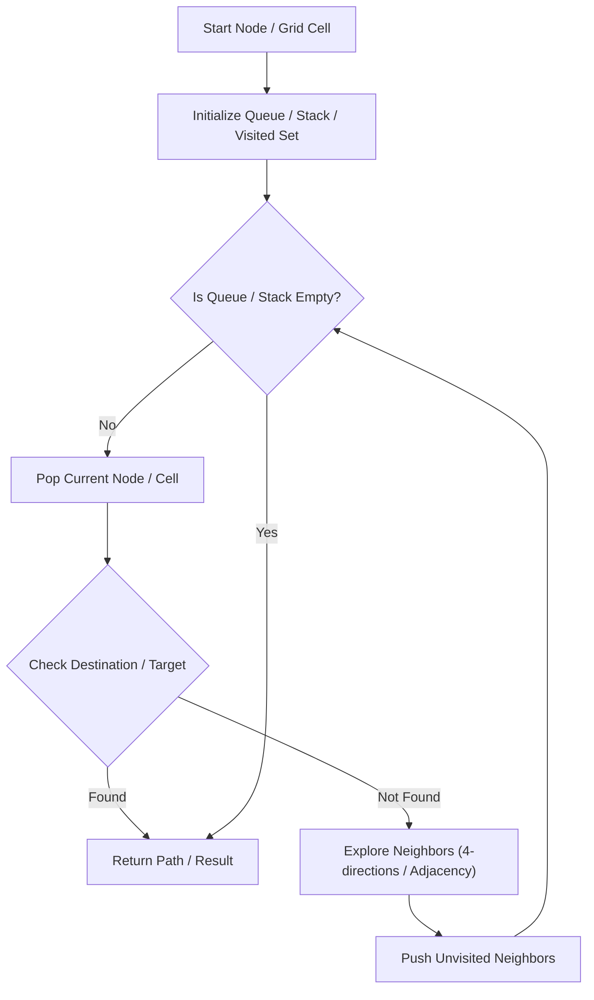

# Design Add and Search Words Data Structure

<div style="display:flex; gap:0.5rem; margin-bottom:1.5rem; align-items:center;">
  <span style="background:#f59e0b22; color:#f59e0b; padding:2px 10px; borderRadius:12px; fontWeight:600; fontSize:0.85rem;">Medium</span>
  <span style="color:#64748b; fontSize:0.85rem;">Day 15 • Striver Blind 75</span>
</div>

## 📌 Problem Overview

Design a data structure supporting `addWord(word)` and `search(word)` where `word` may contain '.' matching any letter.

### Examples & Constraints
**Example 1:**
- **Input:** `addWord("bad"), search(".ad") -> true`
- **Output:** `true`


**Constraints:**
- `1 <= word.length <= 25`

---

## 💡 Approach & Intuition

Trie search using DFS recursion to branch on '.' wildcard characters.

### 🎯 Pattern Recognition
Trie + Wildcard DFS

---

## 📊 Step-by-Step Execution (Mermaid Diagram)



---

## 🐢 Brute Force Solution

### Code
```javascript
class WordDictionary {
  constructor() { this.root = { children: {}, isEnd: false }; }
  addWord(word) {
    let node = this.root;
    for (let c of word) {
      if (!node.children[c]) node.children[c] = { children: {}, isEnd: false };
      node = node.children[c];
    }
    node.isEnd = true;
  }
  search(word) {
    function dfs(node, i) {
      if (i === word.length) return node.isEnd;
      let c = word[i];
      if (c === '.') {
        for (let child in node.children) {
          if (dfs(node.children[child], i + 1)) return true;
        }
        return false;
      } else {
        if (!node.children[c]) return false;
        return dfs(node.children[c], i + 1);
      }
    }
    return dfs(this.root, 0);
  }
}
function testWordDictionary(ops, vals) {
  const wd = new WordDictionary();
  return ops.map((op, i) => {
    if (op === 'addWord') { wd.addWord(vals[i][0]); return null; }
    if (op === 'search') return wd.search(vals[i][0]);
  });
}
```

- **Time Complexity:** `O(N * 26^M)`
- **Space Complexity:** `O(N)`
- **Explanation:** Trie with wildcard DFS branch.

---

## ⚡ Optimized Solution

### Code
```javascript
class WordDictionary {
  constructor() { this.root = { children: {}, isEnd: false }; }
  addWord(word) {
    let node = this.root;
    for (let c of word) {
      if (!node.children[c]) node.children[c] = { children: {}, isEnd: false };
      node = node.children[c];
    }
    node.isEnd = true;
  }
  search(word) {
    function dfs(node, i) {
      if (i === word.length) return node.isEnd;
      let c = word[i];
      if (c === '.') {
        for (let child in node.children) {
          if (dfs(node.children[child], i + 1)) return true;
        }
        return false;
      } else {
        if (!node.children[c]) return false;
        return dfs(node.children[c], i + 1);
      }
    }
    return dfs(this.root, 0);
  }
}
function testWordDictionary(ops, vals) {
  const wd = new WordDictionary();
  return ops.map((op, i) => {
    if (op === 'addWord') { wd.addWord(vals[i][0]); return null; }
    if (op === 'search') return wd.search(vals[i][0]);
  });
}
```

- **Time Complexity:** `O(N * 26^M)`
- **Space Complexity:** `O(N)`
- **Explanation:** Trie with wildcard DFS branch.

---

## 🐾 Step-by-Step Walkthrough

1. **Initialize State:** Setup necessary pointers, dynamic programming arrays, or hash maps.
2. **Iterate & Evaluate:** Process the input according to the boundary conditions.
3. **Update & Return:** Compute the optimal answer and return early or at termination.

### 🎙️ FAANG Interview Pitch
Store words in Trie; when '.' is encountered, recursively test all child branches.

---

## 💡 Progressive Hints

1. Use recursive DFS for search when encountering '.'.

---

## ⚡ Interactive Practice
👉 **[Solve this problem interactively in the DSA Lab](/DSA-Notes-Problems/dsa/problems/add-and-search-word)**
