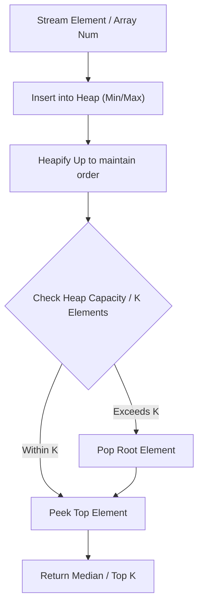

# Find Median from Data Stream

<div style="display:flex; gap:0.5rem; margin-bottom:1.5rem; align-items:center;">
  <span style="background:#ef444422; color:#ef4444; padding:2px 10px; borderRadius:12px; fontWeight:600; fontSize:0.85rem;">Hard</span>
  <span style="color:#64748b; fontSize:0.85rem;">Day 15 • Striver Blind 75</span>
</div>

## 📌 Problem Overview

Design a data structure that supports adding numbers and finding the median of all added elements.

### Examples & Constraints
**Example 1:**
- **Input:** `addNum(1), addNum(2), findMedian() -> 1.5, addNum(3), findMedian() -> 2`
- **Output:** `2`


**Constraints:**
- `At most 5 * 10^4 calls will be made`

---

## 💡 Approach & Intuition

Maintain a sorted array (or max-heap & min-heap) so that median is middle element or average of two middle elements.

### 🎯 Pattern Recognition
Two Heaps / Sorted Stream Partitioning

---

## 📊 Step-by-Step Execution (Mermaid Diagram)



---

## 🐢 Brute Force Solution

### Code
```javascript
class MedianFinder {
  constructor() { this.nums = []; }
  addNum(num) {
    let l = 0, r = this.nums.length;
    while (l < r) {
      let m = (l + r) >> 1;
      if (this.nums[m] < num) l = m + 1; else r = m;
    }
    this.nums.splice(l, 0, num);
  }
  findMedian() {
    const n = this.nums.length;
    if (n % 2 === 1) return this.nums[Math.floor(n / 2)];
    return (this.nums[n / 2 - 1] + this.nums[n / 2]) / 2;
  }
}
function testMedianFinder(ops, vals) {
  const mf = new MedianFinder();
  return ops.map((op, i) => {
    if (op === 'addNum') { mf.addNum(vals[i][0]); return null; }
    if (op === 'findMedian') return mf.findMedian();
  });
}
```

- **Time Complexity:** `O(n)`
- **Space Complexity:** `O(n)`
- **Explanation:** Binary search insert into sorted array.

---

## ⚡ Optimized Solution

### Code
```javascript
class MedianFinder {
  constructor() { this.nums = []; }
  addNum(num) {
    let l = 0, r = this.nums.length;
    while (l < r) {
      let m = (l + r) >> 1;
      if (this.nums[m] < num) l = m + 1; else r = m;
    }
    this.nums.splice(l, 0, num);
  }
  findMedian() {
    const n = this.nums.length;
    if (n % 2 === 1) return this.nums[Math.floor(n / 2)];
    return (this.nums[n / 2 - 1] + this.nums[n / 2]) / 2;
  }
}
function testMedianFinder(ops, vals) {
  const mf = new MedianFinder();
  return ops.map((op, i) => {
    if (op === 'addNum') { mf.addNum(vals[i][0]); return null; }
    if (op === 'findMedian') return mf.findMedian();
  });
}
```

- **Time Complexity:** `O(n)`
- **Space Complexity:** `O(n)`
- **Explanation:** Sorted array stream partitioning.

---

## 🐾 Step-by-Step Walkthrough

1. **Initialize State:** Setup necessary pointers, dynamic programming arrays, or hash maps.
2. **Iterate & Evaluate:** Process the input according to the boundary conditions.
3. **Update & Return:** Compute the optimal answer and return early or at termination.

### 🎙️ FAANG Interview Pitch
Use binary insertion to keep stream sorted, giving O(1) median access.

---

## 💡 Progressive Hints

1. Maintain sorted array using binary search insertion.

---

## ⚡ Interactive Practice
👉 **[Solve this problem interactively in the DSA Lab](/DSA-Notes-Problems/dsa/problems/find-median-from-data-stream)**
