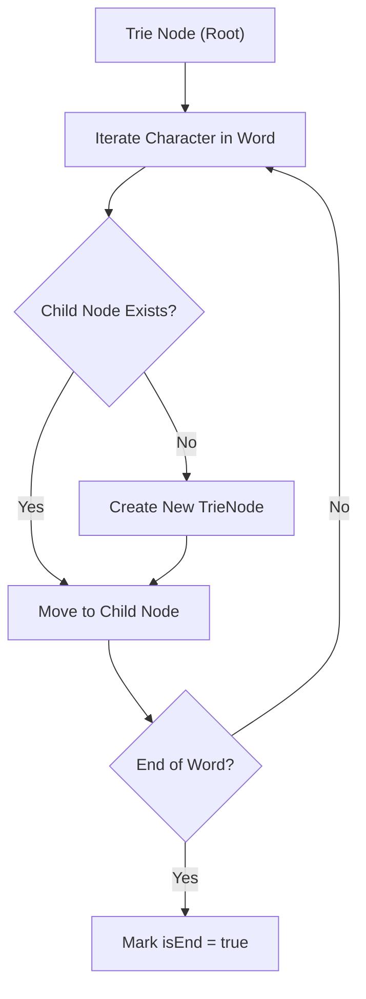

# Implement Trie (Prefix Tree)

<div style="display:flex; gap:0.5rem; margin-bottom:1.5rem; align-items:center;">
  <span style="background:#f59e0b22; color:#f59e0b; padding:2px 10px; borderRadius:12px; fontWeight:600; fontSize:0.85rem;">Medium</span>
  <span style="color:#64748b; fontSize:0.85rem;">Day 15 • Striver Blind 75</span>
</div>

## 📌 Problem Overview

Implement a Trie with `insert`, `search`, and `startsWith` methods.

### Examples & Constraints
**Example 1:**
- **Input:** `insert("apple"), search("apple") -> true, search("app") -> false, startsWith("app") -> true`
- **Output:** `true`


**Constraints:**
- `1 <= word.length <= 2000`

---

## 💡 Approach & Intuition

Tree of node objects where each node contains a children map and `isWordEnd` flag.

### 🎯 Pattern Recognition
Trie Tree Data Structure

---

## 📊 Step-by-Step Execution (Mermaid Diagram)



---

## 🐢 Brute Force Solution

### Code
```javascript
class TrieNode {
  constructor() { this.children = {}; this.isEnd = false; }
}
class Trie {
  constructor() { this.root = new TrieNode(); }
  insert(word) {
    let node = this.root;
    for (let c of word) { if (!node.children[c]) node.children[c] = new TrieNode(); node = node.children[c]; }
    node.isEnd = true;
  }
  search(word) {
    let node = this.root;
    for (let c of word) { if (!node.children[c]) return false; node = node.children[c]; }
    return node.isEnd;
  }
  startsWith(prefix) {
    let node = this.root;
    for (let c of prefix) { if (!node.children[c]) return false; node = node.children[c]; }
    return true;
  }
}
function testTrie(ops, vals) {
  const trie = new Trie();
  return ops.map((op, i) => {
    if (op === 'insert') { trie.insert(vals[i][0]); return null; }
    if (op === 'search') return trie.search(vals[i][0]);
    if (op === 'startsWith') return trie.startsWith(vals[i][0]);
  });
}
```

- **Time Complexity:** `O(L)`
- **Space Complexity:** `O(N * L)`
- **Explanation:** Standard Trie implementation.

---

## ⚡ Optimized Solution

### Code
```javascript
class TrieNode {
  constructor() { this.children = {}; this.isEnd = false; }
}
class Trie {
  constructor() { this.root = new TrieNode(); }
  insert(word) {
    let node = this.root;
    for (let c of word) { if (!node.children[c]) node.children[c] = new TrieNode(); node = node.children[c]; }
    node.isEnd = true;
  }
  search(word) {
    let node = this.root;
    for (let c of word) { if (!node.children[c]) return false; node = node.children[c]; }
    return node.isEnd;
  }
  startsWith(prefix) {
    let node = this.root;
    for (let c of prefix) { if (!node.children[c]) return false; node = node.children[c]; }
    return true;
  }
}
function testTrie(ops, vals) {
  const trie = new Trie();
  return ops.map((op, i) => {
    if (op === 'insert') { trie.insert(vals[i][0]); return null; }
    if (op === 'search') return trie.search(vals[i][0]);
    if (op === 'startsWith') return trie.startsWith(vals[i][0]);
  });
}
```

- **Time Complexity:** `O(L)`
- **Space Complexity:** `O(N * L)`
- **Explanation:** Hash map based Trie nodes.

---

## 🐾 Step-by-Step Walkthrough

1. **Initialize State:** Setup necessary pointers, dynamic programming arrays, or hash maps.
2. **Iterate & Evaluate:** Process the input according to the boundary conditions.
3. **Update & Return:** Compute the optimal answer and return early or at termination.

### 🎙️ FAANG Interview Pitch
Each node maintains a map of character pointers and a boolean indicating word boundary.

---

## 💡 Progressive Hints

1. Use a nested object mapping characters to child nodes.

---

## ⚡ Interactive Practice
👉 **[Solve this problem interactively in the DSA Lab](/DSA-Notes-Problems/dsa/problems/implement-trie)**
