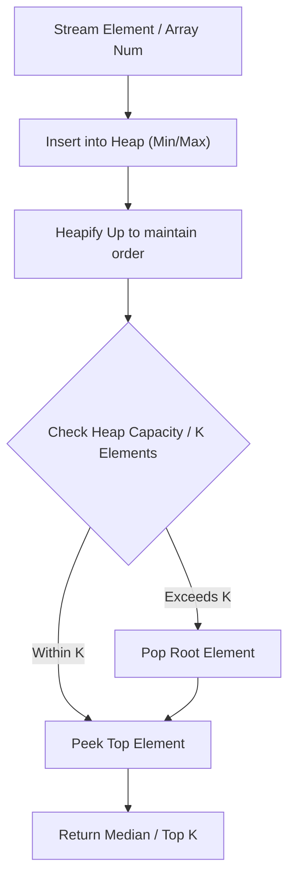

# Top K Frequent Elements

<div style="display:flex; gap:0.5rem; margin-bottom:1.5rem; align-items:center;">
  <span style="background:#f59e0b22; color:#f59e0b; padding:2px 10px; borderRadius:12px; fontWeight:600; fontSize:0.85rem;">Medium</span>
  <span style="color:#64748b; fontSize:0.85rem;">Day 15 • Striver Blind 75</span>
</div>

## 📌 Problem Overview

Given an integer array `nums` and an integer `k`, return the `k` most frequent elements. You may return the answer in **any order**.

It is guaranteed that the answer is unique.

### Examples & Constraints
**Example 1:**
- **Input:** `nums = [1,1,1,2,2,3], k = 2`
- **Output:** `[1,2]`


**Example 2:**
- **Input:** `nums = [1], k = 1`
- **Output:** `[1]`


**Constraints:**
- `1 ≤ nums.length ≤ 10⁵`
- `-10⁴ ≤ nums[i] ≤ 10⁴`
- `k is in the range [1, number of distinct elements in nums]`

---

## 💡 Approach & Intuition

Top K Frequent Elements tests your ability to combine hash maps with bucket sort or a heap to avoid a full O(n log n) sort.

### 🎯 Pattern Recognition
**Pattern: Bucket Sort by Frequency**

When you need the top-k elements by frequency and full sorting is too slow, count frequencies then bucket elements by their frequency (bounded by array length) to collect answers in O(n).

---

## 📊 Step-by-Step Execution (Mermaid Diagram)



---

## 🐢 Brute Force Solution

### Code
```javascript
function topKFrequent(nums, k) {
  const counts = new Map();
  for (const n of nums) counts.set(n, (counts.get(n) || 0) + 1);
  return [...counts.entries()].sort((a, b) => b[1] - a[1]).slice(0, k).map(e => e[0]);
}
```

- **Time Complexity:** `O(n log n)`
- **Space Complexity:** `O(n)`
- **Explanation:** Count frequencies, then sort by frequency.

---

## ⚡ Optimized Solution

### Code
```javascript
function topKFrequent(nums, k) {
  const counts = new Map();
  for (const n of nums) counts.set(n, (counts.get(n) || 0) + 1);
  const buckets = new Array(nums.length + 1).fill(null).map(() => []);
  for (const [num, freq] of counts) buckets[freq].push(num);
  const result = [];
  for (let freq = buckets.length - 1; freq >= 0 && result.length < k; freq--) {
    for (const num of buckets[freq]) {
      result.push(num);
      if (result.length === k) break;
    }
  }
  return result;
}
```

- **Time Complexity:** `O(n)`
- **Space Complexity:** `O(n)`
- **Explanation:** Bucket sort by frequency avoids comparison-based sorting.

---

## 🐾 Step-by-Step Walkthrough

1. **Initialize State:** Setup necessary pointers, dynamic programming arrays, or hash maps.
2. **Iterate & Evaluate:** Process the input according to the boundary conditions.
3. **Update & Return:** Compute the optimal answer and return early or at termination.

### 🎙️ FAANG Interview Pitch
1. Start with counting frequencies via a hash map
2. Sorting by frequency is O(n log n) — can we do better?
3. Bucket sort: frequency is bounded by array length, so use it as an index
4. Collect from the highest-frequency bucket downward until k elements are found

---

## 💡 Progressive Hints

1. Count the frequency of each number first.
2. Instead of sorting by frequency, bucket numbers by their frequency count.
3. Walk the buckets from highest frequency down until you collect k numbers.

---

## ⚡ Interactive Practice
👉 **[Solve this problem interactively in the DSA Lab](/DSA-Notes-Problems/dsa/problems/top-k-frequent-elements)**
