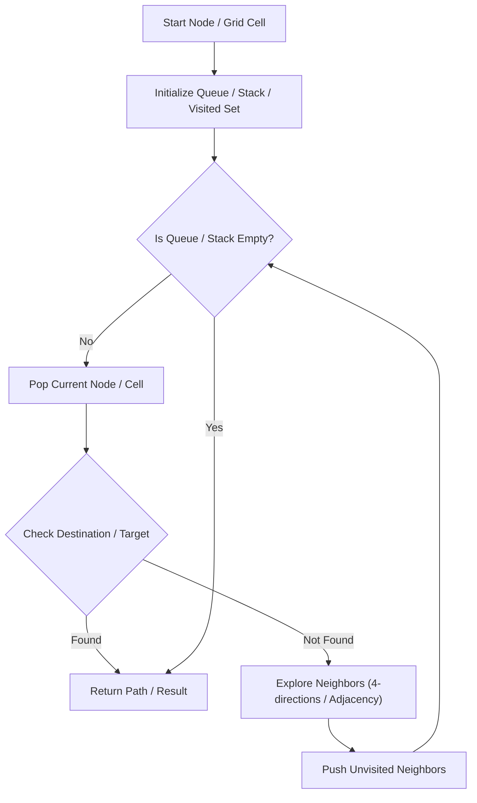

# Word Search II

<div style="display:flex; gap:0.5rem; margin-bottom:1.5rem; align-items:center;">
  <span style="background:#ef444422; color:#ef4444; padding:2px 10px; borderRadius:12px; fontWeight:600; fontSize:0.85rem;">Hard</span>
  <span style="color:#64748b; fontSize:0.85rem;">Day 15 • Striver Blind 75</span>
</div>

## 📌 Problem Overview

Given an `m x n` `board` of characters and a list of `words`, return all words on the board.

### Examples & Constraints
**Example 1:**
- **Input:** `board = [["o","a","a","n"],["e","t","a","e"],["i","h","k","r"],["i","f","l","v"]], words = ["oath","pea","eat","rain"]`
- **Output:** `["eat","oath"]`


**Constraints:**
- `1 <= m, n <= 12`
- `1 <= words.length <= 3 * 10^4`

---

## 💡 Approach & Intuition

Build a Trie from the word list, then run DFS on each grid cell, pruning Trie branches when matched.

### 🎯 Pattern Recognition
Grid DFS + Trie Branch Pruning

---

## 📊 Step-by-Step Execution (Mermaid Diagram)



---

## 🐢 Brute Force Solution

### Code
```javascript
function findWords(board, words) {
  const root = {};
  for (let w of words) {
    let curr = root;
    for (let c of w) { curr[c] = curr[c] || {}; curr = curr[c]; }
    curr.word = w;
  }
  const m = board.length, n = board[0].length, res = new Set();
  function dfs(r, c, node) {
    if (r<0||c<0||r>=m||c>=n||!node[board[r][c]]) return;
    const char = board[r][c];
    node = node[char];
    if (node.word) res.add(node.word);
    board[r][c] = '#';
    dfs(r+1,c,node); dfs(r-1,c,node); dfs(r,c+1,node); dfs(r,c-1,node);
    board[r][c] = char;
  }
  for (let r=0; r<m; r++) for (let c=0; c<n; c++) dfs(r, c, root);
  return Array.from(res);
}
```

- **Time Complexity:** `O(M*N * 4^L)`
- **Space Complexity:** `O(W*L)`
- **Explanation:** Trie + Grid DFS.

---

## ⚡ Optimized Solution

### Code
```javascript
function findWords(board, words) {
  const root = {};
  for (let w of words) {
    let curr = root;
    for (let c of w) { curr[c] = curr[c] || {}; curr = curr[c]; }
    curr.word = w;
  }
  const m = board.length, n = board[0].length, res = new Set();
  function dfs(r, c, node) {
    if (r<0||c<0||r>=m||c>=n||!node[board[r][c]]) return;
    const char = board[r][c];
    node = node[char];
    if (node.word) res.add(node.word);
    board[r][c] = '#';
    dfs(r+1,c,node); dfs(r-1,c,node); dfs(r,c+1,node); dfs(r,c-1,node);
    board[r][c] = char;
  }
  for (let r=0; r<m; r++) for (let c=0; c<n; c++) dfs(r, c, root);
  return Array.from(res);
}
```

- **Time Complexity:** `O(M*N * 4^L)`
- **Space Complexity:** `O(W*L)`
- **Explanation:** Trie + Grid DFS.

---

## 🐾 Step-by-Step Walkthrough

1. **Initialize State:** Setup necessary pointers, dynamic programming arrays, or hash maps.
2. **Iterate & Evaluate:** Process the input according to the boundary conditions.
3. **Update & Return:** Compute the optimal answer and return early or at termination.

### 🎙️ FAANG Interview Pitch
Store all search words in a Trie to prune DFS exploration early.

---

## 💡 Progressive Hints

1. Insert all target words into a Trie before grid DFS.

---

## ⚡ Interactive Practice
👉 **[Solve this problem interactively in the DSA Lab](/DSA-Notes-Problems/dsa/problems/word-search-ii)**
