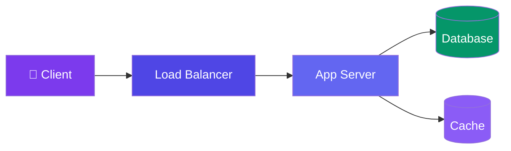

# How to Approach a System Design Problem

> Use the same framework for every question. Interviewers aren't looking for "the right answer" — they want to see **how you think**.

---

## The 7-Step Framework

```mermaid
flowchart LR
    A["1. Requirements<br/>Clarify & Scope"] --> B["2. Estimation<br/>QPS, Storage, Bandwidth"]
    B --> C["3. API Design<br/>Endpoints & Contracts"]
    C --> D["4. Data Model<br/>Schema & Storage Choice"]
    D --> E["5. High-Level Design<br/>Block Diagram"]
    E --> F["6. Deep Dive<br/>Key Components"]
    F --> G["7. Bottlenecks<br/>Trade-offs & Improvements"]

    style A fill:#7c3aed,color:#fff
    style B fill:#4f46e5,color:#fff
    style C fill:#6366f1,color:#fff
    style D fill:#8b5cf6,color:#fff
    style E fill:#7c3aed,color:#fff
    style F fill:#059669,color:#fff
    style G fill:#059669,color:#fff
```



---

## Step 1: Requirements — Clarify & Scope

Ask questions before drawing anything:

**Functional requirements** (what the system does):
- "What features are in scope?" (e.g., shorten URL + redirect)
- "What's out of scope?" (e.g., analytics, user accounts)

**Non-functional requirements** (how it behaves):
- "How many users? 1M or 1B?"
- "Read-heavy or write-heavy?"
- "Consistency or availability priority?"

> **🎯 Goal:** Narrow the problem. Don't design YouTube when they asked for a URL shortener.

---

## Step 2: Estimation

Do quick back-of-the-envelope math (see the [estimation page](/DSA-Notes-Problems/system-design/01-fundamentals/back-of-the-envelope-estimation) for details):

- **Queries per second (QPS)** — peak vs average
- **Storage** — how much data over time
- **Bandwidth** — network traffic in/out

---

## Step 3: API Design

Define the interface:

```json
POST /shorten
{ "url": "https://example.com/very/long/url" }
→ { "short_url": "https://short.ly/abc123" }

GET /{short_code}
→ 302 Redirect to original URL
```

---

## Step 4: Data Model

Design the schema and choose storage:

```sql
CREATE TABLE urls (
  id        BIGINT PRIMARY KEY,
  short_code VARCHAR(10) UNIQUE,
  original_url TEXT NOT NULL,
  created_at TIMESTAMP DEFAULT NOW()
);
```

**Storage choice:** SQL (needs ACID for idempotency)? NoSQL (higher write throughput)?

---

## Step 5: High-Level Design (Block Diagram)

Draw boxes and arrows:



---

## Step 6: Deep Dive

Pick 1-2 components and go deep:

- **Database sharding strategy** — hash-based? range-based?
- **Cache flow** — what's cached, TTL, invalidation
- **Consistency** — how do replicas stay in sync?
- **Failure handling** — what happens when a server dies?

---

## Step 7: Bottlenecks & Trade-offs

Be honest about what's not perfect:

| Component | Bottleneck | Solution |
|-----------|-----------|----------|
| Database | Write-heavy → hot shard | Better shard key |
| Cache | Miss storm on restart | Gradual warmup |
| Single server | SPOF | Add replicas |

---

## In Simple Words

- Always clarify requirements before designing — wrong assumptions sink your answer.
- Use the same 7 steps for every problem: requirements → estimation → API → data → HLD → deep dive → bottlenecks.
- The framework shows how you think. The interviewer cares about your reasoning, not a perfect diagram.
