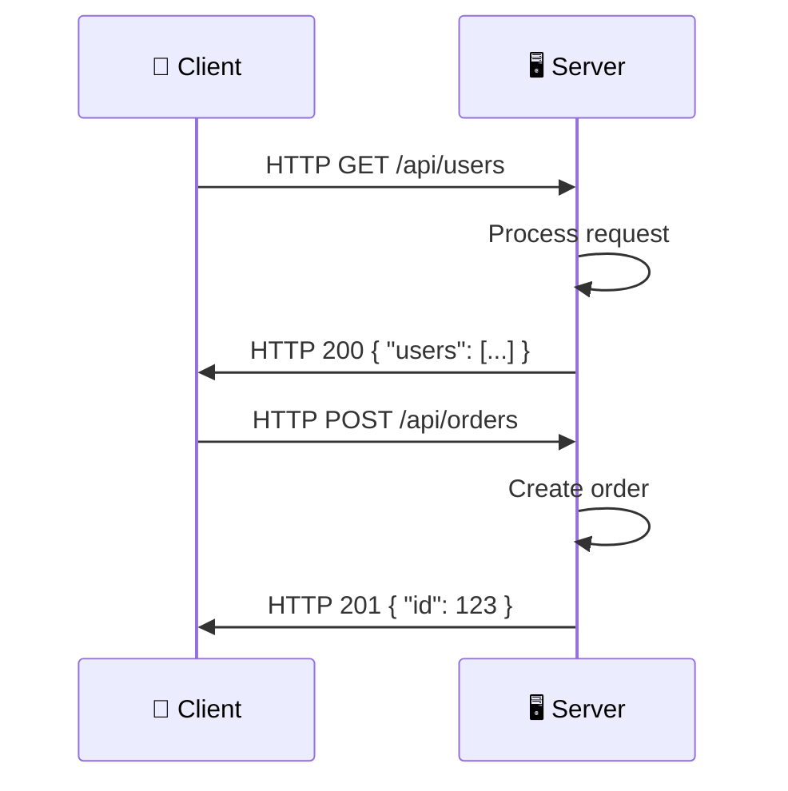

# Client-Server Model

> Almost every web system uses the **client-server model**: a client sends a request, the server processes it and sends back a response.

---

## How It Works

**Analogy — Restaurant:**
- **Client** = you (the customer) — you tell the waiter what you want
- **Server** = the kitchen — they cook your food
- **Network** = the waiter who carries messages back and forth

---

## Key Concepts

| Component | Role | Examples |
|-----------|------|----------|
| **Client** | Initiates requests | Browser, mobile app, IoT device |
| **Server** | Processes requests, sends responses | Web server, database server, API server |
| **Network** | Transports messages | Internet, local network |

---

## Stateless vs Stateful Servers

| Aspect | Stateless | Stateful |
|--------|-----------|----------|
| Stores session? | No — each request is independent | Yes — remembers past requests |
| Scales easily? | ✅ Yes (any server handles any request) | ❌ Harder (requests must go to the same server) |
| Example | REST API | FTP, old-school Java sessions |

---

## Trade-offs

- **Stateless** is easier to scale but may require more data in each request (e.g., JWT tokens).
- **Stateful** is simpler to code but harder to scale.
- Modern systems prefer **stateless servers + external session store** (Redis).

---

## In Simple Words

- Clients ask, servers answer. It's like ordering food at a restaurant.
- Stateless = the server forgets you after each request. Stateful = the server remembers.
- Stateless scales better — any server can handle any request.
