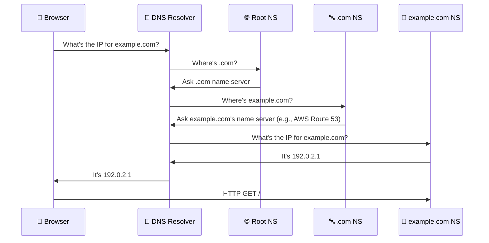
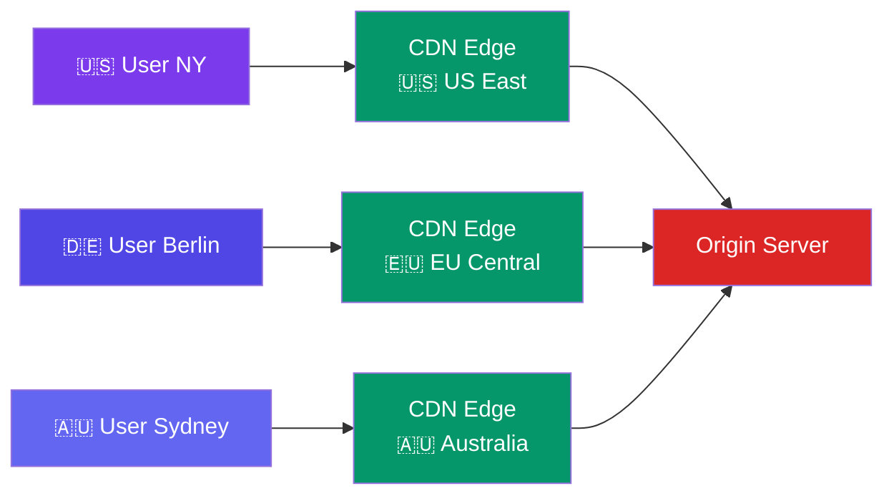

# DNS & CDN

> **DNS** turns domain names into IP addresses. **CDN** serves static content from servers close to the user.

---

## DNS Resolution

**Key record types:**
- **A** — maps domain → IPv4 address
- **AAAA** — maps domain → IPv6 address
- **CNAME** — maps domain → another domain (alias)
- **MX** — mail server records

---

## CDN (Content Delivery Network)

A CDN caches static files (images, CSS, JS, videos) at **edge servers** around the world.

**How a CDN serves a request:**
1. User in Australia requests an image
2. DNS resolves to the **nearest** CDN edge (Australia, not US)
3. If the edge has the image cached → serves instantly (cache hit)
4. If not → edge fetches from origin, caches it, serves it (cache miss)

---

## Why CDNs Matter

| Metric | Without CDN | With CDN |
|--------|:-----------:|:--------:|
| Latency (AU → US) | ~150-200 ms | ~10-20 ms |
| Origin server load | High (all requests hit origin) | Low (only cache misses) |
| Bandwidth costs | High (full bandwidth on origin) | Lower (CDN absorbs traffic) |
| DDoS protection | ❌ | ✅ Many CDNs absorb attacks |

---

## Trade-offs

- CDNs serve **cached** content — not suitable for dynamic personalized data.
- Cache invalidation is hard (users might see stale content).
- CDN cost depends on bandwidth — can be significant for large files.

---

## In Simple Words

- DNS = the phonebook of the internet. It tells your browser where to find a website.
- CDN = copies of your files stored in many locations around the world.
- DNS + CDN = users get content from the nearest server → much faster load times.
