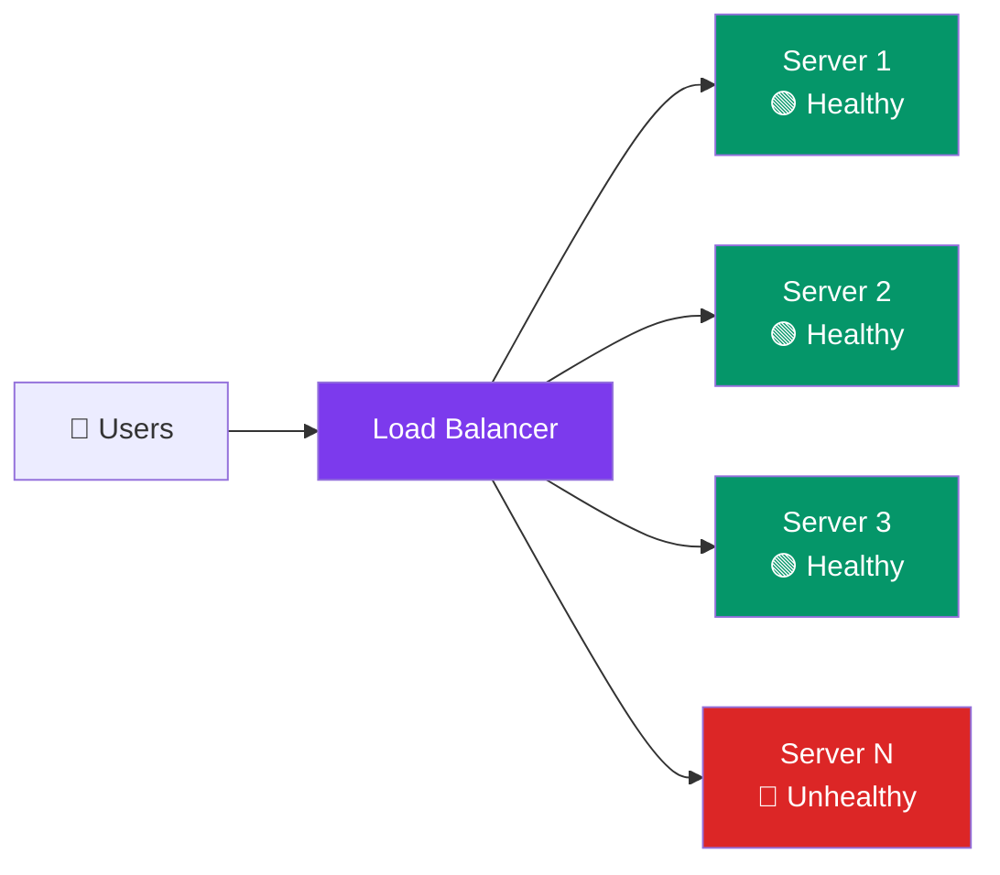

# Load Balancing

> A **load balancer** sits in front of servers and distributes incoming requests. It's the key to horizontal scaling.

---

## Visual: LB Spreading Requests

---

## Load Balancing Algorithms

| Algorithm | How It Works | Best For |
|-----------|-------------|----------|
| **Round Robin** | Requests go to each server in turn | Simple, equal-capacity servers |
| **Least Connections** | Send to server with fewest active connections | Uneven request processing times |
| **IP Hash** | Hash client IP → same server always | Sticky sessions (stateful apps) |
| **Weighted Round Robin** | Heavier servers get more requests | Mixed-capacity servers |
| **Random** | Pick a server at random | Stateless, any server works |

---

## L4 vs L7 Load Balancing

| Layer | How It Routes | Speed | Features |
|:-----:|:-------------|:-----:|----------|
| **L4 (Transport)** | By IP + port | ⚡ Fast | No content awareness |
| **L7 (Application)** | By HTTP path, headers, cookies | Slower | Can route `/api` → one pool, `/web` → another |

**Analogy:** L4 is like a mail sorter that reads only the ZIP code. L7 reads the full letter and decides based on content.

---

## What Else a Load Balancer Does

- **Health checks** — regularly pings servers, removes dead ones
- **SSL termination** — handles HTTPS decryption, servers get plain HTTP
- **Session persistence** — sends the same user to the same server (if needed)
- **Rate limiting** — rejects excess requests

---

## Trade-offs

- The load balancer itself is a **Single Point of Failure** (SPOF) — always run at least two in active-passive mode.
- L7 gives more control but adds latency.
- Most cloud providers offer managed LBs (AWS ALB, GCP HTTP LB).

---

## In Simple Words

- Load balancer = traffic cop. Spreads requests so no server gets overwhelmed.
- Round robin is simplest. Least connections is smarter for uneven work.
- L4 is fast but dumb. L7 is slower but can route by URL.
