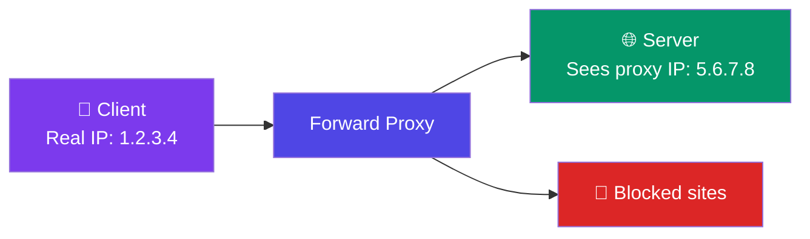
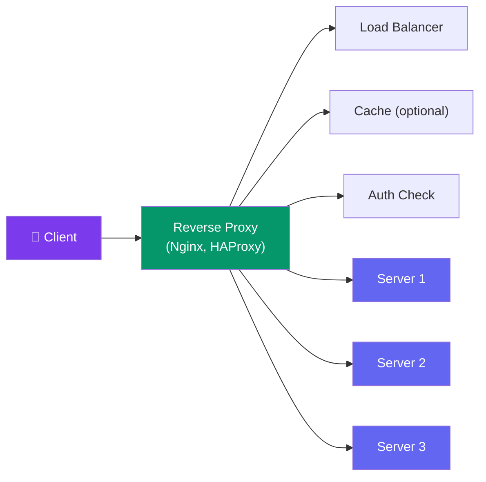

# Proxies & API Gateway

> A **proxy** sits between a client and a server. A **forward proxy** acts for the client. A **reverse proxy** acts for the server.

---

## Forward Proxy

The client routes traffic through a proxy that hides the client's identity from the server.

**Uses:** Bypass geo-restrictions, employee web filtering, anonymity.

---

## Reverse Proxy

The server hides behind a proxy that receives all client requests.

**What a reverse proxy can do:**
- **Load balancing** — distribute requests
- **Caching** — serve cached responses
- **SSL termination** — decrypt HTTPS
- **Rate limiting** — throttle clients
- **Compression** — gzip responses
- **Static file serving** — serve assets directly

---

## API Gateway

An API Gateway is a specialized reverse proxy for microservices that adds routing, auth, and aggregation.

| Feature | Reverse Proxy | API Gateway |
|---------|:-------------:|:-----------:|
| Routing | By host/path | By API contract |
| Auth | Basic | OAuth, JWT, API keys |
| Rate limiting | Simple | Per-user, per-plan |
| Request aggregation | ❌ | ✅ Combine multiple service responses |
| Service discovery | ❌ | ✅ Often integrated |

---

## Trade-offs

- Adding a proxy adds a hop → slight latency.
- The reverse proxy / API gateway is a potential SPOF — run multiple.
- API gateways can become a bottleneck if they do too much processing.

---

## In Simple Words

- Forward proxy hides the client (used for privacy/browsing).
- Reverse proxy hides the server (used for scaling/security).
- API Gateway = reverse proxy on steroids: routing, auth, rate limiting, aggregation.
