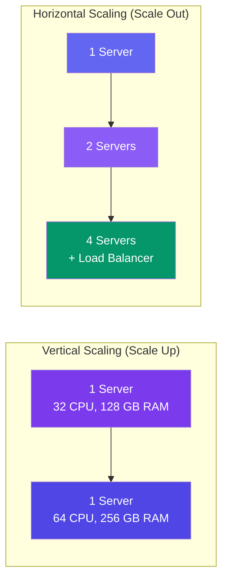

# Vertical vs Horizontal Scaling

> **Vertical scaling** = get a bigger server. **Horizontal scaling** = get more servers.

---

## Visual Comparison

---

## Comparison

| Aspect | Vertical | Horizontal |
|--------|----------|------------|
| **Method** | Bigger machine | More machines |
| **Max limit** | Hardware ceiling (largest machine available) | Theoretically infinite |
| **Cost** | Expensive (top-tier hardware has a premium) | Can use cheap commodity machines |
| **Complexity** | Simple (run on one machine) | Complex (load balancers, data sync) |
| **Fault tolerance** | None (one machine fails → system down) | High (other machines take over) |
| **Downtime on upgrade** | Required (restart the machine) | None (rolling update) |
| **Best for** | Small apps, databases | Large-scale web services |

---

## When to Use Which

**Use vertical scaling when:**
- Your traffic is predictable and small
- You want simple operations
- You're running a database (distributed DBs are hard)

**Use horizontal scaling when:**
- You expect to grow beyond one machine's capacity
- You need high availability (no downtime)
- You want to use cheap commodity hardware

---

## The Database Problem

Databases are hard to scale horizontally because they need **consistency**. Common approaches:

- **Read replicas** — one primary writes, many replicas read (horizontal reads)
- **Sharding** — split data across databases (horizontal writes — complicated)
- **Caching** — reduce database load (delays the scaling problem)

---

## Trade-offs

- Vertical has a hard ceiling. Horizontal is elastic.
- Horizontal adds operational complexity (more machines = more things that break).
- Most mature systems start vertical, then add horizontal layers as they grow.

---

## In Simple Words

- Vertical = buy a bigger truck. Horizontal = buy more trucks.
- Vertical is simpler but has limits. Horizontal is complex but can grow forever.
- Databases usually start vertical; only shard when you absolutely must.
