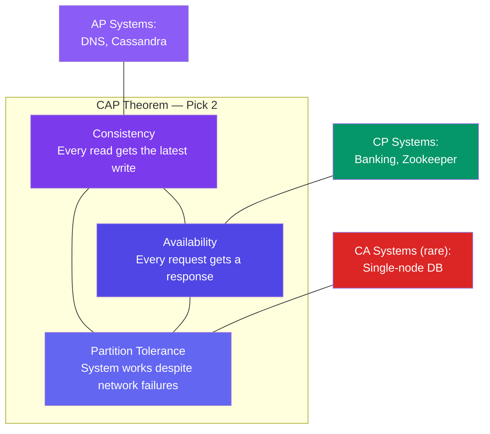

# CAP Theorem & PACELC

> The **CAP theorem** says: under a network partition (P), you must choose between **Consistency** (all nodes see the same data) and **Availability** (every request gets a response).

---

## The CAP Triangle



**The reality:** Network partitions are inevitable. So the real choice is **CP vs AP**.

---

## CP vs AP — Real Examples

### CP (Consistency + Partition Tolerance)

When a partition happens, the system stops accepting writes until consistency is restored.

**Example — Bank transfer:**
- Network splits between two data centers
- The system blocks writes
- Better to be down than to show wrong balances

### AP (Availability + Partition Tolerance)

When a partition happens, the system continues accepting writes. Consistency will be restored later.

**Example — Social media likes:**
- Network splits between two data centers
- Both centers accept likes
- When the network heals, they sync up

---

## PACELC Extension

PACELC adds nuance: if no partition (E = Else), the choice is between **Latency** and **Consistency**:

```
If Partition (P) → choose Availability or Consistency
Else (E)         → choose Latency or Consistency

Example — Cassandra:
  - P → AP (keep accepting writes, sync later)
  - E → Prefer lower latency (eventual consistency)
```

---

## System Classifications

| System | CAP Choice | Reasoning |
|--------|:----------:|-----------|
| PostgreSQL | CA (single node) / CP (clustered) | Strong consistency, will reject writes during partition |
| MongoDB | CP (default) | Primary handles writes, replicas only if consistent |
| Cassandra | AP | Always writable, eventual consistency |
| Redis (cluster) | CP | Cluster unavailable during failover |
| DNS | AP | Stale records are fine, availability is critical |

---

## Trade-offs

- There's no "right" choice — it depends on your requirements.
- **Finance/Inventory** → Consistency (can't show wrong balance).
- **Social/Content** → Availability (better to show stale data than an error).
- **Monitoring/Logs** → Availability (a few lost metrics is fine).

---

## In Simple Words

- CAP says: when the network breaks, pick between correct data (consistency) or always-up service (availability).
- Most systems pick availability because showing slightly stale data is better than showing nothing.
- PACELC adds: even without network issues, you choose between fast responses and perfectly up-to-date data.
