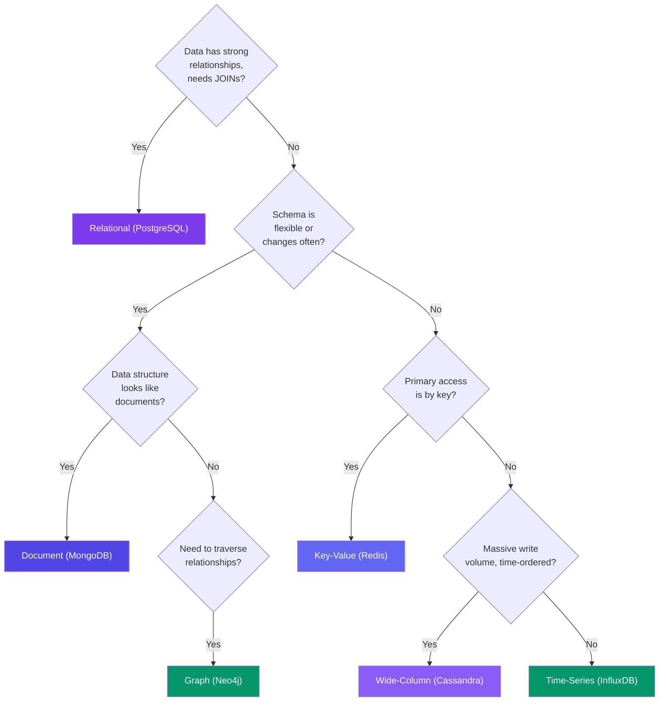

# Database Types

> Not all data is the same shape. Different database types are optimized for different data patterns.

---

## The 6 Major Types

| Type | Example | Data Shape | Use Case |
|------|---------|-----------|----------|
| **Relational** | PostgreSQL, MySQL | Tables with rows | Transactions, inventory |
| **Document** | MongoDB, Couchbase | JSON-like documents | User profiles, catalogs |
| **Key-Value** | Redis, DynamoDB | Key → value pairs | Cache, session store |
| **Wide-Column** | Cassandra, Bigtable | Rows with many columns | Time-series, IoT |
| **Graph** | Neo4j, ArangoDB | Nodes + edges | Social networks, recommendations |
| **Time-Series** | InfluxDB, TimescaleDB | Timestamp → value | Metrics, monitoring |

---

## Quick Decision Guide

---

## Trade-offs

| Database | Read Perf | Write Perf | Consistency | Scalability |
|----------|:---------:|:----------:|:-----------:|:-----------:|
| Relational | Medium | Medium | Strong | Hard |
| Document | High | High | Tunable | Good |
| Key-Value | ⚡ Very High | ⚡ Very High | Usually eventual | Excellent |
| Wide-Column | High | ⚡ Very High | Eventual | Excellent |
| Graph | Medium (traversal) | Low (nodes) | Strong | Hard |
| Time-Series | High (range) | ⚡ Very High | Eventual | Good |

---

## In Simple Words

- Use the database that matches your data shape — don't force a square peg into a round hole.
- Relational for structured, joined data. Document for JSON-like objects. KV for fast lookups.
- Wide-column for write-heavy time-series. Graph for connected data (friends, recommendations).
