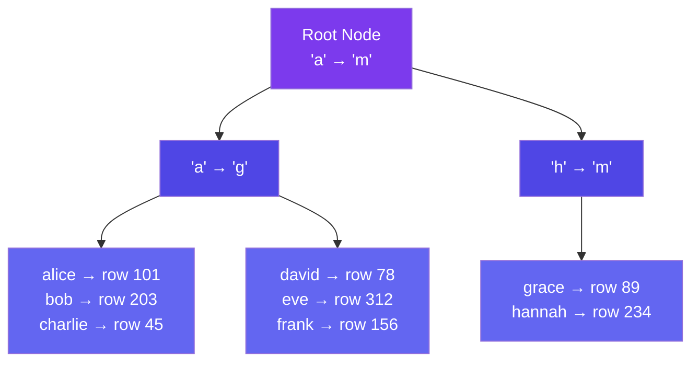

# Indexing Basics

> An **index** is a data structure that speeds up data retrieval. Think of it as the index at the back of a textbook — instead of flipping through every page, you look up the topic and jump directly to the right page.

---

## How Indexes Work

Without an index, finding a user by email scans every row (full table scan → O(N)).

```sql
SELECT * FROM users WHERE email = 'alice@example.com';
-- Without index: Scan all 10M rows (SLOW)
-- With index:   Jump directly to the row (FAST)
```

With a **B-Tree index**, the database stores a sorted tree of (email, row_location) pairs. Lookup takes O(log N) — about 4-5 steps for 10M rows.

---

## B-Tree Index Structure



---

## Types of Indexes

| Type | Description | Use Case |
|------|-------------|----------|
| **Primary Index** | On the primary key, stored with data | Clustered — fastest access |
| **Secondary Index** | On non-primary columns | Email, username lookups |
| **Composite Index** | On multiple columns | `(city, last_login)` queries |
| **Unique Index** | Enforces uniqueness | Email, username |
| **Full-Text Index** | For text search | Search within content |

---

## Indexing in System Design

When designing systems, think about which queries need indexes:

| Query Pattern | Index On |
|---------------|----------|
| Get user by email | `email` (unique index) |
| Get recent orders for user | `(user_id, created_at)` (composite) |
| Search by location | `location` (geospatial index) |
| Count by status | `status` (but careful — low cardinality) |

---

## Trade-offs

- Indexes **speed up reads** but **slow down writes** (the index must be updated on every insert/update).
- Each index consumes storage (disk space).
- Too many indexes = slow writes, large storage. Too few = slow reads.
- **Rule of thumb:** Index columns used in `WHERE`, `JOIN`, and `ORDER BY`. Don't index everything.

---

## In Simple Words

- Index = lookup table that helps the database find data without scanning everything.
- B-Tree is the most common index structure — O(log N) search time.
- Indexes make reads faster and writes slower. Put them on columns you search by.
