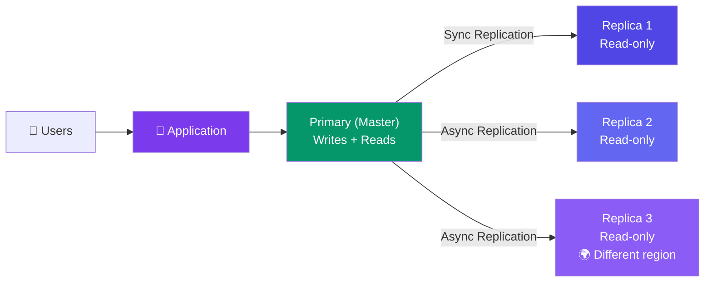

# Database Replication

> **Replication** means keeping copies of your data on multiple database servers. It's essential for availability and read scaling.

---

## Visual: Primary-Replica Replication

---

## Sync vs Async Replication

| Aspect | Synchronous | Asynchronous |
|--------|:-----------:|:------------:|
| Write completes when... | All replicas confirm | Primary alone confirms |
| Data loss on failure? | ❌ None | ✅ Some (not-yet-replicated writes) |
| Write latency | Higher (wait for replicas) | Lower (primary only) |
| Read consistency | Always up-to-date | Potentially stale replicas |
| Best for | Financial transactions | Social media, analytics |

---

## Replication Topologies

| Topology | How It Works | Trade-off |
|----------|-------------|-----------|
| **Single Primary** | One leader writes, many replicas read | Most common. Leader is SPOF |
| **Multi-Primary** | Multiple nodes accept writes | Complex conflict resolution |
| **Synchronous Multi-Primary** | Write to all before confirming | High latency, very safe |
| **Cascading Replica** | Replica replicates to another replica | Reduces load on primary |

---

## Why Replicate?

| Reason | Explanation |
|--------|-------------|
| **High availability** | If primary fails, a replica can become the new primary |
| **Read scaling** | Distribute read queries across replicas (most apps are read-heavy) |
| **Disaster recovery** | Replicas in different regions survive regional outages |
| **Analytics** | Run heavy queries on replicas without impacting production |

---

## Trade-offs

- Sync replication is safer but slower (every write waits for replicas).
- Async replication is faster but risks losing recent writes if the primary crashes.
- Replicas add operational cost — more servers to manage.

---

## In Simple Words

- Replication = making copies of your database so you don't lose data if one server dies.
- Primary handles writes. Replicas handle reads (most apps read way more than they write).
- Sync is safe but slow. Async is fast but might lose a few writes during a crash.
