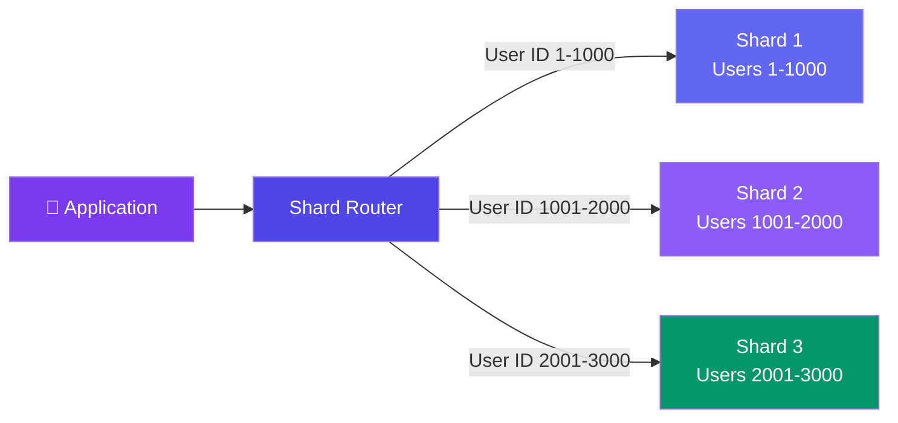

# Sharding & Partitioning

> **Sharding** splits your data across multiple database instances. Each shard holds a subset of the data. Queries go to the correct shard based on a **shard key**.

---

## Visual: Sharding by User ID

---

## Sharding Strategies

| Strategy | How It Works | Pros | Cons |
|----------|-------------|------|------|
| **Hash-based** | `shard = hash(shard_key) % N` | Even distribution | Hard to add shards (rehashing) |
| **Range-based** | `shard_key` falls in a range (A-M, N-Z) | Easy range queries | Hotspots (some ranges more active) |
| **Directory-based** | A lookup table maps key → shard | Flexible, can change | The lookup service is SPOF |

---

## Horizontal vs Vertical Partitioning

| Type | Description | Example |
|------|-------------|---------|
| **Vertical** | Split columns into different tables | User profile in one table, user settings in another |
| **Horizontal** (Sharding) | Split rows across databases | Users 1-1000 in DB1, 1001-2000 in DB2 |

---

## Shard Key — The Most Important Decision

A **good shard key** distributes data **evenly** and supports your **common queries**.

**Bad shard key:** `country` — if 80% of users are from India, that shard is overloaded (hotspot).

**Good shard key:** `user_id` or `hash(user_id)` — distributes evenly.

---

## Challenges with Sharding

| Challenge | What Happens | Mitigation |
|-----------|-------------|------------|
| **Resharding** | Data grows, need to rebalance | Consistent hashing, virtual shards |
| **Joins across shards** | Slow and complex | Denormalize, or accept app-level joins |
| **Transactions across shards** | Not supported in most DBs | Distributed transactions (Saga) |
| **Hotspots** | One shard gets too much traffic | Better shard key, split hot shard |

---

## Trade-offs

- Sharding adds significant operational complexity.
- Queries that need data from multiple shards (cross-shard joins) are expensive.
- Resharding (adding more shards) requires migrating data.
- Start without sharding. Only shard when a single database can't handle the load.

---

## In Simple Words

- Sharding = cutting a big database into smaller pieces spread across machines.
- The shard key determines which piece each record goes to — pick it carefully.
- Sharding is powerful but complex. Avoid it until you genuinely outgrow one database.
