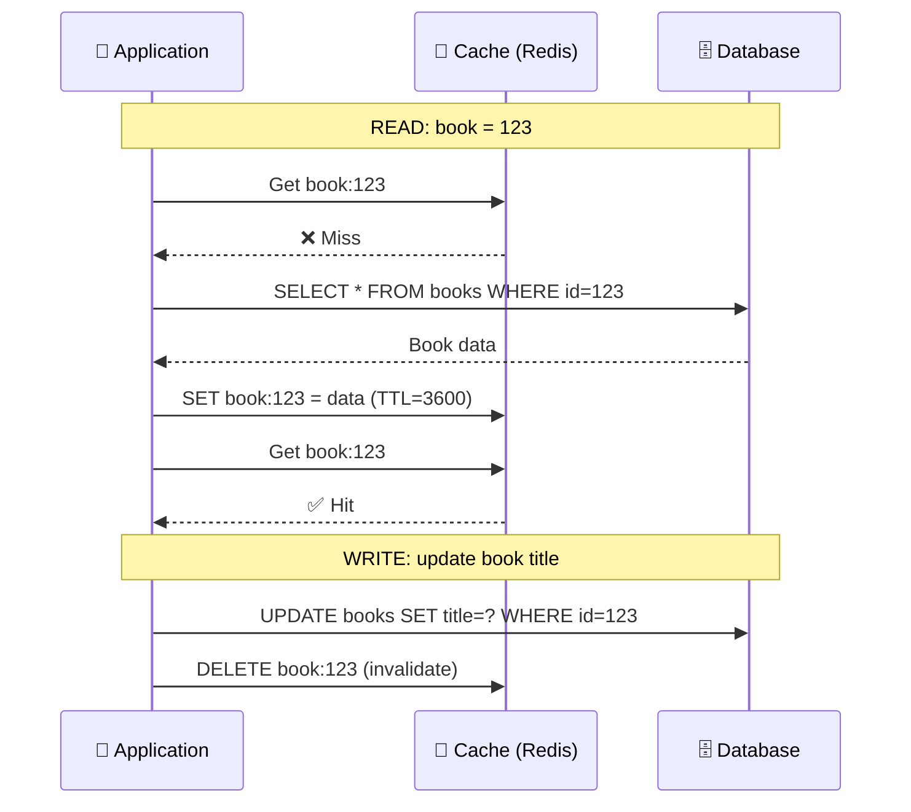
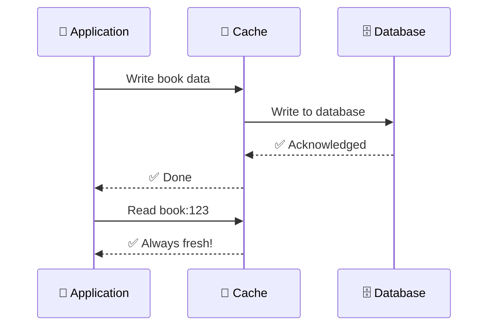
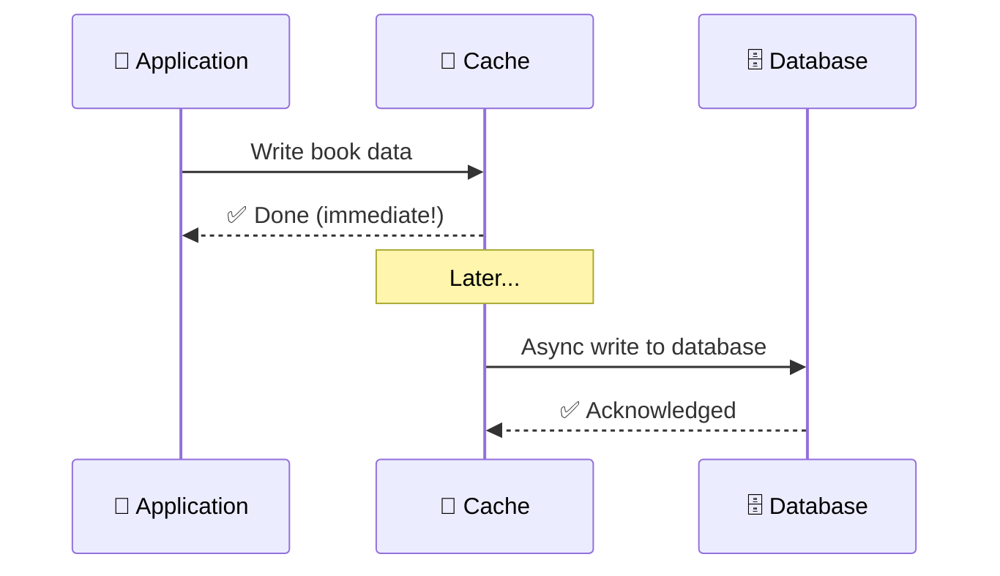

# Cache Strategies

> A **cache strategy** determines how data flows between the application, cache, and database.

---

## Cache-Aside (Most Common)

The application manages the cache manually.



**How it works:** Check cache → miss → query DB → populate cache → return.

**Pros:** Simple, cache only holds what's requested.
**Cons:** Cache miss adds two round trips (cache + DB).

---

## Read-Through

The cache library (not the app) fetches from DB on a miss.

```javascript
// The cache library handles miss automatically
const book = cache.get('book:123', () => {
  // This callback runs only on cache miss
  return db.query('SELECT * FROM books WHERE id=123');
});
```

---

## Write-Through

Every write goes through the cache first. Cache updates DB synchronously.



**Pros:** Cache is always consistent with DB.
**Cons:** Writes are slower (must wait for both cache and DB).

---

## Write-Back (Write-Behind)

The app writes to cache immediately. Cache asynchronously writes to DB later.



**Pros:** Very fast writes (no DB wait).
**Cons:** If cache crashes before async write, data is lost.

---

## Comparison

| Strategy | Read Speed | Write Speed | Consistency | Complexity |
|----------|:----------:|:-----------:|:-----------:|:----------:|
| **Cache-Aside** | ⚡ Fast on hit | Medium (need to invalidate) | Good | Low |
| **Read-Through** | ⚡ Fast on hit | Medium | Good | Medium |
| **Write-Through** | ⚡ Fast | Slower (wait for both) | ✅ Perfect | Low |
| **Write-Back** | ⚡ Fast on hit | ⚡ Very fast | ⚠️ Risk of loss | Medium |

---

## Trade-offs

- Cache-aside is the most common and flexible — start here.
- Write-through keeps consistency but adds write latency.
- Write-back gives blazing writes but risks data loss — use for high-volume, non-critical data (analytics, likes).

---

## In Simple Words

- Cache-aside = app checks cache first, fills cache on miss. Most common pattern.
- Write-through = every write goes to cache and DB together.
- Write-back = write to cache only, DB syncs later (faster but riskier).
