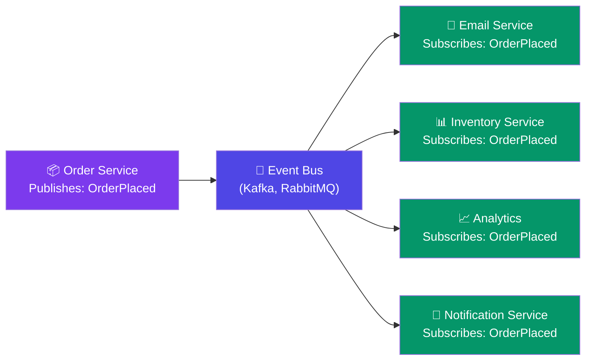

# Event-Driven Architecture

> In an **event-driven architecture**, services publish events when something happens. Other services **subscribe** to events they care about and react.

**Analogy — A radio station:**
- The station broadcasts music (event).
- Anyone with a radio tuned to that frequency hears it (subscriber).
- The station doesn't know who's listening — it just broadcasts.

---

## Visual: Pub/Sub Flow



---

## Benefits of Event-Driven Architecture

| Benefit | Explanation |
|---------|-------------|
| **Loose coupling** | Services don't know about each other — only about events |
| **Scalability** | Each service scales independently |
| **Extensibility** | Add new features by subscribing to existing events |
| **Resilience** | If a consumer is down, events wait in the queue |
| **Audit trail** | Event log provides a history of all changes |

---

## Common Event Patterns

**Event Notification:** A service broadcasts "something happened" — other services react.

```
OrderPlaced → { orderId: 123, userId: 456, total: 59.99 }
```

**Event-Carried State Transfer:** The event includes the full data, so consumers don't need to call back.

```
OrderPlaced → {
  orderId: 123,
  userId: 456,
  items: [ { sku: "ABC", qty: 2 } ],
  total: 59.99
}
```

**Event Sourcing:** Store all events as the source of truth. Reconstruct current state by replaying events.

---

## Challenges

| Challenge | Description |
|-----------|-------------|
| **Event ordering** | Events may arrive out of order — use sequence numbers or timestamps |
| **Exactly-once delivery** | Hard to guarantee. Aim for **at-least-once** + idempotent consumers |
| **Debugging** | Harder to trace a request across multiple async handlers |
| **Event schema evolution** | Changing event format breaks consumers |

---

## Trade-offs

- Event-driven architecture is powerful but complex. Start with simple request-response.
- Use events when you have **multiple services reacting to the same action**.
- Always design consumers to be **idempotent** — processing an event twice should be harmless.

---

## In Simple Words

- Event-driven = services broadcast events instead of calling each other directly.
- New features can just subscribe to existing events — no changes to the publisher.
- More complex than direct calls, but much more flexible and scalable.
