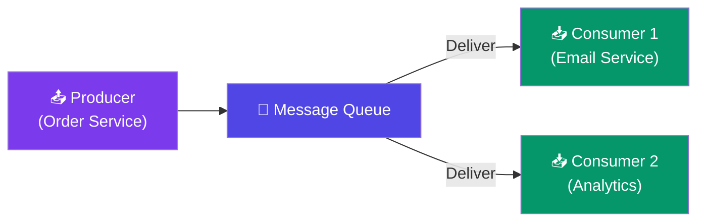
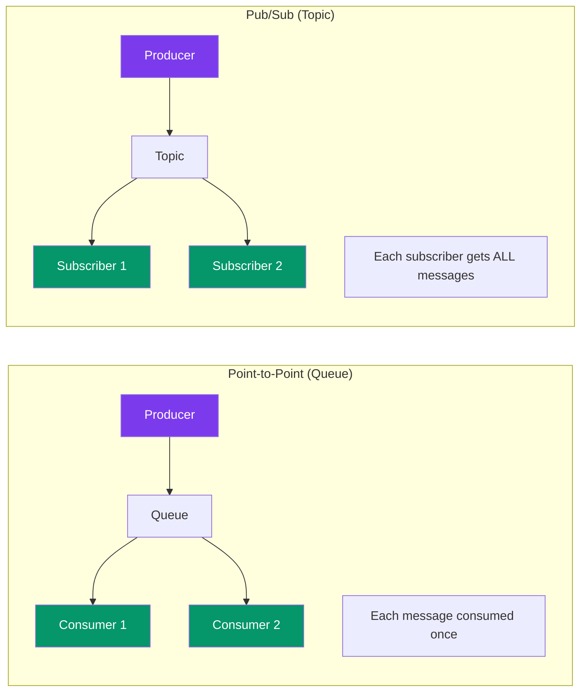

# Message Queues & Streaming

> A **message queue** lets services send messages to each other without knowing about each other. The sender puts a message on a queue. The consumer picks it up later.

---

## Visual: Producer → Queue → Consumers

---

## Point-to-Point vs Pub/Sub

---

## Kafka vs RabbitMQ

| Aspect | RabbitMQ | Kafka |
|--------|:--------:|:-----:|
| **Model** | Smart broker, dumb consumer | Dumb broker, smart consumer |
| **Message retention** | Deleted after consumption | **Persistent** (configurable retention) |
| **Ordering** | Within one queue | Within one partition |
| **Throughput** | ~10K msg/s | **~1M msg/s** |
| **Routing** | Complex (exchanges, bindings) | Simple (topics, partitions) |
| **Best for** | Task queues, RPC, complex routing | Event streaming, data pipelines, logs |

---

## When to Use a Message Queue

| Use Case | Why Queue? |
|----------|------------|
| **Send email on order** | Don't make user wait for email — queue it |
| **Image/video processing** | Long-running task, process async |
| **Decouple microservices** | Order service doesn't need to know about notification service |
| **Handle traffic spikes** | Queue buffers requests, consumers process at their pace |
| **Event-driven architecture** | Multiple services react to the same event |

---

## Key Concepts

- **Dead Letter Queue** — messages that failed processing go here for debugging
- **Idempotency** — processing the same message twice should have the same effect
- **Backpressure** — if consumers can't keep up, the queue grows (or drops messages)

---

## Trade-offs

- Queues add latency (message sits in queue before processing).
- Exactly-once delivery is hard — most queues guarantee at-least-once (retries may cause duplicates).
- Kafka is the right choice for high-throughput event streaming. RabbitMQ for task queues and routing.
- A queue is another system to maintain — adds operational complexity.

---

## In Simple Words

- Message queue = a buffer between services. Producer sends, consumer receives later.
- Point-to-point = one consumer gets each message. Pub/sub = all subscribers get all messages.
- Kafka for streaming and high throughput. RabbitMQ for task queues and flexible routing.
