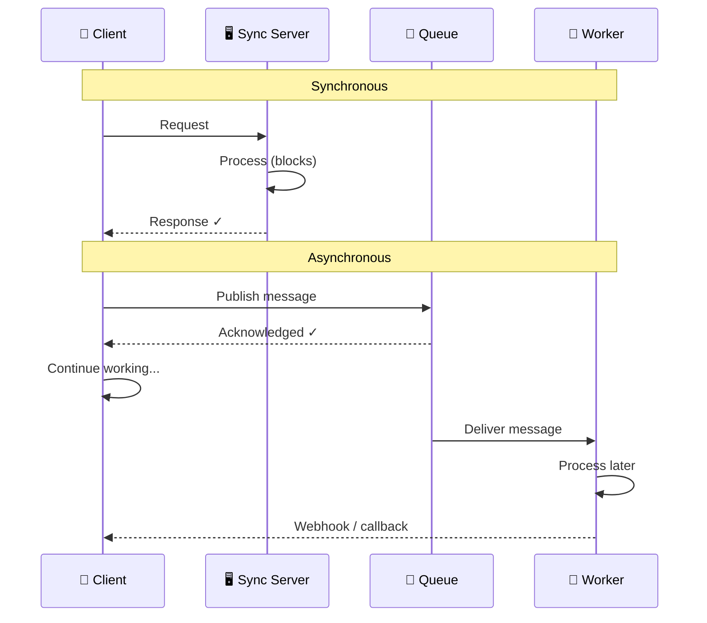

# Synchronous vs Asynchronous Communication

> **Synchronous:** Client sends a request and waits for the response. **Asynchronous:** Client sends a message and continues — the response comes later.

---

## Visual Comparison

---

## Comparison

| Aspect | Synchronous | Asynchronous |
|--------|:-----------:|:------------:|
| **Latency** | Client waits — perceived as slow | Client continues — perceived as fast |
| **Coupling** | Tight (both must be up) | Loose (producer doesn't know consumer) |
| **Complexity** | Simple (direct call) | Complex (queues, retries, idempotency) |
| **Error handling** | Immediate (HTTP error codes) | Delayed (need dead-letter queues) |
| **Traceability** | Easy (single request ID) | Harder (spans across time) |
| **Best for** | CRUD APIs, queries | Email, notifications, image processing |

---

## When to Use Sync

- You need an **immediate answer** (login check, product search)
- Simple request-response is all you need
- Failure means the client should know right away

**Example:** `POST /api/login` → client needs to know if login succeeded before rendering the next page.

---

## When to Use Async

- The operation takes time and the client doesn't need to wait (send email, process video)
- You want to **decouple** services (order service doesn't need to know about notification service)
- You need to handle **spikes** in load (queue the work, process at a steady pace)

**Example:** User uploads a video → return "processing" immediately → send a notification when done.

---

## Trade-offs

- Sync is simpler but couples services and wastes resources while waiting.
- Async decouples services and handles load spikes, but adds complexity (retries, idempotency, monitoring).
- Most systems use **both** — sync for real-time queries, async for background work.

---

## In Simple Words

- Sync = you call me, I answer immediately. You wait on the phone.
- Async = you leave a voicemail. I call you back when I'm done.
- Use sync for things that need instant answers. Use async for slow or background work.
