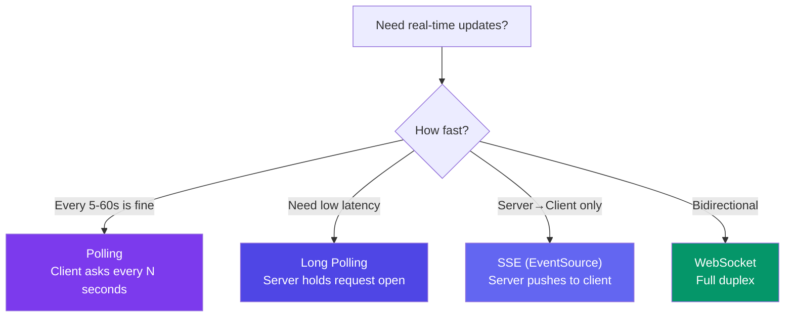
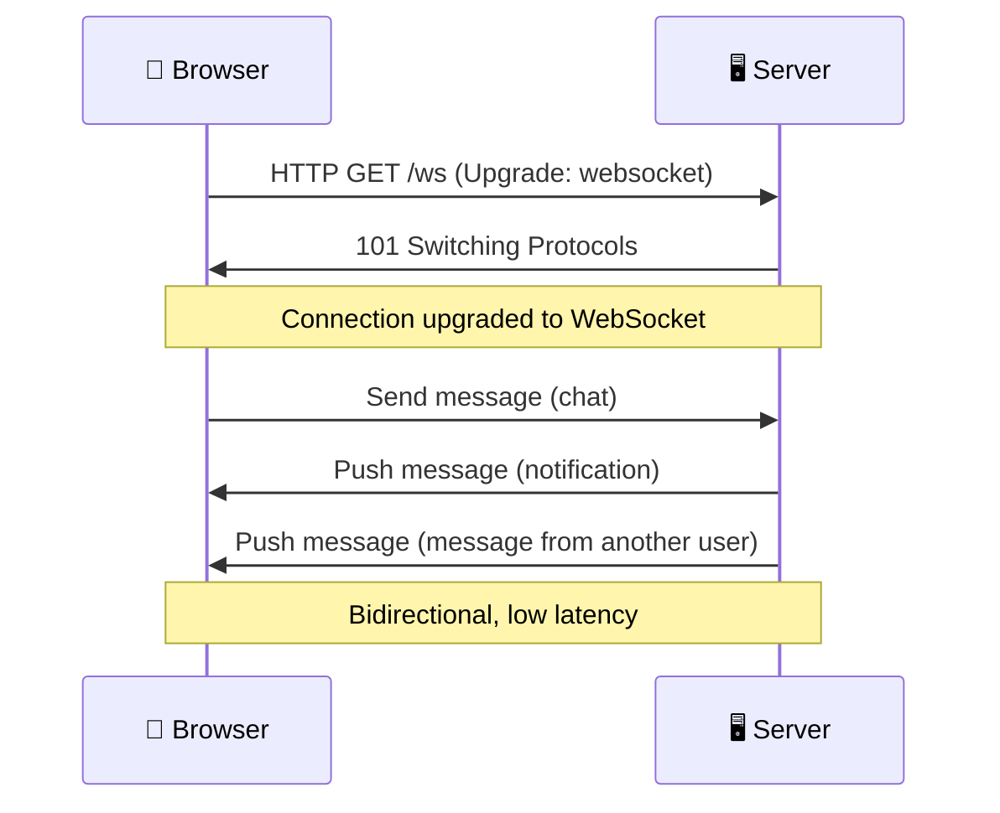

# WebSockets & Real-Time Communication

> Real-time communication means the server pushes data to the client **without the client asking** — like chat messages, live scores, or notifications.

---

## The Options

---

## Comparison

| Method | Direction | Latency | HTTP? | Complexity | Browser Support |
|--------|:---------:|:-------:|:-----:|:----------:|:---------------:|
| **Polling** | Client → Server | Seconds | ✅ Yes | Low | ✅ Universal |
| **Long Polling** | Client → Server → Client | ~100ms | ✅ Yes | Medium | ✅ Universal |
| **SSE** | Server → Client only | ~10ms | ✅ Yes | Low | Modern browsers |
| **WebSocket** | Bidirectional | ~10ms | Starts as HTTP, then upgrades | Medium-High | Modern browsers |

---

## WebSocket Handshake

---

## When to Use Each

| Scenario | Best Choice |
|----------|-------------|
| Dashboard polling every 30 seconds | **Polling** — simple, good enough |
| Real-time stock ticker | **WebSocket** — low latency, constant stream |
| Live sports scores (on mobile) | **SSE** — server pushes, no upload needed |
| Collaborative editing (Google Docs) | **WebSocket** — bidirectional, low latency |
| Notification badge count | **Long polling** — faster than polling, simpler than WS |

---

## Trade-offs

- **Polling** is simple but wasteful — many requests return no data.
- **WebSockets** are efficient but need persistent connections (more server resources).
- **SSE** is simpler than WebSockets but only works one direction (server → client).
- For most systems: use **polling** for non-critical updates, **WebSockets** for real-time features.

---

## In Simple Words

- Polling = client keeps asking "got anything new?" every N seconds.
- WebSocket = permanent open connection. Both sides can send data anytime.
- SSE = server pushes to client only (like live scores, news ticker).
- WebSocket is the gold standard for real-time chat, gaming, and live updates.
