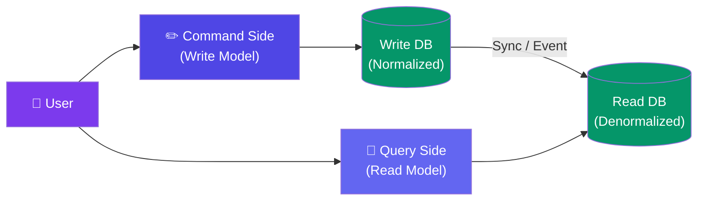

# CQRS & Event Sourcing

> **CQRS** separates commands (writes) from queries (reads). **Event Sourcing** stores every state change as an event — the current state is the sum of all past events.

---

## Visual: CQRS Architecture



---

## CQRS vs CRUD

| Aspect | Traditional CRUD | CQRS |
|--------|:----------------:|:----:|
| **Model** | One model for read & write | Separate models |
| **Schema** | Same schema for both | Different schemas (write: normalized, read: denormalized) |
| **Complexity** | Simple | Higher |
| **Performance** | Medium (one size fits none) | ⚡ Optimized for each operation |
| **Best for** | Simple apps | Complex domains, high-read/write asymmetry |

---

## Event Sourcing

Instead of storing "current balance = $100", store every event:

```
Account 123 Events:
1. AccountCreated($0)
2. Deposit($50)    → balance = $50
3. Withdraw($20)   → balance = $30
4. Deposit($70)    → balance = $100 ← current
```

**To get the current state:** replay all events in order.

**Benefits:**
- ✅ Full audit trail — every change is recorded
- ✅ Time travel — reconstruct state at any point
- ✅ Debugging — exactly what happened, in order

**Costs:**
- ❌ Event store grows forever (need compaction)
- ❌ Replaying events can be slow
- ❌ Schema evolution — old events need to be handled

---

## When to Use CQRS + Event Sourcing

| Scenario | Why This Combo? |
|----------|-----------------|
| **Audit trail required** (banking, compliance) | Every transaction is an event |
| **Read and write patterns are very different** | Optimize each separately |
| **Complex business rules** | Commands can validate before writing |
| **Need time travel / debugging** | Replay events to understand failures |

---

## When NOT to Use

| Scenario | Why Not? |
|----------|----------|
| Simple CRUD app | Overkill — adds massive complexity |
| No audit requirement | More complexity than benefit |
| Small team | Too much to build and maintain |

---

## Trade-offs

- CQRS is powerful but doubles your data storage (write DB + read DB).
- Event Sourcing gives you a perfect audit trail but the event store grows forever.
- **Don't start with CQRS/Event Sourcing.** Add them when your CRUD patterns genuinely hurt.

---

## In Simple Words

- CQRS = separate "write this" from "read that." Each can be optimized differently.
- Event Sourcing = instead of saving the current state, save every change (event) in order.
- Together they're powerful for complex systems but overkill for simple CRUD apps.
