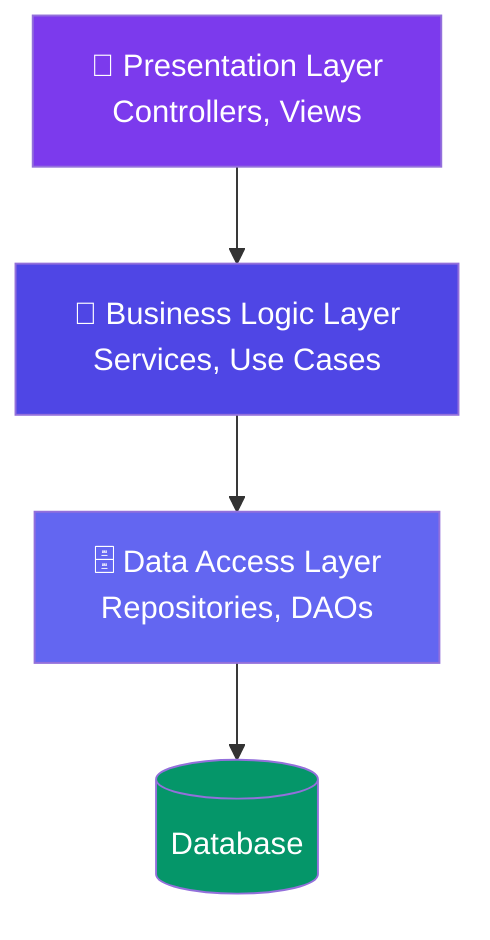
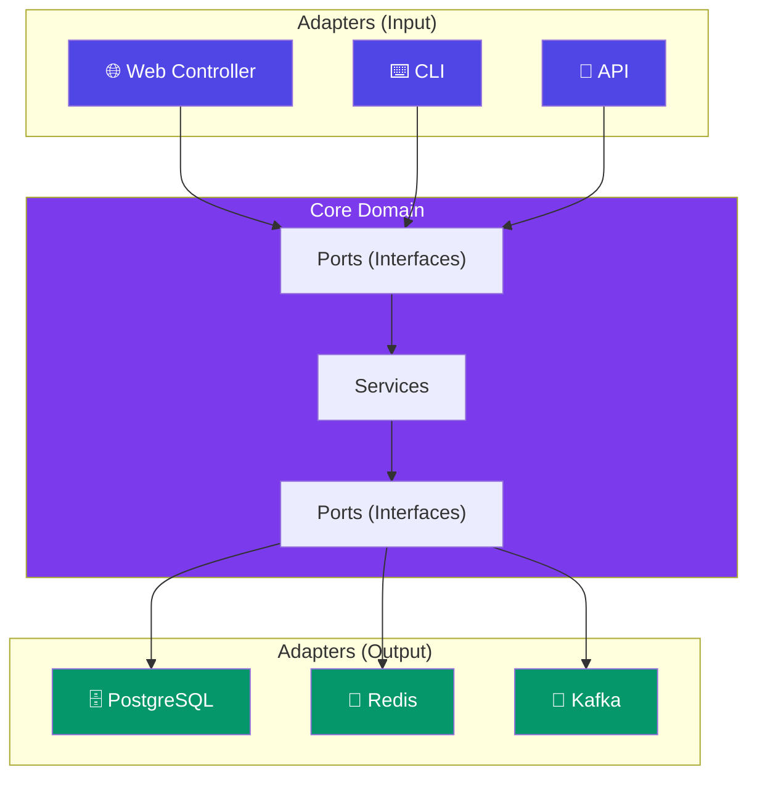

# Layered & Hexagonal Architecture

> **Layered architecture** organizes code into horizontal layers. **Hexagonal architecture** (Ports & Adapters) isolates business logic from external systems.

---

## Layered Architecture (N-Tier)

**Rules:**
- Each layer only talks to the layer directly below it.
- Changes in one layer don't affect others (if interfaces are stable).

**Pros:** Simple, well-understood, good for most applications.
**Cons:** Tight coupling between layers, can lead to "big ball of mud."

---

## Hexagonal Architecture (Ports & Adapters)

**Core idea:** The business logic doesn't depend on any specific technology. It defines **ports** (interfaces). **Adapters** implement those ports for specific technologies.

**Pros:** Highly testable, technology-independent business logic.
**Cons:** More code (interfaces, adapters), steeper learning curve.

---

## Comparison

| Aspect | Layered | Hexagonal |
|--------|:-------:|:---------:|
| **Dependency direction** | Top → bottom | Outside → inside (core has no dependencies) |
| **Testability** | Medium (mocks) | High (pure domain logic, swap adapters) |
| **Flexibility** | Low (changes ripple) | High (swap DB, cache without touching core) |
| **Complexity** | Low | Medium |
| **Best for** | Most web apps | Complex domains, DDD, systems that need flexibility |

---

## Trade-offs

- **Layered** is simpler and sufficient for most applications.
- **Hexagonal** shines when you need to swap infrastructure (e.g., migrate from PostgreSQL to MongoDB) or test business logic in isolation.
- Don't over-engineer — start with layered, evolve to hexagonal when you feel the pain of tight coupling.

---

## In Simple Words

- Layered = organize code in stacks: presentation → business → data.
- Hexagonal = put business logic in the center, connect external systems through interfaces.
- Layered is simpler. Hexagonal is more flexible. Start with layered.
