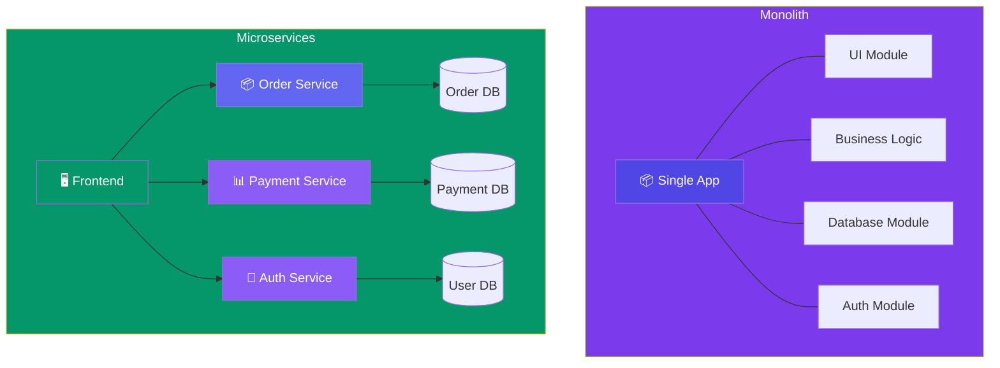

# Monolith vs Microservices

> A **monolith** is a single application that does everything. **Microservices** split the application into independent services that communicate over a network.

---

## Visual Comparison

---

## Comparison

| Aspect | Monolith | Microservices |
|--------|:--------:|:-------------:|
| **Codebase** | Single repo | Multiple repos (one per service) |
| **Deploy** | One deploy for everything | Independent deployments |
| **Scale** | Scale the whole app | Scale only busy services |
| **Complexity** | Low (simple code) | High (network, data sync, deployment) |
| **Team structure** | One team owns everything | Each team owns a service |
| **Fault isolation** | ❌ One bug takes down everything | ✅ One service failure is isolated |
| **Startup speed** | ⚡ Fast to start | Slower (more infrastructure) |

---

## When to Use a Monolith

| Scenario | Why Monolith? |
|----------|---------------|
| Small team (< 10 engineers) | Lower overhead, faster iteration |
| Simple application | No need for complex service boundaries |
| Early-stage startup | Focus on product, not infrastructure |
| Not expecting massive scale | Monolith can handle plenty with good code |

> **Most successful microservices started as monoliths.** Don't over-engineer early.

---

## When to Use Microservices

| Scenario | Why Microservices? |
|----------|--------------------|
| Large team (50+ engineers) | Teams work independently |
| Different scaling needs | Order service needs 10 servers, auth needs 2 |
| Multiple technology stacks | Python for ML, Go for API, Node for frontend |
| High availability requirements | One service failing shouldn't take down everything |

---

## The "Monolith First" Strategy

1. Start with a **well-structured monolith** (modular code, clear boundaries)
2. When it's too big for one team → **extract services** one at a time
3. Start with the **highest-value** boundary (e.g., payment, auth)

> **Rule of thumb:** Don't start with microservices. Extract them when the monolith hurts.

---

## Trade-offs

- Monoliths are simple but can become unmanageable at scale.
- Microservices are powerful but add **network latency, data consistency challenges, and operational overhead**.
- Netflix, Amazon, Uber all migrated from monolith to microservices — they didn't start there.

---

## In Simple Words

- Monolith = one big app. Simple to build, hard to scale.
- Microservices = many small apps. Harder to build, easier to scale.
- Start with a monolith. Extract services only when you need to.
