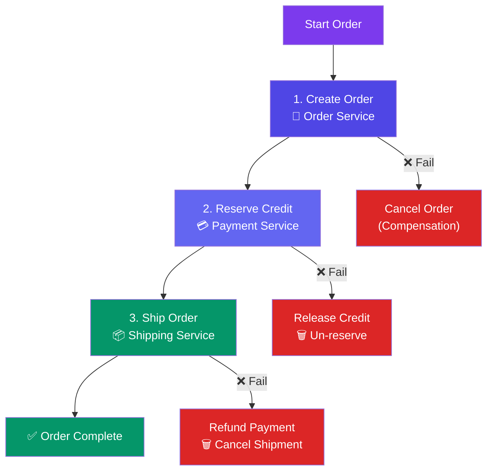

# Saga & Distributed Transactions

> A **distributed transaction** involves multiple services. A **Saga** is a sequence of local transactions — if one fails, compensating actions undo the previous ones.

**Analogy — Booking a trip:**
- Book flight ✅ → Book hotel ✅ → Book car ✅ → Done!
- Book flight ✅ → Book hotel ❌ → Cancel flight (compensation) → Back to start

---

## Visual: Saga Flow

---

## Choreography vs Orchestration

| Aspect | Choreography (Event-driven) | Orchestration (Command-driven) |
|--------|:---------------------------:|:------------------------------:|
| **How** | Services react to events | Central coordinator tells services what to do |
| **Control** | Decentralized | Centralized (Saga orchestrator) |
| **Pros** | Loose coupling, simple services | Easier to manage, test, and monitor |
| **Cons** | Hard to trace and debug | Orchestrator is a SPOF |
| **Example** | Each service emits events on completion | A dedicated Saga manager routes commands |

---

## Challenges

| Challenge | Description |
|-----------|-------------|
| **No isolation** | Other services can see intermediate (uncommitted) states |
| **Compensation complexity** | Need to write undo logic for every step |
| **Debugging** | Hard to trace what happened across services |
| **Idempotency** | Compensations may run multiple times — must be safe |

---

## When to Use Sagas

| Scenario | Why Saga? |
|----------|-----------|
| **Order processing** | Multiple services: order, payment, shipping, notification |
| **Booking systems** | Flight + hotel + car — all or compensated |
| **Account transfer** | Debit one account, credit another |
| **Any multi-service write** | When ACID across services is impossible |

---

## Trade-offs

- Sagas give you **eventual consistency** instead of ACID — there's a window where data is inconsistent.
- Compensating actions may not be exact rollbacks (e.g., "cancel flight" works, but "un-send email" doesn't).
- Orchestration is easier to manage. Choreography gives more autonomy.

---

## In Simple Words

- Saga = breaking a big transaction into small steps, each with an undo action.
- If step 3 fails, undo steps 1 and 2 (compensation).
- There's no ACID — data is temporarily inconsistent until the saga completes or compensates.
