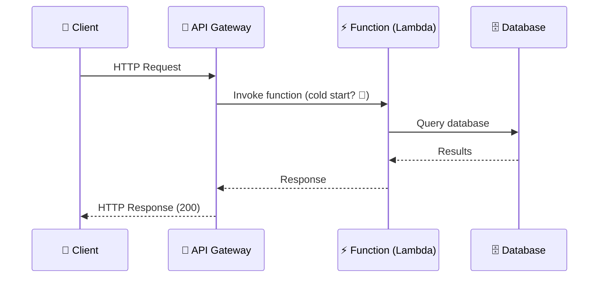

# Serverless Architecture

> **Serverless** doesn't mean there are no servers. It means you don't have to think about them. You write functions, and the cloud provider (AWS Lambda, Cloudflare Workers) runs them on demand.

---

## How Serverless Works

---

## Serverless vs Traditional

| Aspect | Serverless | Traditional Server |
|--------|:----------:|:-----------------:|
| **Provisioning** | Auto (zero to N instantly) | Manual (need to estimate capacity) |
| **Scaling** | Invisible — scales per request | Configurable — autoscaling groups |
| **Pricing** | Per-invocation + duration | Per-hour server cost |
| **Cold start** | ❌ Can be slow (first invocation) | ✅ Always warm |
| **Timeout** | Limited (Lambda: 15 min max) | Unlimited |
| **State** | Stateless by default | Can store in memory |
| **Best for** | Event-driven, sporadic traffic | Sustained, predictable load |

---

## When to Use Serverless

| Use Case | Why Serverless? |
|----------|-----------------|
| **Webhook handlers** | Low traffic, just needs to work |
| **Image processing** | Triggered by upload, process then done |
| **Cron jobs** | Run on schedule, no idle cost |
| **Mobile/Web backends** | Spiky traffic, unpredictable load |
| **Event-driven tasks** | File upload → process → notify |

---

## Trade-offs

- **Cold starts** — functions that haven't run recently can take 1-2 seconds to start.
- **Vendor lock-in** — your code is tied to AWS Lambda / Cloudflare Workers APIs.
- **Debugging** harder — no SSH access, distributed tracing needed.
- **Cost at scale** — at very high traffic, dedicated servers might be cheaper.
- **State** — every request starts fresh. Use external storage (Redis, DB) for state.

---

## In Simple Words

- Serverless = you write code, the cloud runs it. No servers to manage.
- Great for sporadic traffic, webhooks, and event processing.
- Watch out for cold starts and cost at very high volume.
