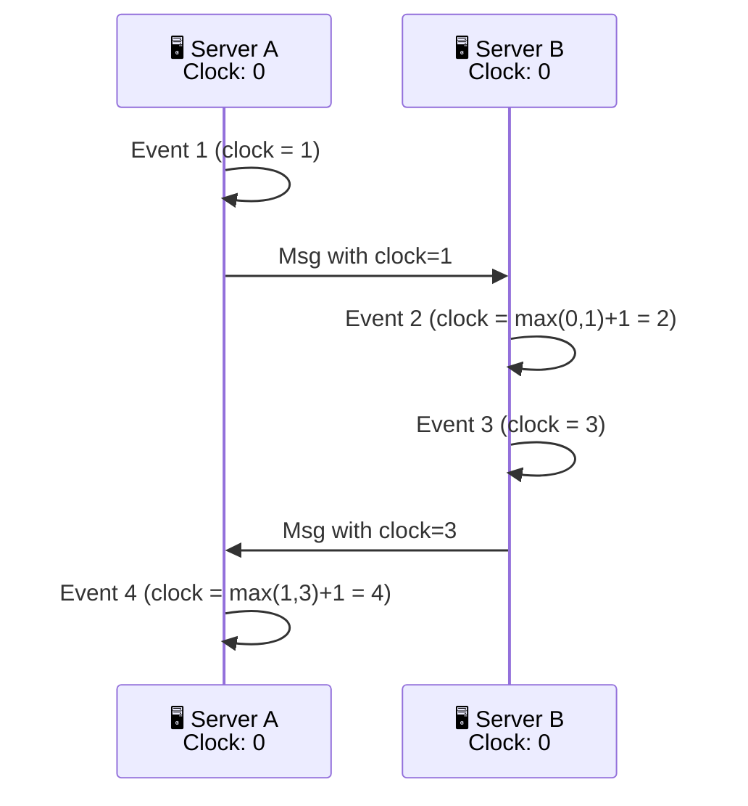

# Clocks & Ordering

> In a distributed system, **ordering events** is surprisingly hard. Two servers might disagree on which event happened first — and wall clocks (system time) can't be trusted.

---

## The Problem: Clock Drift

Server A says "event happened at 10:00:01.001"
Server B says "event happened at 10:00:01.000"

Which one happened **first**? You can't tell because:
- Server B's clock might be 2ms ahead of Server A's
- Clock drift can be seconds or minutes

> **NTP** (Network Time Protocol) helps synchronize clocks but can't make them perfect — there's always some drift.

---

## Logical Clocks

Instead of wall time, use a **counter** that increases.

### Lamport Clocks

Each server keeps a counter:
- Increment counter on every event
- Include the counter when sending messages
- When receiving: `counter = max(local, received) + 1`

**Limitation:** Lamport clocks give **partial ordering** — if `clock(A) < clock(B)`, then A happened before B. But if `clock(A) = clock(B)`, they could have happened in any order.

### Vector Clocks

Each server keeps a vector of counters (one per server). This can detect **concurrent updates** — important for conflict resolution in systems like DynamoDB.

---

## Why Ordering Matters

| Scenario | Why Order |
|----------|-----------|
| **Last write wins** | Which update is the "latest"? |
| **Event sourcing** | Events replayed in correct order |
| **Causal dependencies** | "Reply" must appear after "comment" |
| **Transactional ordering** | Operations applied in correct sequence |

---

## Practical Solutions

| Solution | How It Works | Used By |
|----------|-------------|---------|
| **Single leader** | All writes through one server → total order | Raft, primary-replica DBs |
| **Monotonic clocks** | Use `clock_gettime` (monotonic, not wall time) | Local ordering within a server |
| **Hybrid clocks** | Wall time + logical counter | CockroachDB, Spanner (TrueTime) |
| **Sequence numbers** | Global incrementing counter | Kafka partitions (per-partition order) |

---

## Trade-offs

- Wall clocks are convenient but unreliable (NTP sync can't fix drift perfectly).
- Logical clocks solve ordering but don't tell you the real time.
- For most systems: **use a single leader** for ordering. Only need logical clocks for multi-leader or peer-to-peer systems.

---

## In Simple Words

- Wall clocks in different servers can disagree → you can't trust timestamps.
- Logical clocks use counters, not time — they tell you "what happened before what."
- For most systems, a single leader (Raft, Kafka partition leader) gives simple, reliable ordering.
