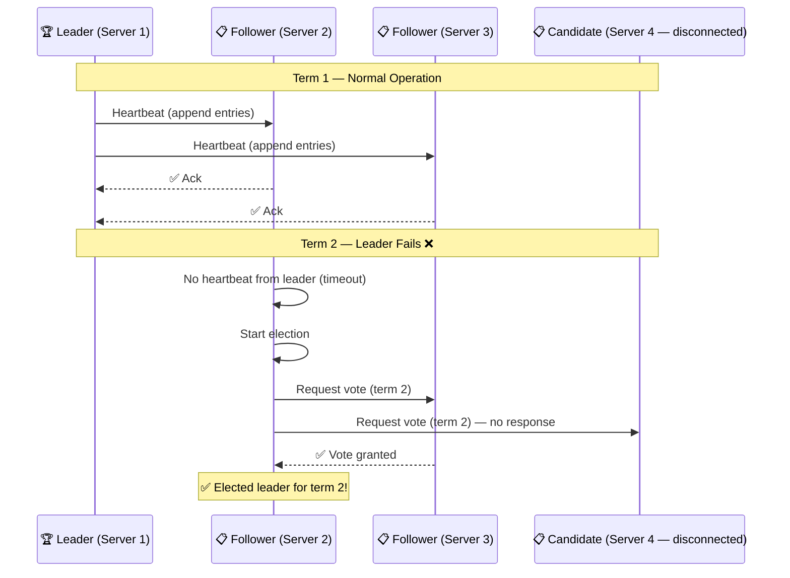

# Consensus & Leader Election

> **Consensus** is the problem of getting multiple servers to agree on a value. **Leader election** is a common way to achieve consensus — one server is the leader, others follow.

---

## Visual: Raft Leader Election



---

## How Consensus Works (Raft Simplified)

1. **Leader election:** Servers vote for a leader. The candidate with majority votes wins.
2. **Log replication:** The leader accepts writes and replicates them to followers.
3. **Commit:** When a majority of followers acknowledge a write, it's committed.
4. **Safety:** If the leader fails, a new leader is elected with the latest committed data.

---

## Quorum

A **quorum** is the minimum number of nodes that must agree for a decision to be valid.

```
With 3 nodes: quorum = 2 (majority)
With 5 nodes: quorum = 3 (majority)
```

**Why quorum matters:**
- Leader needs quorum votes to be elected
- Writes need quorum acks to be committed
- Reads need quorum responses to be consistent

---

## Raft vs Paxos

| Aspect | Raft | Paxos |
|--------|:----:|:-----:|
| **Understandability** | ✅ Designed for understandability | ❌ Famous for being hard to understand |
| **Leader** | Strong leader (elected) | Multiple proposers possible |
| **Implementation** | Used in etcd, Consul, MongoDB | Used in Google Chubby, Spanner |
| **Log consistency** | Sequential log replication | Multiple values can be proposed |
| **Real-world usage** | Very common | Common (often hidden behind abstractions) |

---

## Use Cases

| System | Consensus Algorithm | Purpose |
|--------|:-------------------:|---------|
| **etcd / Consul** | Raft | Service discovery, distributed config |
| **Apache ZooKeeper** | Zab (similar to Paxos) | Coordination, leader election |
| **MongoDB (replica set)** | Raft | Primary election, write consistency |
| **Kafka** | KRaft (Raft-based) | Controller election, metadata management |

---

## In Simple Words

- Consensus = getting multiple servers to agree on who the leader is and what data is correct.
- Raft is the most popular algorithm — it's designed to be understandable.
- A quorum (majority) must agree for things to happen. 3-node cluster needs 2/3 votes.
