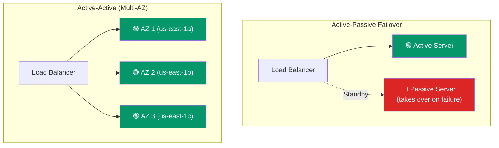

# Fault Tolerance & Redundancy

> **Fault tolerance** means a system continues operating despite failures. **Redundancy** is the primary technique — have backups of everything.

---

## Types of Failures

| Failure | Description | Example |
|---------|-------------|---------|
| **Crash** | Server stops responding | Power outage, OS crash |
| **Omission** | Server doesn't respond (but is alive) | Network partition, overloaded |
| **Timing** | Server responds too slowly | GC pause, resource contention |
| **Byzantine** | Server behaves maliciously or incorrectly | Corrupted data, buggy code |
| **Resource exhaustion** | Runs out of memory, disk, connections | Traffic spike |

---

## Redundancy Patterns

| Pattern | Setup | Recovery Time | Cost |
|---------|-------|:-------------:|:----:|
| **Active-Passive** | One server, one standby | Minutes (need to start standby) | 2× |
| **Active-Active** | Multiple servers, all serving | Instant (LB routes away from dead server) | N× |
| **Multi-region** | Servers in different geographic regions | Minutes (DNS failover) | Very high |

---

## Graceful Degradation

When parts of the system fail, the rest should still work — possibly with reduced functionality.

**Example — Netflix:**
- If recommendations are down → still show the search bar and catalog
- If video transcoding fails → try a lower-quality version
- If the entire personalization service fails → show generic popular titles

**Techniques:**
- **Circuit breakers** — detect failing services and stop calling them
- **Fallbacks** — return cached/default data when live data isn't available
- **Bulkheads** — isolate components so one failure doesn't cascade

---

## How Much Redundancy?

| Availability Target | Redundancy Needed |
|:------------------:|-------------------|
| 99% (2 nines) | Single server, maybe backups |
| 99.9% (3 nines) | Active-passive failover |
| 99.99% (4 nines) | Active-active multi-AZ |
| 99.999% (5 nines) | Multi-region, multi-AZ |

> Each additional "nine" roughly **10× the cost**.

---

## Trade-offs

- More redundancy = higher cost (more servers, more complexity).
- Redundancy also adds complexity — more servers to manage, more failure modes.
- **Prioritize:** What's the cost of downtime vs the cost of redundancy?
- Not all failures can be predicted. Design for the **common failure modes** (server crash, network partition).

---

## In Simple Words

- Fault tolerance = the system keeps working even when things break.
- Redundancy = have backups of every critical component.
- Active-active (multiple servers all running) is better than active-passive (one standby).
- More reliability costs exponentially more money.
