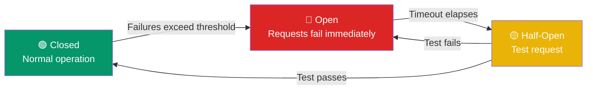

# Backpressure & Circuit Breakers

> **Backpressure** tells the sender "I can't keep up, slow down." **Circuit breakers** stop calling a service that's failing, giving it time to recover.

---

## Circuit Breaker States



**States:**
- **Closed** — Normal. Requests flow through. Failures are counted.
- **Open** — Too many failures. Requests are rejected immediately (fast fail).
- **Half-Open** — After a timeout, let one request through. If it succeeds → close. If it fails → stay open.

---

## Implementation

```javascript
class CircuitBreaker {
  constructor(fn, options = {}) {
    this.fn = fn;
    this.failureCount = 0;
    this.threshold = options.threshold || 5;     // Failures before opening
    this.timeout = options.timeout || 30000;      // Time before half-open (30s)
    this.state = 'CLOSED';
    this.lastFailureTime = null;
  }

  async call(...args) {
    if (this.state === 'OPEN') {
      if (Date.now() - this.lastFailureTime > this.timeout) {
        this.state = 'HALF_OPEN';
      } else {
        throw new Error('Circuit breaker is OPEN');
      }
    }

    try {
      const result = await this.fn(...args);
      if (this.state === 'HALF_OPEN') {
        this.state = 'CLOSED';     // Test passed, close circuit
        this.failureCount = 0;
      }
      return result;
    } catch (err) {
      this.failureCount++;
      this.lastFailureTime = Date.now();
      if (this.failureCount >= this.threshold) {
        this.state = 'OPEN';
      }
      throw err;
    }
  }
}
```

---

## Backpressure Strategies

| Strategy | How It Works | When to Use |
|----------|-------------|-------------|
| **Queue with limit** | Requests go to a bounded queue. Queue full → reject. | When processing takes variable time |
| **Drop** | Drop excess requests (load shedding). | When the system is overloaded |
| **Slow down consumer** | Tell the producer to send slower. | When you control both sides (e.g., Kafka) |
| **Block** | Block the caller until there's capacity. | Simple, but blocks resources |

---

## Why They Matter

**Without circuit breaker:** A slow database call makes the web server thread wait. Other threads pile up waiting for the same database. Eventually the web server runs out of threads → entire site goes down because of one slow query.

**With circuit breaker:** After 5 slow responses, the circuit breaker opens. Requests fail instantly (fast) instead of timing out after 30 seconds. The web server stays healthy. The database gets a break and recovers.

---

## Trade-offs

- Circuit breakers add complexity — need to decide thresholds and timeouts.
- Too sensitive → circuit opens for transient blips (false positives).
- Too tolerant → circuit never opens, failures cascade.
- Backpressure requires the sender to be cooperative — doesn't help with malicious clients.

---

## In Simple Words

- Circuit breaker = if something keeps failing, stop trying for a while. Let it recover.
- Backpressure = "please send slower, I can't keep up."
- Without these, one slow service can take down your entire system (cascading failure).
