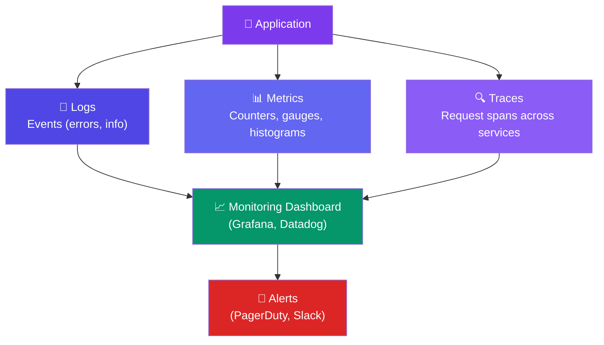
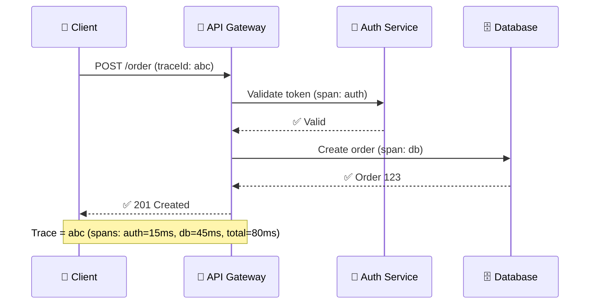

# Observability

> **Observability** is the ability to understand what's happening inside your system by looking at the outputs. It has three pillars: **logging, metrics, and tracing**.

---

## The Three Pillars



---

## Logging

| Log Level | When to Use |
|:---------:|-------------|
| **ERROR** | A failure that needs investigation (DB connection lost, payment failed) |
| **WARN** | Something unexpected but not critical (rate limit approaching, retry attempt) |
| **INFO** | Important events (user registered, order placed) |
| **DEBUG** | Detailed information for debugging (not in production) |

**Best practice:** Log in **structured format** (JSON), not plain text.

```json
{ "level": "ERROR", "service": "payment", "msg": "Payment declined",
  "userId": 123, "orderId": 456, "errorCode": "INSUFFICIENT_FUNDS",
  "traceId": "abc-123-def", "timestamp": "2024-01-15T10:30:00Z" }
```

---

## Metrics

| Metric Type | Example |
|-------------|---------|
| **Counter** | Total requests, total errors (only increases) |
| **Gauge** | Current CPU, memory usage, queue size (goes up and down) |
| **Histogram** | Request latency p50, p95, p99 |

**The "Four Golden Signals"** (Google SRE):
1. **Latency** — time to serve requests (p50, p95, p99)
2. **Traffic** — requests per second
3. **Errors** — rate of failed requests (explicit 5xx + implicit errors like wrong data)
4. **Saturation** — how "full" your system is (CPU, memory, queue depth)

---

## Distributed Tracing

A **trace** tracks a single request as it travels through multiple services:



**Tools:** Jaeger, Zipkin, OpenTelemetry, AWS X-Ray

---

## What to Monitor

| Component | What to Watch | Why |
|-----------|---------------|-----|
| **API Gateway** | QPS, error rate, p99 latency | Is the system reachable? |
| **Application** | CPU, memory, GC pauses, thread count | Is the app healthy? |
| **Database** | Connection count, query latency, slow queries | Is the DB the bottleneck? |
| **Cache** | Hit rate, memory usage, evictions | Is caching working? |
| **Queue** | Queue depth, consumer lag | Are consumers keeping up? |

---

## Trade-offs

- Observability is **essential** but adds cost (storage for logs, overhead for tracing).
- Too little observability = blind debugging.
- Too much observability = alert fatigue, high storage costs.
- Start with **logs + the 4 golden signals**. Add tracing when you have microservices.

---

## In Simple Words

- Observability = seeing what's happening inside your system.
- Three pillars: logs (events), metrics (numbers), traces (request paths).
- Monitor the 4 golden signals: latency, traffic, errors, saturation.
