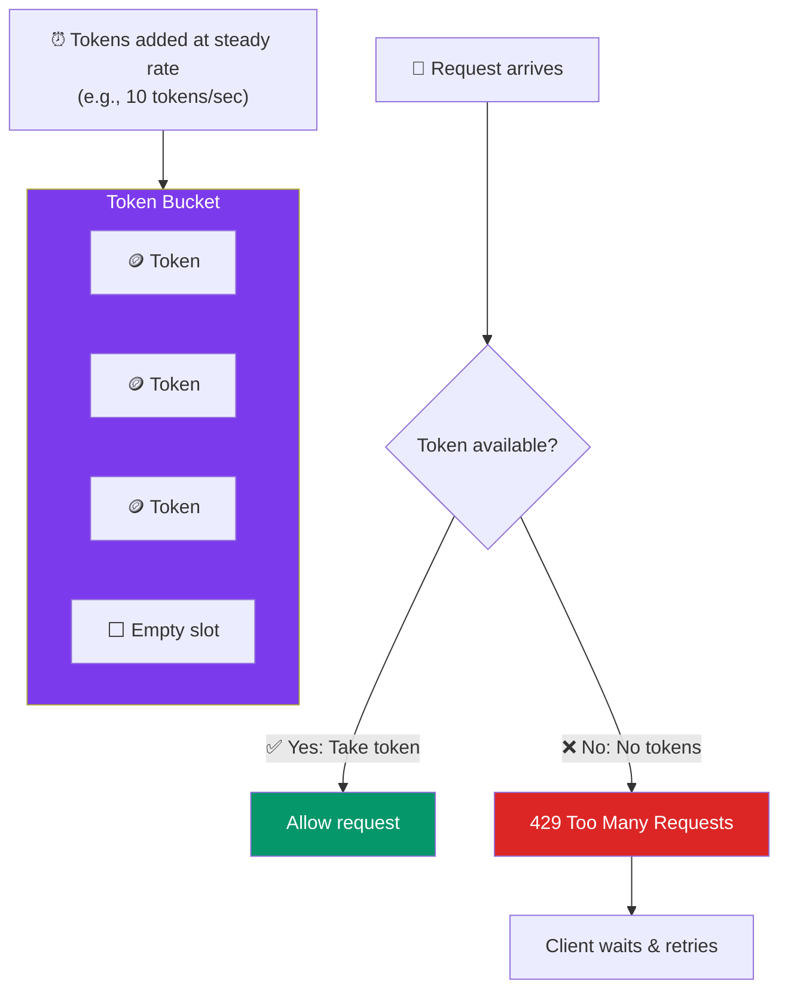

# Rate Limiting & Throttling

> **Rate limiting** controls how many requests a client can make in a time window. It protects your system from abuse, accidental spikes, and DDoS attacks.

---

## Visual: Token Bucket Algorithm



---

## Rate Limiting Algorithms

| Algorithm | How It Works | Pros | Cons |
|-----------|-------------|------|------|
| **Token Bucket** | Tokens added at fixed rate. Request consumes a token. | Handles bursts, simple | Can allow short-term over-limit |
| **Leaky Bucket** | Requests processed at fixed rate. Excess queues/discards. | Smooth output, predictable | No burst support |
| **Fixed Window** | Count requests per minute/hour. Reset counter. | Simple, memory efficient | Burst at window boundaries |
| **Sliding Window Log** | Track timestamps of recent requests. Count in window. | Accurate, no boundary burst | More memory per user |

---

## What to Rate Limit On

| Dimension | Example | Why |
|-----------|---------|-----|
| **User ID** | 100 requests/minute per user | Fair usage across users |
| **IP address** | 1000 requests/minute per IP | Protect against DDoS |
| **API endpoint** | 10 requests/second for `/search` | Protect expensive queries |
| **Global** | 100K requests/second total | Protect overall system capacity |

---

## HTTP Status Codes

| Code | Meaning | What to Do |
|:----:|---------|------------|
| **429** | Too Many Requests | Client should retry after `Retry-After` header |
| **429 + Retry-After: 60** | Retry in 60 seconds | Client MUST wait before retrying |

---

## Implementing Rate Limiting

```javascript
// Pseudocode: token bucket per user
function rateLimit(userId, requestCost = 1) {
  const bucket = redis.get(`ratelimit:${userId}`);

  if (!bucket) {
    // First request — create bucket with max tokens
    redis.set(`ratelimit:${userId}`, JSON.stringify({
      tokens: 10 - requestCost,
      lastRefill: Date.now()
    }), { ttl: 60 });
    return true; // allow
  }

  // Refill tokens based on elapsed time
  const elapsed = (Date.now() - bucket.lastRefill) / 1000;
  bucket.tokens = Math.min(10, bucket.tokens + elapsed * rate);

  if (bucket.tokens >= requestCost) {
    bucket.tokens -= requestCost;
    // Save updated bucket
    return true; // allow
  }

  return false; // rate limited (429)
}
```

---

## Trade-offs

- Rate limiting protects the system but can frustrate legitimate users if too strict.
- Token bucket is the most popular algorithm — handles bursts while enforcing average rate.
- Distributed rate limiting (across multiple servers) needs a shared store (Redis) and adds latency.
- Always return a `Retry-After` header so clients know when to retry.

---

## In Simple Words

- Rate limiting = saying "you're going too fast, slow down" to clients.
- Token bucket is the most common algorithm: tokens drip in, requests use them up.
- Return 429 with a Retry-After header when a client exceeds the limit.
