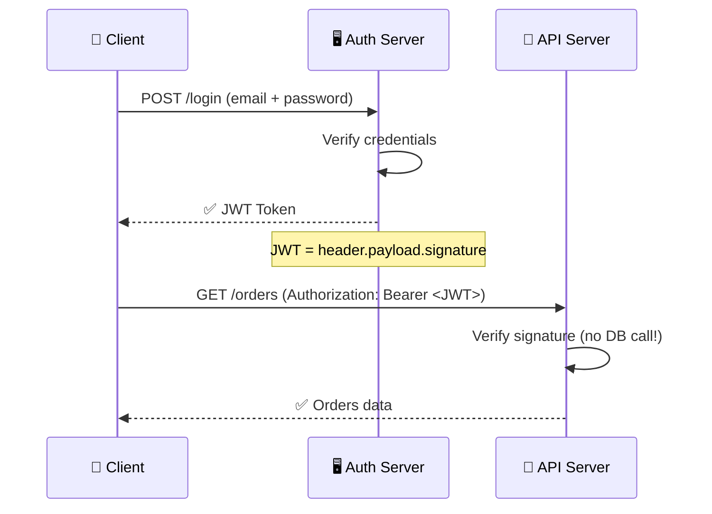
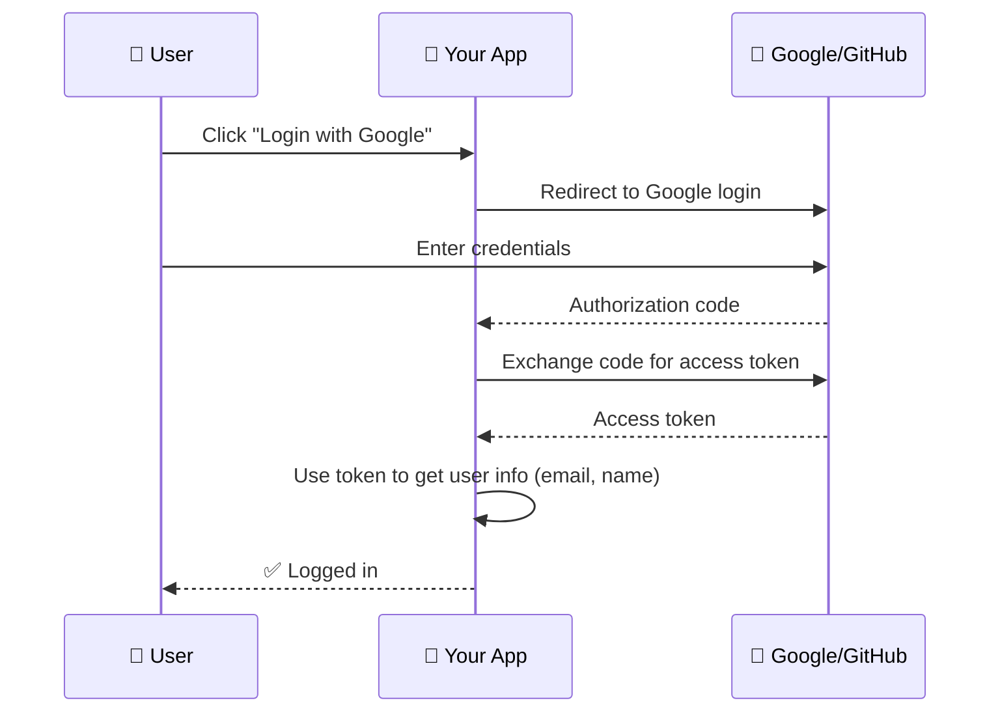

# Authentication & Authorization

> **Authentication** (AuthN) = who are you? **Authorization** (AuthZ) = what are you allowed to do?

---

## Authentication Methods

| Method | How It Works | Pros | Cons |
|--------|-------------|------|------|
| **Session-based** | Server stores session, client sends cookie | Simple, server controls sessions | Stateful, harder to scale |
| **JWT (JSON Web Token)** | Server signs a token, client stores it | Stateless, scales easily | Can't revoke tokens (until expiry) |
| **OAuth 2.0** | Third-party authorization (Google, GitHub) | No password management for you | Complex flow, depends on external provider |
| **SSO (SAML/OIDC)** | One login for multiple apps | Single sign-on across apps | Complex setup |

---

## JWT Flow



**JWT structure:** `header.base64(payload).signature`

```json
// JWT Payload (decoded)
{
  "sub": "user_123",
  "name": "Alice",
  "role": "admin",
  "iat": 1700000000,  // issued at
  "exp": 1700086400    // expires
}
```

---

## OAuth 2.0 Flow (Simplified)



---

## Authorization Models

| Model | How It Works | Example |
|-------|-------------|---------|
| **RBAC** (Role-Based) | Roles → permissions | Admin can delete, User can read |
| **ABAC** (Attribute-Based) | Rules based on attributes | "Managers can edit their department's budgets" |
| **ACL** (Access Control List) | Explicit list per resource | "User 123 can read file X" |

---

## Trade-offs

- **Session-based** is simpler but doesn't scale horizontally without a shared session store (Redis).
- **JWT** scales beautifully but can't be revoked — set short expiry times (15 min) and use refresh tokens.
- **OAuth 2.0** is the standard for third-party logins but adds flow complexity.
- Never roll your own auth — use proven libraries and providers.

---

## In Simple Words

- AuthN = proving who you are (login, password, biometrics).
- AuthZ = what you can do (read, write, delete).
- JWT is the most common API auth — the server signs a token, the client presents it.
- Use OAuth 2.0 for "Login with Google/GitHub."
