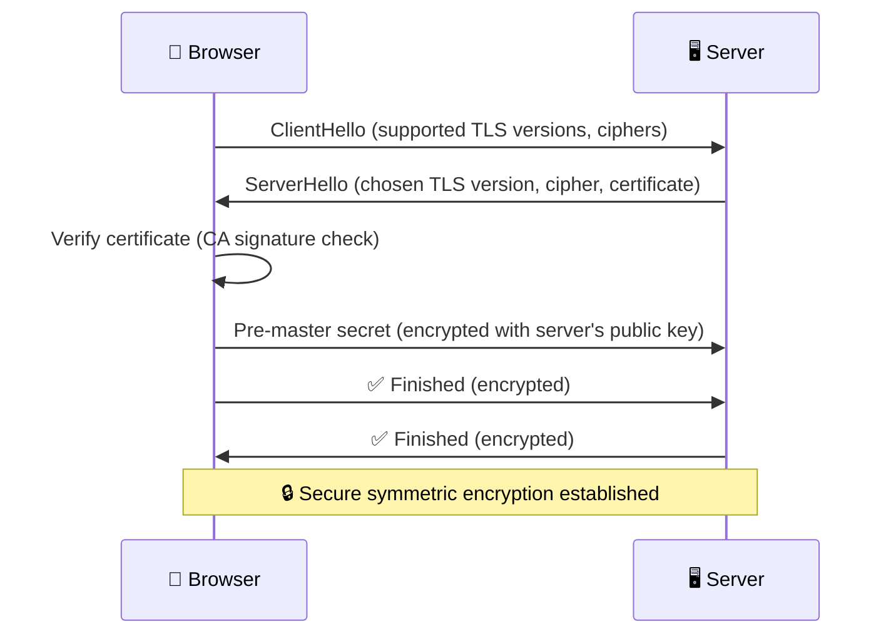
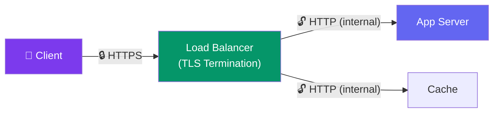

# Encryption & TLS

> **Encryption** scrambles data so only authorized parties can read it. **TLS** (Transport Layer Security) encrypts data in transit between client and server.

---

## Encryption at Rest vs In Transit

| Type | What It Protects | Examples |
|------|-----------------|----------|
| **In Transit** | Data moving over the network | HTTPS (TLS), VPN, SSH |
| **At Rest** | Data stored on disk | Database encryption, file encryption |

**Both are needed.** Encrypting the database doesn't help if someone intercepts the API response.

---

## TLS Handshake

**What TLS provides:**
- **Authentication** — you're talking to the real server (not an imposter)
- **Encryption** — no one can read the data in transit
- **Integrity** — data hasn't been tampered with

---

## HTTPS vs HTTP

| Aspect | HTTP | HTTPS |
|--------|:----:|:-----:|
| **Encryption** | None (plain text) | Full (TLS) |
| **Port** | 80 | 443 |
| **Performance** | Faster (no handshake) | Slightly slower (TLS overhead) |
| **SEO** | Penalized by Google | Preferred by Google |
| **Trust** | ❌ Anyone can intercept | ✅ Verified by CA |
| **Typical overhead** | — | ~5-10% CPU, one extra round trip |

---

## SSL/TLS Termination

In practice, you don't do TLS in your application code. You terminate TLS at a **reverse proxy** (Nginx, ELB, CloudFront):

---

## Trade-offs

- TLS adds CPU overhead (encryption) and one round trip (handshake).
- Use TLS termination at the load balancer — app servers get plain HTTP internally.
- Certificate management is operational overhead (use Let's Encrypt for free automated certs).
- Never send sensitive data (passwords, tokens) without TLS.

---

## In Simple Words

- Encryption at rest = data is scrambled on disk (database encryption).
- Encryption in transit = data is scrambled while traveling (HTTPS/TLS).
- TLS handshake verifies the server's identity and establishes encryption.
- Always use HTTPS. Terminate TLS at the load balancer, not the app server.
