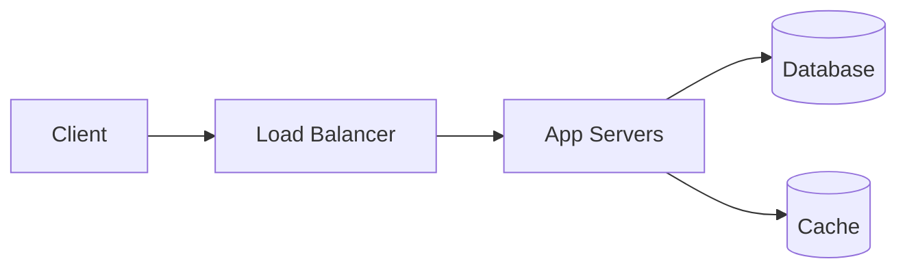

# The System Design Interview Framework

> Use this template for EVERY system design interview question. It shows the interviewer you have a structured approach.

---

## The Template

### 1. Requirements (2-3 min)

**Ask clarifying questions:**
- "What features are in scope?"
- "How many users? (DAU/MAU)"
- "Is this read-heavy or write-heavy?"
- "What are the latency requirements?"
- "Do we need real-time updates?"

> **Don't assume.** A URL shortener is very different from a video streaming service.

### 2. Estimation (2 min)

Quick back-of-the-envelope numbers:

| What to Estimate | Formula |
|-----------------|---------|
| QPS | DAU × actions/user / 86,400 |
| Peak QPS | Average × 5 |
| Storage | QPS × data per request × retention period |
| Bandwidth | QPS × response size |

### 3. API Design (2 min)

Write 2-4 main endpoints:

```json
POST /api/resource  →  { ... }
GET  /api/resource/:id  →  { ... }
```

### 4. Data Model (2 min)

Sketch the schema and choose storage type:

```sql
CREATE TABLE resource (id BIGINT PRIMARY KEY, ...);
-- or
// MongoDB document
```

**Reasoning:** "I'm using PostgreSQL because we need ACID... / MongoDB because the schema varies..."

### 5. High-Level Design (5 min)

Draw the block diagram:



**Explain the flow:** "A request comes from the client, hits the load balancer, which routes to an app server. The app server checks the cache first. On cache miss, it queries the database."

### 6. Deep Dive (10 min)

Pick 1-2 components and go deep. Common deep dives:

| Topic | What to Discuss |
|-------|----------------|
| **Database** | Sharding strategy, replication, read replicas |
| **Cache** | Cache-aside vs write-through, eviction policy, TTL |
| **Scaling** | Vertical vs horizontal, auto-scaling rules |
| **Consistency** | Strong vs eventual, how replicas sync |
| **Real-time** | WebSockets vs polling vs SSE |

### 7. Bottlenecks & Trade-offs (2 min)

Be honest:

- "The database is a single point of failure right now — we could add read replicas."
- "The cache improves reads by 10× but adds complexity for cache invalidation."
- "We chose eventual consistency for the feed — users might see stale data for a few seconds."
- "With more time, I'd design the sharding strategy more carefully."

---

## Do's and Don'ts

| ✅ DO | ❌ DON'T |
|------|----------|
| Start with requirements | Jump straight to a diagram |
| Explain your reasoning | Mumble through the answer |
| Discuss trade-offs | Claim your design is perfect |
| Admit what you don't know | Make up numbers |
| Use the whiteboard/diagram | Talk for 30 minutes without drawing |
| Keep the interviewer engaged | Treat it as a monologue |

---

## Sample Outline (URL Shortener)

```
1. Requirements: shorten URL, redirect, basic analytics
2. Estimation: 100M URLs/day → ~1,200 QPS, 10TB storage over 5 years
3. API: POST /shorten, GET /{code}
4. Data: { id, short_code, original_url, created_at } in SQL
5. Design: Client → LB → App → Cache → DB
6. Deep dive: base62 encoding for short codes, cache-aside for redirects
7. Bottlenecks: DB write load → could shard by short_code prefix
```

---

## In Simple Words

- Use the 7-step framework for every question: requirements → estimation → API → data → HLD → deep dive → bottlenecks.
- The interviewer wants to see your **thought process**, not a perfect design.
- Admit trade-offs and discuss alternatives — that's what senior engineers do.
