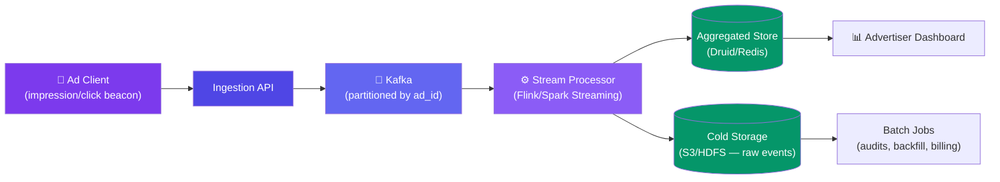

# Case Study: Design an Ad Click Aggregation System

> An ad click aggregation system ingests millions of click/impression events per second and rolls them up into per-ad, per-time-window counters for near-real-time advertiser dashboards and billing.

---

## Requirements

**Functional:**
- Ingest ad click and impression events at massive scale (millions/sec at peak)
- Aggregate counts per ad, per advertiser, per time window (last minute / hour / day)
- Filter/flag duplicate and fraudulent clicks (bots, click farms, double-clicks)
- Serve near-real-time dashboards to advertisers (clicks, CTR, spend so far today)
- Support historical/ad-hoc queries over raw events (audits, disputes, backfills)

**Non-functional:**
- High throughput ingestion (millions of events/sec), horizontally scalable
- Near-real-time dashboard freshness (seconds, not minutes)
- Exactly-once (or effectively-once) counting for billing — money is on the line
- Fault-tolerant: no data loss on stream processor/broker failure
- Reprocessable: aggregation logic changes shouldn't require re-deriving from scratch by hand

---

## Estimation

| Metric | Value |
|--------|-------|
| Peak ad impressions/sec | 1,000,000 |
| Click-through rate | 1% |
| Peak clicks/sec | 10,000 |
| Impression event size | ~200 bytes (ad_id, user_id, ts, geo, device) |
| Raw ingest bandwidth (impressions) | 1M × 200B = **200 MB/sec** |
| Raw events/day | 1M/sec × 86,400s ≈ 86.4B impressions/day |
| Raw storage/day (impressions, uncompressed) | 86.4B × 200B ≈ **17 TB/day** |
| Raw storage, 30 days (cold storage, compressed ~5x) | ~17 TB × 30 / 5 ≈ **100 TB** |
| Pre-aggregated rollups (per ad, per minute) | ~1M active ads × 1440 min/day × 50 bytes ≈ **72 GB/day** |
| Rollup storage, 30 days | ~2 TB (fits comfortably in an OLAP store) |

Takeaway: raw events are 100-1000x bigger than rollups — never query raw events for a live dashboard, always query pre-aggregated data.

---

## High-Level Design



The split matters: **hot path** (Kafka → Stream Processor → Aggregated Store) feeds dashboards in seconds. **Cold path** (raw events in S3/HDFS) is the source of truth for billing, audits, and reprocessing.

---

## Deep Dive: Streaming Aggregation with Windows

Events are partitioned by `ad_id` in Kafka so all events for one ad land on the same partition and can be aggregated in order. The stream processor maintains **tumbling windows** (non-overlapping, e.g., 1-minute buckets) for dashboards and **sliding windows** (e.g., "clicks in last hour," recomputed every minute) for rolling metrics.

```javascript
// Pseudo-code: Flink-style windowed aggregation
stream
  .keyBy(event => event.ad_id)
  .window(TumblingEventTimeWindows.of(Time.minutes(1)))
  .aggregate(new ClickCountAggregator())
  .addSink(writeToAggregatedStore);

class ClickCountAggregator {
  createAccumulator() { return { clicks: 0, impressions: 0 }; }
  add(event, acc) {
    if (event.type === 'click') acc.clicks++;
    else acc.impressions++;
    return acc;
  }
  getResult(acc) { return acc; } // flushed to store per window close
}
```

| Window type | Use case | Trade-off |
|---|---|---|
| Tumbling (1 min) | Dashboard "clicks this minute" | Simple, but resets every window |
| Sliding (1 hr, slide 1 min) | "Rolling last-hour CTR" | More compute — overlapping windows recomputed often |
| Session | Per-user click session analysis | Variable length, harder to size |

---

## Deep Dive: Approximate Counting at Scale

Exact counting (e.g., a `HashSet<user_id>` per ad to count unique clickers) doesn't scale — a viral ad could have tens of millions of unique users, and holding that set in memory per ad, per window, is untenable.

**HyperLogLog (HLL)** — approximate distinct count with fixed memory (~12 KB) regardless of cardinality, ~2% standard error. Used for "unique users who clicked this ad."

**Count-Min Sketch (CMS)** — approximate frequency count in a fixed-size 2D array of counters, used for "how many times has this (ad_id, user_id) pair clicked" to catch high-frequency clickers.

| Approach | Memory | Accuracy | Use case |
|---|---|---|---|
| Exact `HashSet`/counter map | O(n) — unbounded | 100% | Small cardinality only (billing-critical exact totals) |
| HyperLogLog | ~12 KB, fixed | ~2% error | Unique clicks/impressions per ad at scale |
| Count-Min Sketch | Fixed (width × depth) | Slight over-count, tunable via width | Click frequency per user, hot-key/fraud detection |

Rule of thumb: use approximate structures for **dashboards** (advertisers don't need the 47,382nd decimal of precision in real time), but reconcile against **exact counts from the cold-storage batch job** for **billing**.

---

## Deep Dive: Late Events, Watermarks & Dedup

Mobile clients retry on flaky networks, so click events can arrive late or out of order relative to their `event_time`. The stream processor uses **watermarks** — a heuristic for "we don't expect events older than time T anymore" — to decide when a window can be closed and flushed, while still allowing a grace period for stragglers.

```
watermark = max_event_time_seen - allowed_lateness   // e.g., allowed_lateness = 2 min

on event arrival:
  if event.event_time < watermark:
      route to "late events" side-output → reprocessed in next batch merge
  else:
      assign to correct window, update aggregate
```

**Fraud/duplicate dedup:** every click carries an `idempotency_key` (click_id) generated client-side. A short-lived dedup cache (Redis, TTL = few minutes, keyed by `idempotency_key` or `hash(ad_id, user_id, ts_bucket)`) rejects replays before they hit the aggregator.

```javascript
async function isDuplicate(clickId) {
  // SETNX returns false if key already exists = duplicate
  const isNew = await redis.set(`click:${clickId}`, 1, { NX: true, EX: 300 });
  return !isNew;
}
```

Beyond exact-duplicate dedup, a separate fraud-scoring stage flags **patterns**: too many clicks from one IP/device in a short window, clicks with no matching impression, click timing distributions that look bot-like (sub-100ms after impression, repeated at fixed intervals).

---

## Bottlenecks & Trade-offs

| Bottleneck | Solution |
|---|---|
| **Hot ad skews one Kafka partition** | Salt the partition key (`ad_id + random_shard`), aggregate shards downstream |
| **Exact vs. approximate counting** | Approximate (HLL/CMS) for dashboards; exact batch recompute from raw log for billing |
| **Aggregation bug found after the fact** | Replay raw events from Kafka/cold storage (lambda architecture) — never mutate rollups by hand |
| **Late/out-of-order events** | Watermarks + bounded allowed-lateness window, side-output stragglers into a correction batch |
| **Duplicate/fraudulent clicks** | Idempotency key + short-TTL dedup cache, plus offline fraud-scoring pipeline |
| **Stream processor failure mid-window** | Checkpointing (Flink state snapshots) + exactly-once sink semantics |

---

## Follow-up Questions

**Q: You find a bug in the aggregation logic after it's been running for a week — how do you fix historical numbers?**
Replay raw events from Kafka (if retention covers it) or cold storage (S3/HDFS) through the corrected job, writing to a new rollup table, then cut dashboards over. This is the batch layer of a **lambda architecture** — raw events are the immutable source of truth, so rollups can always be regenerated.

**Q: How do you keep dashboards near-real-time but still have exact numbers for billing?**
Two paths from the same raw stream: a **speed layer** (stream processor, approximate/best-effort, seconds of latency) feeds dashboards, and a **batch layer** (nightly/hourly job over cold storage, exact counts) is the source of truth for invoices. Advertisers see fast-but-approximate numbers intraday; the final bill reconciles against the exact batch count.

**Q: How would you detect click fraud, like bot traffic or click farms?**
Look for signal combinations: abnormally high click velocity per IP/device/user, clicks with no corresponding impression, near-identical timing deltas (bot scripts fire at fixed intervals), CTR far outside an ad's historical baseline, and known-bad IP/device fingerprint lists. Score and flag rather than hard-block in the streaming path — hard blocking happens after a scoring model runs asynchronously.

**Q: Why partition Kafka by ad_id instead of user_id or randomly?**
Aggregation is per-ad, so keeping all events for an ad on one partition means the stream processor can aggregate without a shuffle/join across partitions. The trade-off is partition skew for viral ads — mitigated by sub-partitioning (salting) a hot ad's key and merging shard-level partials downstream.

**Q: Where do impressions live vs. clicks, and why track both?**
Both flow through the same pipeline; impressions are needed to compute CTR (clicks/impressions) and to fraud-check clicks with no matching impression. Impression volume is ~100x click volume, so impressions dominate ingestion bandwidth even though clicks dominate business value.

**Q: Would you use Redis or an OLAP store (like Druid) for the aggregated layer?**
Redis is great for simple counters with sub-millisecond reads (current-minute counts). Druid/ClickHouse is better once advertisers need slice-and-dice queries (by geo, device, campaign, time range) over rollups — it's built for exactly that OLAP access pattern at scale.

---

## In Simple Words

- Split the pipeline into a fast, approximate path for dashboards and a slow, exact path for billing — don't force one system to do both jobs well.
- HyperLogLog and Count-Min Sketch trade a small, bounded memory footprint for a small, bounded error — the only way unique/frequency counts scale to millions of ads.
- Raw events in cold storage are the source of truth; rollups are disposable and always regenerable by replaying the log.
- Watermarks and idempotency keys are how you handle the two ugly realities of real-world clients: events arrive late, and events arrive twice.
