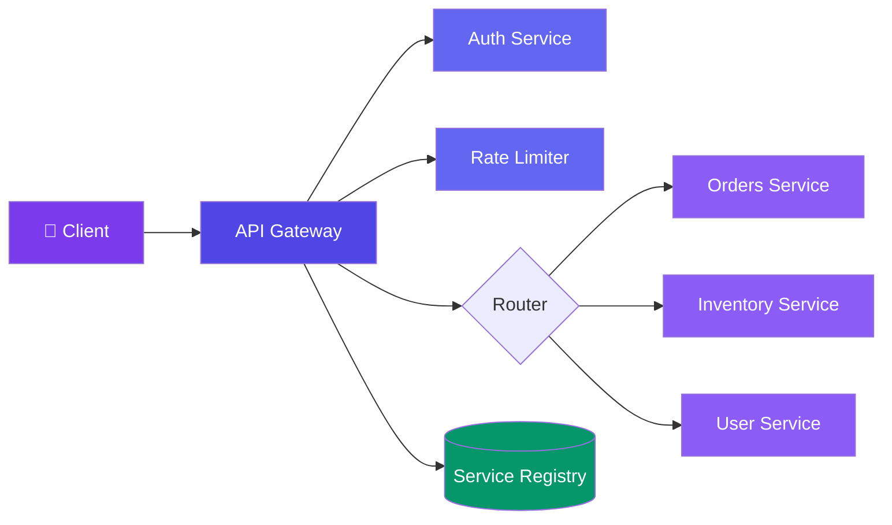
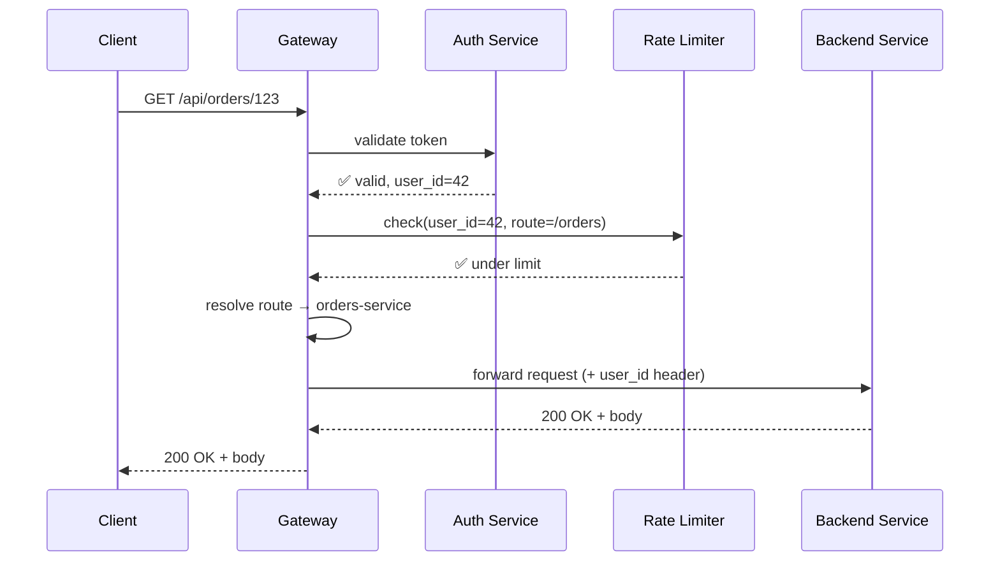
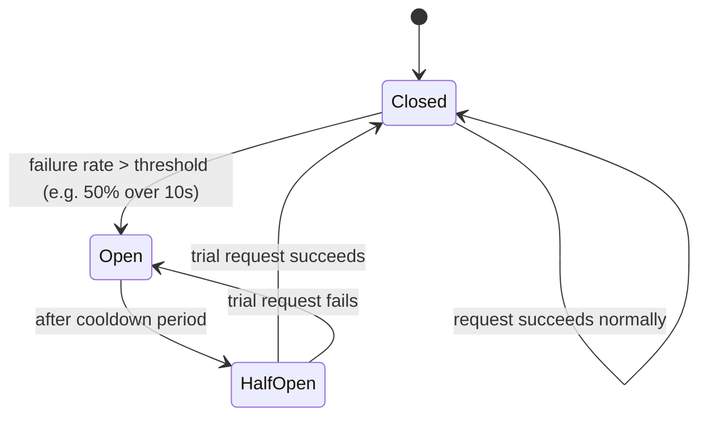

# Case Study: Design an API Gateway

> Not the token-bucket algorithm itself (see [Design a Rate Limiter](/system-design/11-case-studies/design-rate-limiter/) for that) — this is the edge layer that sits in front of a microservices fleet and owns routing, auth, request aggregation, and failure isolation, with rate limiting as just one of several concerns it composes.

---

## Requirements

**Functional:**
- Route each incoming request to the correct backend microservice by path/host
- Authenticate/authorize every request once, at the edge — services don't re-implement auth
- Aggregate multiple backend calls into one client-facing response (BFF-style composition)
- Apply per-route rate limits, request/response transformation, and API versioning

**Non-functional:**
- Gateway must not become a bigger single point of failure than the services behind it
- Adds minimal latency overhead (single-digit ms) on top of backend response time
- One misbehaving downstream service must not degrade requests to unrelated services
- Handle 100K+ RPS at the edge

---

## High-Level Design



Every request passes through the same pipeline stages — auth, then rate limit, then route — regardless of which backend it ultimately reaches. That uniformity is the point: services behind the gateway don't each re-implement auth or limiting.

---

## Deep Dive: Request Pipeline (Middleware Chain)

The gateway processes a request through an ordered chain of concerns. Each stage can short-circuit (reject early) before the request ever reaches a backend service.



```javascript
// Gateway middleware chain — each stage can short-circuit the request
const pipeline = [authenticate, rateLimit, route, forward];

async function handleRequest(req) {
  for (const stage of pipeline) {
    const result = await stage(req);
    if (result.shortCircuit) {
      return result.response; // e.g. 401, 429 — never reaches a backend
    }
    req = result.req; // stage may enrich req (e.g. attach user_id)
  }
}
```

Auth runs before rate limiting so that limits can be applied **per authenticated user**, not just per IP — an important ordering choice, not an arbitrary one.

---

## Deep Dive: Request Aggregation (Backend-for-Frontend)

A mobile client's "product page" often needs data from 3+ services (product info, inventory, reviews). Making the client fire three separate requests wastes round trips on a slow mobile network. The gateway composes them into one call.

```javascript
// Gateway-side aggregation endpoint
async function getProductPage(req) {
  const productId = req.params.id;

  // Fan out to backends in parallel — not sequential
  const [product, inventory, reviews] = await Promise.all([
    productService.get(productId),
    inventoryService.getStock(productId),
    reviewService.getSummary(productId),
  ]);

  return {
    ...product,
    inStock: inventory.quantity > 0,
    rating: reviews.averageRating,
    reviewCount: reviews.count,
  };
}
```

This trades one thing for another: the client gets one round trip instead of three, but the gateway now has a dependency on three services succeeding for one logical request — which is exactly what the next section's circuit breaker exists to contain.

---

## Deep Dive: Circuit Breaking (Failure Isolation)

If the reviews service is down or slow, a naive aggregation endpoint hangs waiting on it — and if this repeats across every request, the gateway's own thread/connection pool exhausts, taking down routes to *healthy* services too. A **circuit breaker** per downstream dependency stops this from cascading.



```javascript
class CircuitBreaker {
  constructor(failureThreshold = 0.5, cooldownMs = 10000) {
    this.state = "CLOSED";
    this.failures = 0;
    this.requests = 0;
  }

  async call(fn, fallback) {
    if (this.state === "OPEN") {
      if (Date.now() < this.openedAt + this.cooldownMs) {
        return fallback(); // fail fast — don't even try the dependency
      }
      this.state = "HALF_OPEN";
    }

    try {
      const result = await fn();
      if (this.state === "HALF_OPEN") this.state = "CLOSED";
      this.requests = 0; this.failures = 0;
      return result;
    } catch (e) {
      this.failures++; this.requests++;
      if (this.failures / this.requests > this.failureThreshold) {
        this.state = "OPEN";
        this.openedAt = Date.now();
      }
      return fallback();
    }
  }
}

// Usage in the aggregation endpoint above
const reviews = await reviewsCircuit.call(
  () => reviewService.getSummary(productId),
  () => ({ averageRating: null, count: 0 }) // graceful degradation, not a hang
);
```

With the breaker wrapping the reviews call, a dead reviews service degrades the product page (missing rating) instead of hanging the whole request — and stops retrying a dead service on every single request during the cooldown, giving it room to recover.

---

## Bottlenecks & Trade-offs

| Bottleneck | Solution |
|-----------|----------|
| **Gateway itself becomes the single point of failure for everything** | Run it as a horizontally-scaled, stateless fleet behind a load balancer — never a single instance |
| **One slow downstream service exhausts the gateway's connection pool** | Circuit breaker per dependency + bounded timeouts per call, isolated thread/connection pools per downstream |
| **Aggregation endpoint's latency is bounded by its slowest dependency** | Parallel fan-out (`Promise.all`) instead of sequential calls, plus a fallback default for non-critical fields |
| **Auth service becomes a hard dependency for every single request** | Cache validated tokens briefly at the gateway (short TTL) so a momentary auth-service blip doesn't reject all traffic |
| **Gateway config (routes, rate limits) changing requires a redeploy** | Externalize routing/rate-limit config to a dynamic store (service registry / config service) the gateway polls or subscribes to |

---

## Follow-up Questions

**Q: Why put rate limiting at the gateway instead of inside each individual service?**
Centralizing it means every service gets consistent protection without re-implementing the token-bucket logic per team/language, and the gateway can apply limits *before* a request even reaches a backend — a service-level limiter still burns backend CPU/connections evaluating and rejecting the request.

**Q: If the gateway aggregates three backend calls into one response, what status code do you return if two succeed and one fails?**
Depends on whether the failed field is critical — for a non-critical field like review summary, degrade gracefully and return 200 with a fallback value (as the circuit breaker example does); for a genuinely required field (e.g. the core product data itself), the whole request should fail since a product page with no product data isn't a valid partial response.

**Q: How is a circuit breaker different from just setting a short timeout on each call?**
A timeout bounds a single call's latency but still retries the dead dependency on every subsequent request, wasting resources and adding load exactly when the dependency needs breathing room to recover; the breaker remembers recent failure history and stops calling entirely during the open state, checking recovery with just one trial request instead of the full traffic volume.

**Q: Doesn't putting auth at the gateway mean a compromised or buggy gateway can impersonate any user to backend services?**
Yes — this is why the gateway should forward a signed, short-lived internal token/claim (not just a raw trusted header) that backend services can independently verify, rather than backend services blindly trusting an unauthenticated internal header just because "it came from the gateway."

**Q: How do you roll out a new backend service version without breaking the gateway's existing routes?**
Version at the route level (`/v2/orders`) or via a header, and keep the gateway routing both versions to their respective service deployments simultaneously during the migration window — the gateway's router config, not the backend service itself, is what decides which clients see the new version.

---

## In Simple Words

- The gateway is a single, uniform entry point that owns routing, auth, rate limiting, and aggregation — so backend services don't each reinvent them.
- Request aggregation trades client round trips for a gateway dependency on multiple backends succeeding — which is exactly why it needs circuit breakers, not despite it.
- A circuit breaker stops retrying a dead dependency on every request; it fails fast during the cooldown instead of piling up hung connections.
- The gateway must scale horizontally and stay stateless itself — otherwise you've just moved the single point of failure one hop earlier.
