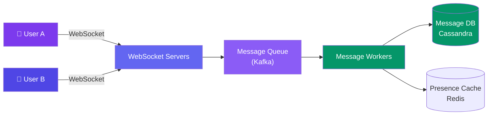
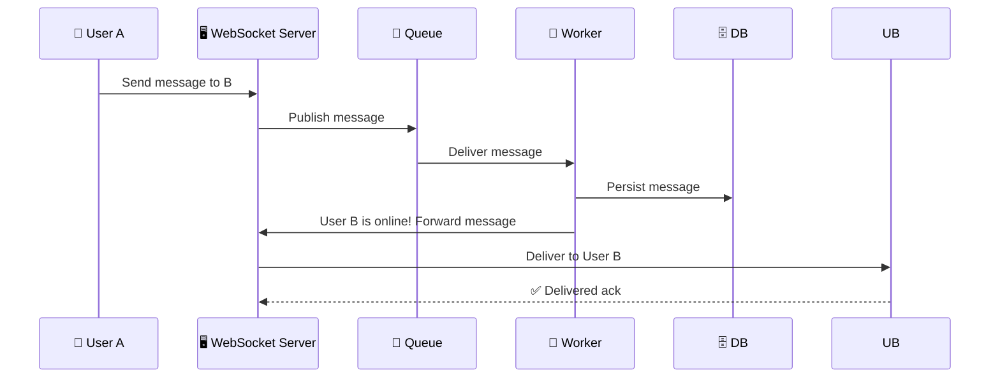

# Case Study: Design a Chat System

> A chat system like WhatsApp or Messenger allows users to send and receive messages in real-time.

---

## Requirements

**Functional:**
- Send a message to another user
- Receive messages in real-time
- Online/offline presence
- Message history
- Group chats

**Non-functional:**
- Messages delivered in <100ms
- No message loss (at-least-once delivery)
- Support 500M users
- Messages persisted for history

---

## Estimation

| Metric | Value |
|--------|-------|
| Active users | 500M |
| Messages/user/day | 50 (25B messages/day, ~290K QPS) |
| Message size | ~1 KB (text) |
| Storage (1 year) | 25B × 1KB × 365 = **~9 PB** |
| Storage per user | ~50 messages/day × 1KB × 365 = **~18 MB/year** |

---

## API Design

**WebSocket connection for real-time:**
```
Connect: ws://chat.example.com
Send: { "type": "message", "to": "user_456", "text": "Hey!", "message_id": "msg_789" }
Receive: { "type": "message", "from": "user_456", "text": "Hello!", "timestamp": "..." }
```

---

## High-Level Design



---

## Deep Dive: Message Flow



**Offline delivery:**
- If User B is offline, the message is stored in DB
- When User B connects, they pull unread messages since their last `last_read_message_id`
- Push notification (APNS/FCM) alerts the user

---

## Deep Dive: Message Ordering

Use a **sequence number** per conversation:

```javascript
// Each conversation has an incrementing sequence number
key = `conversation:${conversationId}:seq`
seq = redis.incr(key) // atomic increment

message = { seq, from, text, timestamp }
```

Messages within a conversation are sorted by `seq` — simple, total order.

---

## Data Model

```sql
-- Cassandra (write-optimized)
CREATE TABLE messages (
  conversation_id TEXT,
  message_id TIMEUUID,  -- time-based UUID for ordering
  from_user TEXT,
  text TEXT,
  timestamp TIMESTAMP,
  PRIMARY KEY (conversation_id, message_id)
) WITH CLUSTERING ORDER BY (message_id ASC);
```

**Why Cassandra?** High write throughput, no joins needed (just `WHERE conversation_id = X`).

---

## Bottlenecks & Trade-offs

| Bottleneck | Solution |
|-----------|----------|
| **WebSocket server memory** | Each connection uses memory. Scale horizontally with sticky sessions |
| **Message ordering** | Sequence numbers per conversation via Redis |
| **No message loss guarantee** | At-least-once delivery + deduplication on client side |
| **Group chats** | Fan-out on write for small groups, fan-out on read for large groups |
| **Media sharing** | Upload to CDN, send CDN URL in the message |

---

## Follow-up Questions

**Q: In a group chat, how do you guarantee message ordering when different senders connect to different WebSocket servers?**
The per-conversation `redis.incr` sequence number is the source of truth, not arrival order at any given WebSocket server — every message gets its sequence assigned centrally (via the queue/worker path) before persistence, so clients render by `seq`, not by receipt time, even if two members' messages hit different servers milliseconds apart.

**Q: A user reconnects after being offline for a month with 10,000 unread messages — how do you sync without hammering the DB or overwhelming the client?**
Don't push all 10,000 at once — return the latest N (e.g., last 50) immediately for a responsive UI, plus a total unread count, then let the client paginate backward through history using `last_read_message_id` as a cursor against Cassandra's clustered `(conversation_id, message_id)` index, which is efficient for range scans.

**Q: How do you scale read receipts in large group chats without a write-amplification explosion (every read by every member notifying everyone else)?**
Per-message-per-member receipts are O(n²) in a large group. Instead, track only a per-user "last read message_id" per conversation (one row updated, not one write per message), batch/debounce receipt broadcasts (e.g., every few seconds instead of per-message), and skip granular read receipts entirely above some group size threshold, falling back to a simple "seen by N" count.

**Q: If a WebSocket server crashes mid-session, how do users avoid losing messages sent during the failover window?**
Because delivery already goes through the Kafka queue and is persisted before being forwarded to the recipient's WebSocket connection, a crashed WS server just means the client reconnects (to a different server via the load balancer) and replays anything with a `seq` greater than their last-acknowledged one — persistence-before-delivery is what makes this safe.

**Q: How would you add end-to-end encryption without breaking server-side features like search and push notification previews?**
E2E encryption means the server can only route encrypted blobs, so message search has to move client-side (index on-device) or be dropped, and push notifications can only show generic ("New message") previews instead of the text itself — this is a real trade-off between the "no message loss + persisted history" requirement and encryption, since the server-side DB now stores ciphertext it can't inspect for the deduplication or ordering logic beyond the sequence number.

---

## In Simple Words

- Chat = persistent WebSocket connections for real-time delivery + database for history.
- Use a message queue (Kafka) to decouple WebSocket servers from storage.
- Order messages by sequence numbers per conversation. Store in a write-optimized DB (Cassandra).
- At-least-once delivery + client-side dedup = no lost messages.
