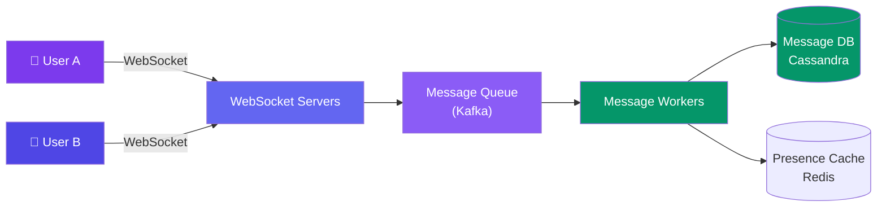
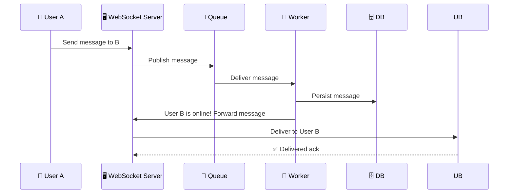

# Case Study: Design a Chat System

> A chat system like WhatsApp or Messenger allows users to send and receive messages in real-time.

---

## Requirements

**Functional:**
- Send a message to another user
- Receive messages in real-time
- Online/offline presence
- Message history
- Group chats

**Non-functional:**
- Messages delivered in <100ms
- No message loss (at-least-once delivery)
- Support 500M users
- Messages persisted for history

---

## Estimation

| Metric | Value |
|--------|-------|
| Active users | 500M |
| Messages/user/day | 50 (25B messages/day, ~290K QPS) |
| Message size | ~1 KB (text) |
| Storage (1 year) | 25B × 1KB × 365 = **~9 PB** |
| Storage per user | ~50 messages/day × 1KB × 365 = **~18 MB/year** |

---

## API Design

**WebSocket connection for real-time:**
```
Connect: ws://chat.example.com
Send: { "type": "message", "to": "user_456", "text": "Hey!", "message_id": "msg_789" }
Receive: { "type": "message", "from": "user_456", "text": "Hello!", "timestamp": "..." }
```

---

## High-Level Design



---

## Deep Dive: Message Flow



**Offline delivery:**
- If User B is offline, the message is stored in DB
- When User B connects, they pull unread messages since their last `last_read_message_id`
- Push notification (APNS/FCM) alerts the user

---

## Deep Dive: Message Ordering

Use a **sequence number** per conversation:

```javascript
// Each conversation has an incrementing sequence number
key = `conversation:${conversationId}:seq`
seq = redis.incr(key) // atomic increment

message = { seq, from, text, timestamp }
```

Messages within a conversation are sorted by `seq` — simple, total order.

---

## Data Model

```sql
-- Cassandra (write-optimized)
CREATE TABLE messages (
  conversation_id TEXT,
  message_id TIMEUUID,  -- time-based UUID for ordering
  from_user TEXT,
  text TEXT,
  timestamp TIMESTAMP,
  PRIMARY KEY (conversation_id, message_id)
) WITH CLUSTERING ORDER BY (message_id ASC);
```

**Why Cassandra?** High write throughput, no joins needed (just `WHERE conversation_id = X`).

---

## Bottlenecks & Trade-offs

| Bottleneck | Solution |
|-----------|----------|
| **WebSocket server memory** | Each connection uses memory. Scale horizontally with sticky sessions |
| **Message ordering** | Sequence numbers per conversation via Redis |
| **No message loss guarantee** | At-least-once delivery + deduplication on client side |
| **Group chats** | Fan-out on write for small groups, fan-out on read for large groups |
| **Media sharing** | Upload to CDN, send CDN URL in the message |

---

## In Simple Words

- Chat = persistent WebSocket connections for real-time delivery + database for history.
- Use a message queue (Kafka) to decouple WebSocket servers from storage.
- Order messages by sequence numbers per conversation. Store in a write-optimized DB (Cassandra).
- At-least-once delivery + client-side dedup = no lost messages.
