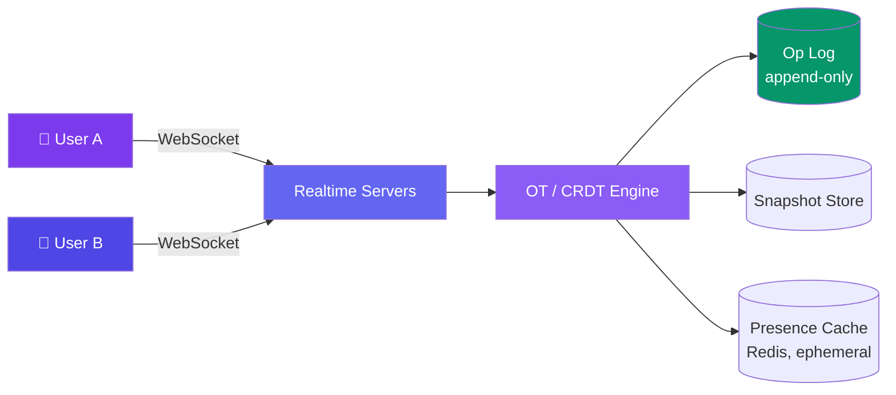
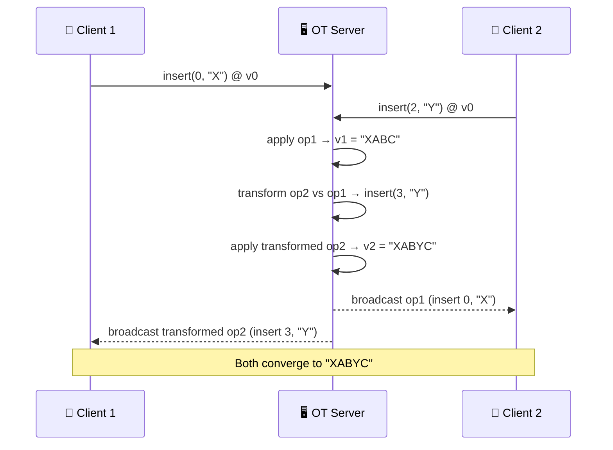

# Case Study: Design a Collaborative Document Editor

> A collaborative editor like Google Docs lets multiple users edit the same document at the same time, with every edit converging to the same final text for everyone.

---

## Requirements

**Functional:**
- Multiple users edit the same document simultaneously
- Changes appear for all editors in near real-time
- No lost edits, even under concurrent writes
- Offline edits sync automatically when the user reconnects
- Show live cursors and presence of other editors

**Non-functional:**
- Edits propagate in <200ms to other active editors
- Eventual consistency — all replicas converge to the identical document
- Support documents with 10K+ historical edit operations without slowing down
- Scale to thousands of documents with dozens of concurrent editors each

---

## Estimation

| Metric | Value |
|--------|-------|
| Concurrent editors/doc | 1-50 (avg ~3) |
| Edit ops/user/minute | ~20 (keystrokes batched) |
| Op size | ~100 bytes (position + content + metadata) |
| Active documents | 10M |
| Ops/sec (system-wide) | 10M × 3 editors × 20/60 ≈ **10K ops/sec** |
| Doc history storage | 10K ops × 100 bytes = **~1 MB/doc** before compaction |

---

## High-Level Design



Every keystroke becomes an **operation** (insert/delete at a position), not a raw text diff. Operations flow through a central server, get transformed or merged against concurrent ops, then broadcast to all connected clients over the same WebSocket transport used in a chat system.

---

## Deep Dive: Operational Transformation (OT)

**Core idea:** when two users edit concurrently, each op is generated against a document state the *other* user hasn't seen yet. Before applying a remote op locally, **transform** it against every op that happened concurrently, adjusting its position so the intent is preserved and both clients converge to the same text.

**Example:** Document = `"ABC"`. User 1 and User 2 both start from this state.
- User 1 inserts `"X"` at position 0 → `op1 = insert(0, "X")` → intends `"XABC"`
- User 2 inserts `"Y"` at position 2 → `op2 = insert(2, "Y")` → intends `"ABYC"`

Both ops hit the server concurrently, based on the same original version. Applied naively in arrival order, the two clients would diverge. The server transforms one against the other:

```javascript
// transform(opA, opB) adjusts opA so it applies correctly
// AFTER opB has already been applied
function transformInsert(opA, opB) {
  if (opB.pos <= opA.pos ||
     (opB.pos === opA.pos && opB.siteId < opA.siteId)) {
    // opB's insert shifted the document — bump opA's position
    return { ...opA, pos: opA.pos + opB.text.length };
  }
  return opA; // no shift needed
}

// Server has already applied op1 = insert(0, "X")
// Now transform op2 = insert(2, "Y") against it
op2_prime = transformInsert(op2, op1); // → insert(3, "Y")
```

Server applies `op1` then `op2_prime`: `"ABC"` → `"XABC"` → `"XABYC"`.
It sends `op1` to User 2 (transformed against nothing new) and `op2_prime` to User 1. Both clients end up with `"XABYC"` — same result, no manual merge.



**Why a central server?** Transform functions must be applied in a consistent order to guarantee convergence. A single authoritative server (or a designated leader) makes that ordering trivial — this is what Google Docs uses in production.

---

## Deep Dive: CRDTs as the Alternative

A **CRDT** (Conflict-free Replicated Data Type) — e.g. RGA (Replicated Growable Array) or Logoot — assigns every character a globally unique, immutably-ordered ID (often `(position-fraction, siteId, counter)`) when it's inserted. Because IDs are comparable and never reused, any two replicas can merge their operations **in any order** and still reach the same result — no transform step, no central authority required.

```javascript
// Each character carries a unique, totally-ordered ID
{ id: [betweenFractionalPos, siteId, counter], char: "X", tombstone: false }

// Insert = generate an ID that sorts between its neighbors, broadcast it
// Delete = mark tombstone: true instead of physically removing (so
//          concurrent ops referencing that ID still resolve)
// Merge = union of all known ops, sorted by ID — deterministic, commutative
```

Because merging is just "union + sort by ID," CRDTs merge peer-to-peer — useful for offline-first apps that reconnect and merge without ever talking to a server in real time.

| | OT (Operational Transformation) | CRDT (e.g. RGA/Logoot) |
|---|---|---|
| **Topology** | Needs a central server to order & transform ops | Works fully peer-to-peer, no authority needed |
| **Offline support** | Harder — needs transform against a long queue on reconnect | Natural fit — just merge op sets, any order |
| **Metadata overhead** | Low — no per-character IDs | Grows over time (unique ID + tombstone per char) |
| **Complexity** | Transform functions are notoriously easy to get subtly wrong | Simpler merge logic, but larger data structures |
| **Used by** | Google Docs | Figma, Notion-style local-first tools |

---

## Deep Dive: Live Cursors & Presence

Cursor positions and "who's online" are **ephemeral** — never persisted, never part of the document's durable history. They're broadcast over the same WebSocket channel as edits, but on a separate lightweight message type so they don't pollute the op log.

```javascript
// Broadcast on every cursor move / selection change — not persisted
{
  type: "presence",
  userId: "u_42",
  color: "#7c3aed",
  cursor: { line: 12, col: 8 },
  selection: { from: { line: 12, col: 8 }, to: { line: 12, col: 20 } },
  ts: 1690000000000
}
```

Presence updates are throttled client-side (e.g. every 50-100ms) and stored in Redis with a short TTL keyed by `document_id:user_id` — if a heartbeat stops, the presence cache expires and other clients see the user go offline automatically.

---

## Bottlenecks & Trade-offs

| Bottleneck | Solution |
|-----------|----------|
| **Long edit history slows load** | Periodic snapshots of full document state; replay only ops since the last snapshot |
| **CRDT metadata/tombstone bloat** | Background garbage collection once all sites have acknowledged a tombstone is safe to purge |
| **Offline reconnect with a backlog** | Client resyncs from its last known version, server transforms/merges the whole batch in one pass, not op-by-op |
| **Central OT server as single point of failure** | Shard by document ID; replicate the op log; promote a standby on failure |
| **High-frequency cursor broadcasts** | Throttle/debounce on the client, use ephemeral pub/sub (not the durable op log) |

---

## Follow-up Questions

**Q: How do you handle a user who was offline for a day and comes back with local edits?**
Their client buffered ops locally against the document version it last saw. On reconnect it sends that whole batch tagged with the base version; the server transforms (OT) or merges (CRDT) the entire batch against everything that happened since, then returns the resulting state and broadcasts the now-transformed ops to everyone else.

**Q: How do you keep it fast for a document with 10,000 edit operations in its history?**
Don't replay the full op log on every load. Periodically write a full-document **snapshot** (e.g. every 500 ops) and store it alongside the version number; loading a doc means fetching the latest snapshot plus only the handful of ops since, then compacting the log in the background.

**Q: Why did Google Docs choose OT while newer tools increasingly choose CRDTs?**
Google Docs predates mature CRDT research and already had a reliable, low-latency central server model, so OT's server-side ordering was a natural fit and battle-tested. Newer local-first/offline-first tools (Figma, Notion-likes) favor CRDTs because they merge correctly without any server round-trip, which matters more now that offline and multi-device editing are first-class requirements.

**Q: How do you resolve conflicting formatting changes, like two users bolding overlapping text?**
Model formatting as its own operation type with the same position-based transform/merge rules as text — e.g. a CRDT "attribute" op tagged to a character range that merges by last-writer-wins per attribute, or an OT transform rule specific to style ops.

**Q: How would you support rich media (images, tables) in the same document?**
Treat embedded objects as single atomic tokens in the sequence (one CRDT ID or one OT position unit) rather than trying to transform their internal content — their metadata (size, position) can update independently via ordinary attribute ops.

**Q: What happens if the OT server itself has a bug that produces a bad transform?**
Documents can diverge silently, which is why production OT systems checksum client and server state periodically and force a full resync (fetch authoritative snapshot) whenever a mismatch is detected.

---

## In Simple Words

- Every keystroke is an operation, not a text blob — that's what makes merging concurrent edits possible.
- OT transforms your op against everyone else's concurrent ops through a central server; CRDTs skip the server by giving every character a globally unique, sortable ID so merges are automatic.
- Presence and cursors are just ephemeral broadcasts on the same WebSocket — never written to the durable document history.
- Snapshot + compact the op log so old documents with huge histories still load fast.
