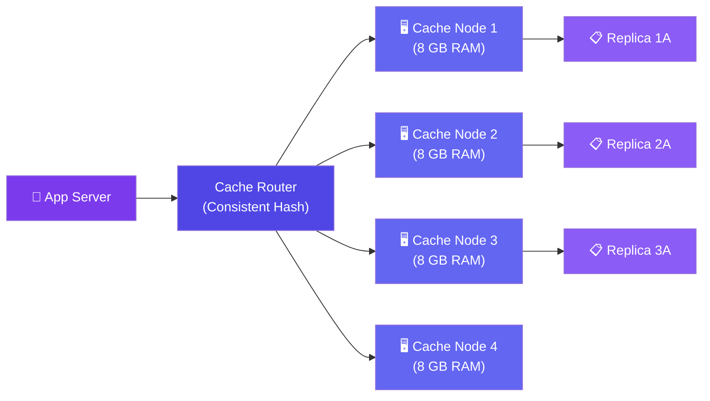

# Case Study: Design a Distributed Cache

> A distributed cache stores data across multiple servers. It's the backbone of low-latency systems.

---

## Requirements

**Functional:**
- Get and set key-value pairs
- Support TTL (auto-expiry)
- Handle large keys (up to 1 MB)
- LRU eviction when full

**Non-functional:**
- Get/set in <5ms
- Scale to 10TB of cached data
- Handle node failures without data loss
- 100K+ QPS

---

## High-Level Design



---

## Deep Dive: Consistent Hashing

When adding/removing nodes, consistent hashing minimizes which keys need to move:

```javascript
class ConsistentHashRing {
  constructor(virtualNodes = 100) {
    this.ring = {};       // hash → node
    this.nodes = {};
    this.virtualNodes = virtualNodes;
  }

  addNode(nodeId) {
    // Add virtual nodes on the ring for better distribution
    for (let i = 0; i < this.virtualNodes; i++) {
      const hash = this._hash(`${nodeId}:vnode:${i}`);
      this.ring[hash] = nodeId;
    }
  }

  getNode(key) {
    const hash = this._hash(key);
    // Find the first node with hash >= key hash (clockwise)
    const sortedHashes = Object.keys(this.ring).sort();
    const idx = sortedHashes.findIndex(h => h >= hash);
    const targetHash = sortedHashes[idx === -1 ? 0 : idx];
    return this.ring[targetHash];
  }

  removeNode(nodeId) {
    // Remove all virtual nodes for this node
    for (let i = 0; i < this.virtualNodes; i++) {
      const hash = this._hash(`${nodeId}:vnode:${i}`);
      delete this.ring[hash];
    }
  }
}
```

**Why virtual nodes?** They spread each node's responsibility across the ring, reducing imbalance when nodes are added/removed.

---

## Deep Dive: Replication & Failover

- Each primary has 1-2 replicas on different servers
- Writes go to primary + replicas (async)
- If a primary fails, a replica is promoted
- Client library handles failover transparently

**Data loss window:** With async replication, if a primary crashes before replicating, recent writes are lost. Trade-off for performance.

---

## Internal Storage Engine

```javascript
class CacheNode {
  constructor(maxMemory) {
    this.store = new Map();       // key → { value, expiry }
    this.lruList = new LinkedList(); // LRU tracking
    this.maxMemory = maxMemory;
  }

  get(key) {
    const entry = this.store.get(key);
    if (!entry) return null;
    if (entry.expiry < Date.now()) {
      this.store.delete(key);
      return null; // expired
    }
    this.lruList.moveToFront(key); // mark as recently used
    return entry.value;
  }

  set(key, value, ttlSeconds) {
    this.evictIfNeeded(value.length);

    this.store.set(key, {
      value,
      expiry: Date.now() + ttlSeconds * 1000,
      size: estimateSize(key, value)
    });
    this.lruList.addToFront(key);
  }

  evictIfNeeded(neededBytes) {
    while (this.currentMemory + neededBytes > this.maxMemory) {
      const lruKey = this.lruList.removeLast(); // LRU eviction
      this.store.delete(lruKey);
    }
  }
}
```

---

## Bottlenecks & Trade-offs

| Bottleneck | Solution |
|-----------|----------|
| **Resharding when adding nodes** | Consistent hashing minimizes movement |
| **Hot keys** | Replicate popular keys across multiple nodes |
| **Memory fragmentation** | Memory pool, slab allocation (like Memcached) |
| **Network latency** | Co-locate cache with app servers (same rack/region) |
| **Persistence** | Cache is in-memory — no disk persistence (use Redis for persistence) |

---

## Follow-up Questions

**Q: What happens if the entire cache cluster restarts (e.g., a bad deploy)? Won't every request stampede the database?**
Yes — a cold cluster with 0% hit rate hitting a DB built for a small miss rate can take it down. Mitigate with staggered node warm-up, request coalescing (only one in-flight DB read per key, others wait on it), and pre-warming known hot keys from a snapshot or the DB before routing live traffic to the new nodes.

**Q: The bottleneck table says replicate hot keys — but what if one key's traffic exceeds what even a replica can serve?**
Go beyond node-level replication: fan the key out to N replicas and have clients pick one at random (or round-robin) per read, effectively sharding reads for that single key. For extreme cases, add a local in-process (L1) cache on the app servers so most reads never leave the host.

**Q: How would you warm the cache ahead of a planned traffic spike (e.g., a big sale)?**
Run a background job before the event that reads the expected hot key set from the source of truth and pre-populates the cache nodes, so the first wave of real traffic hits warm nodes instead of triggering cold misses.

**Q: With async replication and failover, can a network partition cause two nodes to think they're both primary for the same key range?**
Yes — a healed partition can leave a stale old primary accepting writes after a replica was already promoted. Use a fencing token or epoch number that increments on every promotion; nodes reject writes tagged with an older epoch than the one they've seen.

**Q: How do you know when the cache is simply too small for the workload, versus a routing problem?**
Track eviction rate and hit ratio per node. A high eviction rate with a still-low hit ratio signals the working set doesn't fit — the fix is adding nodes (consistent hashing rebalances with minimal key movement) rather than tuning the router.

---

## In Simple Words

- Distributed cache = many memory stores working together as one.
- Consistent hashing routes keys to nodes with minimal reshuffling when nodes change.
- Cache nodes are in-memory and fast — but data is lost on restart (batteries included).
