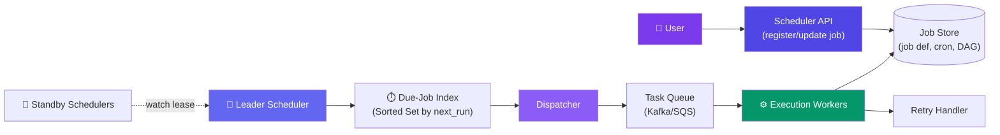
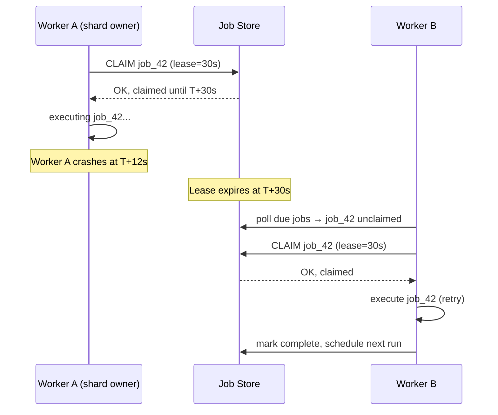

# Case Study: Design a Distributed Job Scheduler

> A distributed job scheduler triggers jobs on a cron-like schedule or a DAG of dependent tasks — reliably, exactly once, at scale (like Airflow, Temporal, or a cron-as-a-service).

---

## Requirements

**Functional:**
- Users register jobs with a cron expression (`0 * * * *`) or as a DAG of dependent tasks
- Trigger each job exactly once at its scheduled time
- Retry failed jobs with backoff, up to N attempts
- Support DAGs — a job runs only after its upstream dependencies succeed
- View job history, status, and next-run time

**Non-functional:**
- **High availability** — multiple scheduler instances run for failover, but a job must never fire twice
- Scale to **millions of scheduled jobs**
- Low scheduling latency — a job due at `12:00:00` should fire within a few seconds
- Fault-tolerant — a crashed worker mid-execution shouldn't lose the job

---

## Estimation

| Metric | Value |
|--------|-------|
| Scheduled jobs | 10M |
| Avg trigger rate | ~2,000 triggers/sec (bursty around common cron times like `0 * * * *`) |
| Scheduler shards | 100 (each owns ~100K jobs) |
| Job metadata size | ~1 KB/job → 10 GB total |
| Peak burst (midnight cron) | Up to 500K jobs due in the same second |

---

## High-Level Design



---

## Deep Dive: Leader Election for Scheduling

Running N scheduler instances for HA is easy — the hard part is making sure only **one** of them actually dispatches triggers at any moment. Two instances both scanning "what's due" and firing triggers means duplicate execution.

The standard fix: elect a leader using a **distributed lock service** (ZooKeeper, etcd, or Redis with `SET NX PX`) that grants a time-bound lease.

- Every scheduler instance tries to acquire the lease `scheduler/leader` with a TTL (e.g. 10s)
- The winner is the leader — it renews the lease every few seconds (heartbeat)
- If the leader crashes or gets network-partitioned, the lease expires and another standby wins it
- Only the current leader is allowed to run the dispatch loop

This is the same "distributed lock with lease" primitive used in a **Distributed Lock Service** case study — the consensus mechanics (Raft/ZAB) behind the lock service aren't re-derived here; the scheduler just treats it as a black box: `acquireLease(key, ttl) → token`.

```javascript
async function runAsLeaderOrStandby() {
  while (true) {
    const token = await lockService.tryAcquire("scheduler/leader", { ttl: 10_000 });
    if (token) {
      await runDispatchLoopUntilLeaseLost(token); // renews lease each 3s
    } else {
      await sleep(2000); // standby — retry later
    }
  }
}
```

**Why not just run one instance?** No failover — a single dead process means zero jobs fire until it's restarted. Leader election gives HA without duplicate dispatch.

---

## Deep Dive: Sharded Claim-with-Lease (No Double-Trigger, No Missed Trigger)

A single leader dispatching *all* 10M jobs doesn't scale past a point, and it's also a fragile single point. The better model: **shard jobs across workers**, and let each worker independently claim its due jobs with a lease — so even the "leader" role can be scoped to per-shard ownership rather than one global process.

- Partition jobs by `hash(job_id) % num_shards`
- Each shard is owned by exactly one worker at a time (via the same lease mechanism as above, one lease per shard)
- The owning worker polls its shard's due-job index and **atomically claims** a job before executing it

**Claim-with-lease pattern:**
1. Worker finds a due job in its shard
2. Worker does `CLAIM job_id WITH lease_ttl=30s` — an atomic compare-and-set that only succeeds if no one else holds a claim
3. Worker executes the job, renewing the lease if execution runs long
4. On success: mark job complete, release claim, compute next `next_run_timestamp`
5. If the worker **crashes mid-execution**, the lease simply expires — another worker (or the same one after restart) sees the job un-claimed and re-claims it



This gives **at-least-once** execution per job — never zero triggers (lease expiry guarantees a retry), and never *concurrent* double-execution (the atomic claim guarantees mutual exclusion at any instant).

---

## Deep Dive: Finding "What's Due Now" Efficiently

Scanning a 10M-row job table every second to find due jobs is a non-starter. Instead, index jobs by their next scheduled run time so "what's due" is a range query, not a scan.

**Redis sorted set per shard:**

```javascript
// On schedule / reschedule: add job to the sorted set, scored by next run time
await redis.zadd(`due:shard:${shardId}`, nextRunTimestamp, jobId);

// Every poll tick (e.g. every 1s), the shard owner asks: "what's due right now?"
const dueJobs = await redis.zrangebyscore(
  `due:shard:${shardId}`,
  0,               // min score
  Date.now()       // max score = now
);

for (const jobId of dueJobs) {
  await claimAndDispatch(jobId);       // claim-with-lease from above
  await redis.zrem(`due:shard:${shardId}`, jobId);
}
```

This is essentially a **time-wheel**: `ZRANGEBYSCORE` gives O(log N + M) lookup (M = jobs due now) instead of O(N) full scans. An in-memory hierarchical time wheel (like Kafka's `DelayQueue` / Netty's `HashedWheelTimer`) is the non-Redis equivalent — buckets are seconds/minutes/hours, and a pointer sweeps forward.

---

## Deep Dive: DAG Dependency Handling

Some jobs aren't purely time-triggered — they're triggered by the **completion** of upstream jobs (Airflow-style DAGs).


- Each job stores its `upstream_dependencies: [job_ids]`
- A job only becomes "eligible to trigger" when **all** upstream jobs report `SUCCESS` for the current run (tracked by a `run_id` grouping a DAG execution)
- On upstream success, the worker decrements a counter (or checks a bitmap) of pending dependencies for downstream jobs; when it hits zero, push the downstream job into the due-index immediately (bypassing the time-based check)
- Failure propagation: if `A` fails after retries exhausted, mark `B` and `C` as `UPSTREAM_FAILED` — don't trigger them, but keep them visible in the run's status

---

## Bottlenecks & Trade-offs

| Bottleneck | Solution |
|-----------|----------|
| **Clock skew across nodes** | Rely on a single source of truth for "now" (NTP-synced servers, or use the lock service's own logical clock for lease timestamps) rather than trusting each machine's local clock for correctness-critical decisions |
| **Thundering herd (many jobs due at same second, e.g. midnight)** | Jitter scheduled times by a few hundred ms at registration; shard due-jobs across many workers so no single node absorbs the whole burst |
| **Retry storms after a downstream outage** | Exponential backoff with jitter per job, plus a circuit breaker that pauses retries for jobs hitting the same failing dependency |
| **Leader bottleneck at global dispatch** | Move ownership to per-shard leases instead of one global leader — leader election only decides *cluster coordination*, not per-job dispatch |
| **Long-running jobs blocking a worker** | Workers dispatch to an async execution queue (Kafka/SQS) rather than executing inline — the scheduler's job is to trigger, not to run |
| **Job store as single point of failure** | Replicate the job store (leader-follower DB) and keep the due-index (Redis) as a derived, rebuildable cache, not the source of truth |

---

## Follow-up Questions

**Q: How do you handle a job that takes longer than its scheduled interval (overlapping runs)?**
Default to skip-if-running: track an `is_running` flag per job, and if the next scheduled time arrives while the previous run's lease is still held, skip (or queue) the new trigger instead of running concurrently. Some systems (Airflow) let users opt into `max_active_runs` to allow bounded overlap.

**Q: How do you guarantee exactly-once execution when the infrastructure only gives at-least-once?**
You don't — you push the burden to idempotent job handlers. The scheduler guarantees at-least-once delivery (via lease expiry retries); each job execution carries a unique `(job_id, run_id)` key so the handler can dedupe (e.g. check-then-act against a "runs completed" table) and safely re-run without side effects like double-charging or double-sending.

**Q: How would you scale to 10 million scheduled jobs?**
Shard the job store and due-index by `hash(job_id)` across many nodes (e.g. 100+ shards), so each shard's due-set stays small enough for cheap `ZRANGEBYSCORE` polls. Scale workers horizontally per shard, and keep leader election scoped to lightweight cluster coordination (not per-job work) so it never becomes the bottleneck.

**Q: What happens if the leader is falsely believed dead due to a GC pause, not an actual crash?**
Classic lease-safety problem: attach a monotonically increasing fencing token to each lease, and have downstream systems reject writes carrying a stale token — so a paused-then-resumed "zombie" leader can't double-dispatch after another node has taken over.

---

## In Simple Words

- Elect one leader (or per-shard owner) via a lease so only one node dispatches at a time — no duplicate triggers.
- "Claim with lease" gives at-least-once execution: a crashed worker's lease expires and someone else picks up the job.
- Index jobs by next-run time (sorted set / time wheel) so finding due jobs is a range query, not a table scan.
- DAGs are just jobs whose trigger condition is "upstream succeeded" instead of "clock reached this time" — same claim-and-dispatch machinery underneath.
