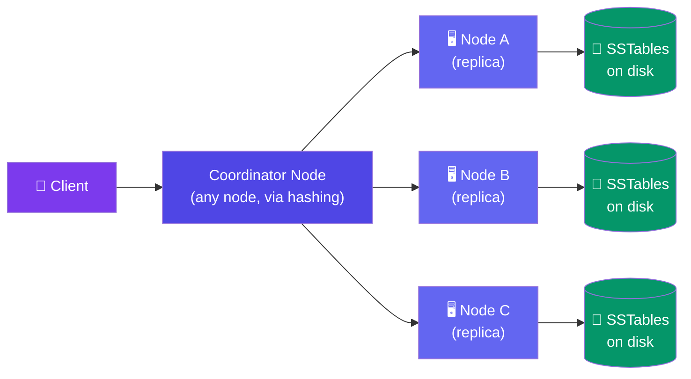
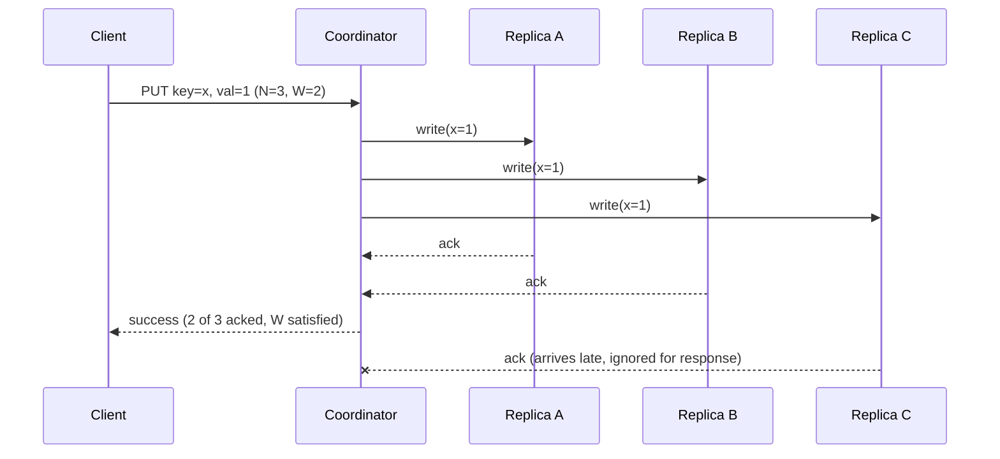
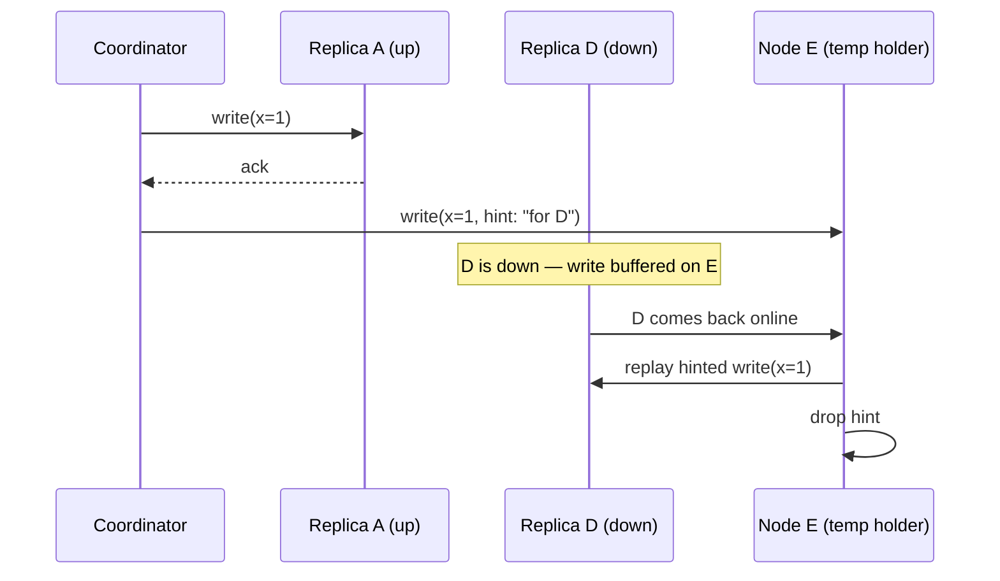

# Case Study: Design a Distributed Key-Value Store (DynamoDB/Cassandra)

> A distributed KV store is a database, not a cache — every acknowledged write must survive a crash, a restart, or a lost node.

---

## Requirements

**Functional:**
- `put(key, value)` and `get(key)` with tunable consistency per request
- Data replicated across N nodes, partitioned across a cluster
- Survive individual node/disk failures without losing acknowledged writes

**Non-functional:**
- **Durable** — writes are persisted to disk, not just RAM (unlike the [distributed cache](/system-design/11-case-studies/design-distributed-cache/), which loses everything on restart)
- High write availability — accept writes even during partial network partitions
- Tunable consistency (strong when needed, eventual for speed)
- Partition-tolerant — no single point of failure, no full-cluster coordination for a single request

---

## High-Level Design



Keys are placed on the ring via consistent hashing (same idea as the cache case study), but here every node also owns a **durable, on-disk** store — there is no "just RAM" tier.

---

## Deep Dive: Quorum Reads & Writes (N, W, R)

- **N** — replication factor: how many nodes store a copy of the key
- **W** — write quorum: how many replicas must ack a write before it's considered successful
- **R** — read quorum: how many replicas must respond before a read returns



**The rule:** `W + R > N` guarantees at least one overlapping replica between every write set and read set → **strong consistency** (read-your-writes). `W + R <= N` skips that overlap → **higher availability, lower latency**, but a read can return stale data.

**Concrete example — N=3, W=2, R=2:**

| Config | W + R vs N | Guarantee | Cost |
|--------|-----------|-----------|------|
| W=2, R=2 | 4 > 3 | Strong consistency | Every op waits on 2 of 3 nodes |
| W=1, R=1 | 2 ≤ 3 | Eventual consistency | Fastest, may read stale value |
| W=3, R=1 | 4 > 3 | Strong reads, slow writes | Write blocks on all replicas |

Tune per-operation: critical writes use W=2, R=2; bulk/analytics reads can use R=1 for speed.

---

## Deep Dive: Vector Clocks & Conflict Resolution

With W=1/R=1 (or during a partition), two clients can concurrently write different values for the same key to different replicas. A plain timestamp can't tell "concurrent" apart from "later" — clock skew lies.

A **vector clock** tags each write with a per-node counter: `[A:2, B:1]` means "this version reflects 2 writes coordinated through A and 1 through B." Comparing two vector clocks tells you:
- One **dominates** the other (all counters ≥) → it's a strict successor, safe to discard the older one
- Neither dominates → they're **concurrent/conflicting** → both versions must be kept

```javascript
function compareVectorClocks(vc1, vc2) {
  let vc1Greater = false, vc2Greater = false;
  const nodes = new Set([...Object.keys(vc1), ...Object.keys(vc2)]);

  for (const node of nodes) {
    const c1 = vc1[node] || 0, c2 = vc2[node] || 0;
    if (c1 > c2) vc1Greater = true;
    if (c2 > c1) vc2Greater = true;
  }

  if (vc1Greater && !vc2Greater) return 'vc1_wins';
  if (vc2Greater && !vc1Greater) return 'vc2_wins';
  if (!vc1Greater && !vc2Greater) return 'equal';
  return 'concurrent'; // conflict — needs resolution
}
```

**Two ways to resolve a conflict:**

| Strategy | How | Trade-off |
|----------|-----|-----------|
| **Last Write Wins (LWW)** | Pick the version with the highest wall-clock timestamp | Simple, but silently drops one client's update |
| **Return both to client** (DynamoDB-style siblings) | Store both versions; client/app merges (e.g. union a shopping cart) | Correct, but pushes merge logic to the application |

---

## Deep Dive: Hinted Handoff & Anti-Entropy

**Hinted handoff** — if a replica for key `x` is down when a write arrives, the coordinator writes to a healthy node instead, tagged with a "hint": *this belongs to node D, hand it off when D returns.* Keeps write availability high even with a node down.



**Anti-entropy (Merkle trees)** — background process that repairs replicas that missed writes and weren't caught by hints (e.g. long outages). Each node builds a Merkle tree over its key ranges; nodes exchange root hashes first, and only recurse into subtrees whose hashes differ — avoids comparing every key over the network.

| Mechanism | Fixes | Trigger |
|-----------|-------|---------|
| Hinted handoff | Short outages (seconds-minutes) | Write-time, proactive |
| Merkle tree repair | Long outages, missed hints, bit rot | Background, periodic |

---

## Deep Dive: Storage Engine (LSM-Tree)

The cache case study uses a pure in-memory `Map` — fast, but gone on restart. A durable KV store needs writes on disk *before* acking, without paying random-disk-seek costs on every write. The **LSM-tree** (Log-Structured Merge-tree) solves this:

1. **Write-ahead log (WAL)** — every write is appended to disk sequentially first (crash recovery)
2. **Memtable** — write also goes into an in-memory sorted structure (skip list / red-black tree)
3. **Flush** — when the memtable fills up, it's flushed to disk as an immutable **SSTable** (Sorted String Table)
4. **Compaction** — background job merges multiple SSTables, drops overwritten/deleted keys, keeps read amplification bounded

```javascript
class LSMStore {
  put(key, value) {
    this.wal.append({ key, value });      // durability: fsync before ack
    this.memtable.set(key, value);        // fast in-memory write
    if (this.memtable.size >= FLUSH_THRESHOLD) {
      this.flushToSSTable();              // memtable → immutable disk file
    }
  }

  get(key) {
    if (this.memtable.has(key)) return this.memtable.get(key);
    // newest SSTable first — bloom filters skip files that can't contain the key
    for (const sstable of this.sstablesNewestFirst) {
      if (sstable.bloomFilter.mightContain(key)) {
        const val = sstable.lookup(key);
        if (val !== undefined) return val;
      }
    }
    return null;
  }
}
```

| | Distributed Cache (in-memory) | KV Store (LSM-tree) |
|---|---|---|
| Write path | Hash map, RAM only | WAL + memtable, then SSTable on disk |
| Survives crash? | No | Yes |
| Write cost | O(1) RAM write | Sequential disk append (cheap) + periodic compaction (background cost) |
| Read cost | O(1) | Memtable + bloom-filtered SSTable scan |

---

## Bottlenecks & Trade-offs

| Bottleneck | Solution |
|-----------|----------|
| **Tunable consistency vs latency** | Let callers pick W/R per request; default to W+R>N only where correctness matters |
| **Compaction I/O overhead** | Throttle compaction, run during low-traffic windows, size-tiered vs leveled strategies |
| **Hot partition keys** | Salt/shard hot keys across multiple physical keys, cache read-heavy hot keys separately |
| **Conflict resolution complexity** | Prefer LWW for simple counters/flags; use sibling-return + app merge for business-critical data |
| **Read amplification (many SSTables)** | Bloom filters per SSTable + periodic compaction to reduce file count |

---

## Follow-up Questions

**Q: How is this different from the distributed cache case study?**
The cache is a pure in-memory, best-effort store — data loss on restart is acceptable, and there's no persistence layer. This KV store must never lose an acknowledged write, so every node has a WAL + LSM-tree on disk, plus quorum acks before responding to the client.

**Q: What happens during a network partition?**
Per CAP theorem, you must pick AP or CP. DynamoDB/Cassandra choose **AP** — both sides of the partition keep accepting writes (using hinted handoff for unreachable replicas), and conflicts are reconciled afterward via vector clocks/LWW once the partition heals.

**Q: How do you rebalance data when adding a node, without full quorum-wide downtime?**
The new node claims a range of tokens on the consistent-hash ring; it streams only the SSTables/key-ranges it now owns from existing replica holders, while those nodes keep serving reads/writes for that range until streaming completes. No global lock or full-cluster pause is needed — only the affected key ranges are briefly under extra replication load.

**Q: Why not just use W=N and R=1 (or vice versa) always?**
That gives you strong consistency with less latency on one side, but it means *any* single node failure on the "all nodes" side blocks the operation entirely — you lose the availability benefit of having N replicas in the first place.

**Q: How do bloom filters help reads?**
Each SSTable keeps a bloom filter of its keys. Before doing a disk lookup, the engine checks the filter — a "definitely not present" answer skips that file entirely, so a get() doesn't have to scan every SSTable on disk.

**Q: Why use a WAL if you already have SSTables?**
The memtable lives in RAM and isn't yet flushed to an SSTable. If the process crashes before a flush, replaying the WAL rebuilds the memtable — SSTables alone wouldn't have the most recent, unflushed writes.

---

## In Simple Words

- This is a real database: writes go to disk (WAL + SSTables), not just RAM — restarts don't lose data.
- N/W/R let you dial consistency vs. speed per request; `W + R > N` means "someone always overlaps."
- Vector clocks catch concurrent conflicting writes that timestamps can't reliably order; resolve via LWW or return-both-to-client.
- Hinted handoff keeps writes flowing during short outages; Merkle-tree anti-entropy quietly fixes the rest in the background.
